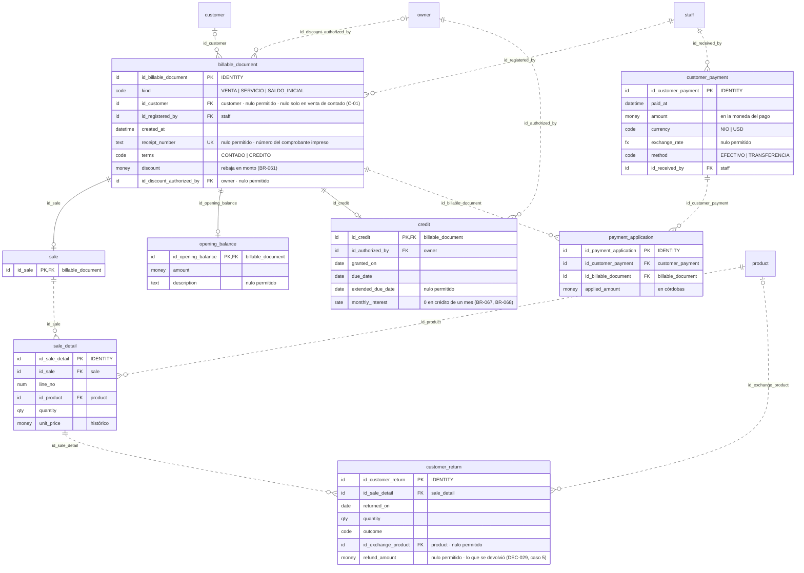
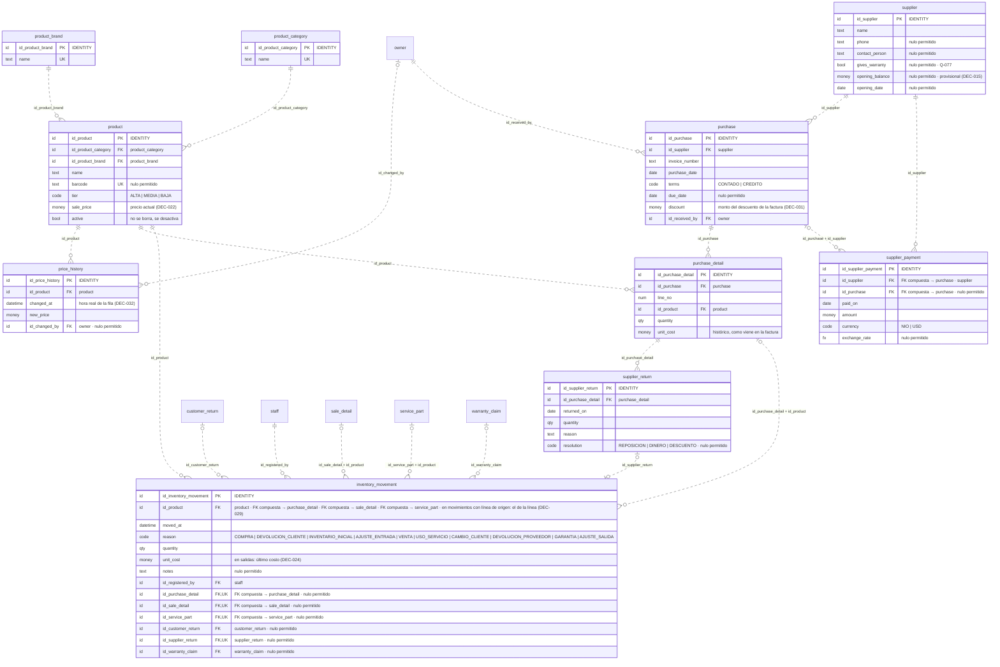
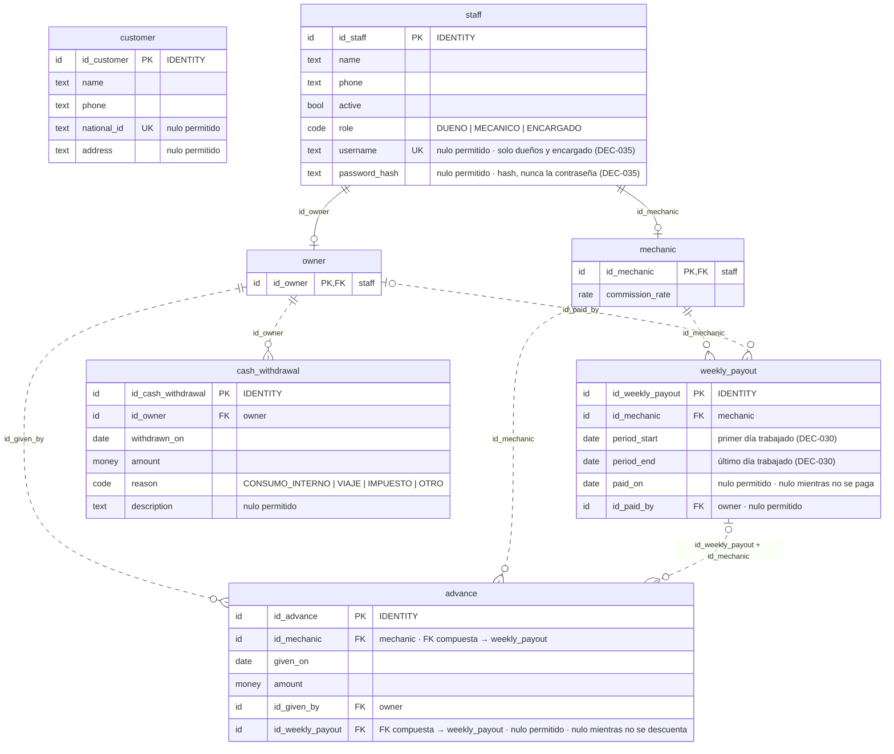

	**[[Motor IRM|← Hub]]** · **[[S5 - Relational Model and Normalization - MIRM|← S5]]** · **[[S4 - ER and EER Model - MIRM|MER/EER]]** · **[[Business Rules - MIRM|📏 Business Rules]]** · **[[Traceability - MIRM|🔗 Traceability]]**

# S5 - Relational Schema - MIRM

> [!info] Cómo leer esta nota
> - **Qué es:** el MER/EER transformado a **tablas**: columnas, tipos, nulos, llaves primarias (PK), foráneas (FK), únicas (UQ) y reglas de validación (CK). Es lo más cercano al DDL, pero **no es DDL**: el DDL es `db/postgres/01_schema.sql` ([[DEC-034 - DDL as Single Source of Truth - MIRM|DEC-034]]).
> - **Diferencia con el MER:** en el MER las conexiones eran *relaciones*; aquí cada relación se convirtió en una **columna FK** (o en una tabla, si era M:N). Los atributos derivados **no son columnas**: son vistas (§7).
> - **Orden de la nota:** decisiones de transformación (§1) → convenciones (§2) → dominios y tipos (§3) → diagramas: el completo y uno por área (§4) → diccionario por área (§5) → restricciones entre tablas (§6) → vistas (§7) → normalización (§8) → orden de creación y reparto (§9) → pistas para el DDL en PostgreSQL (§10).

> [!important] Versión 2 — cierre de S5 (07-nov)
> - **Diagramas (§4) y diccionario (§5) regenerados desde la base** creada con `01_schema.sql` v2: los nombres, tipos, nulos y restricciones son exactamente los del DDL (convención `id_<tabla>`, [[DEC-028 - Naming Convention for Keys - MIRM|DEC-028]]).
> - Cambios de la v2: FK compuestas ([[DEC-029 - Controlled Redundancy with Composite Foreign Keys - MIRM|DEC-029]]), periodo de pago `period_start`/`period_end` ([[DEC-030 - Mechanic Pay Period - MIRM|DEC-030]]), `purchase.discount` ([[DEC-031 - Purchase Invoice Discount - MIRM|DEC-031]]), correcciones ([[DEC-032 - Integrity Fixes From S5 Review - MIRM|DEC-032]]) e inicio de sesión en `staff` ([[DEC-035 - Staff Login Credentials - MIRM|DEC-035]]).
> - El programa ya no es Django: TypeScript + Node.js + PostgreSQL ([[DEC-033 - Technology Stack Change to TypeScript and Node - MIRM|DEC-033]]).
> - Redactado y regenerado por Claude a pedido de Kenry; pendiente de revisión del equipo.

---

## 1. Decisiones de transformación

Registradas como [[DEC-016 - Surrogate Primary Keys - MIRM|DEC-016]] a [[DEC-028 - Naming Convention for Keys - MIRM|DEC-028]] (05-nov). Las de la versión 2 son DEC-029 a DEC-035 (07-nov).

| ID   | Tema                          | Decisión                                                                                                                                                                                                                                                                              | Por qué                                                                                                                                                                                                                                                                                           |
| ---- | ----------------------------- | ------------------------------------------------------------------------------------------------------------------------------------------------------------------------------------------------------------------------------------------------------------------------------------- | ------------------------------------------------------------------------------------------------------------------------------------------------------------------------------------------------------------------------------------------------------------------------------------------------- |
| T-01 | **Llaves primarias**          | Llave sustituta `id_<tabla>` (autonumérica) en las tablas de entidades fuertes **y débiles**; la clave natural de la débil queda como **UQ** (por ejemplo, `UQ (id_sale, line_no)`). Excepciones: subclases y `credit` usan como PK la FK a su padre; `payment_application` usa PK compuesta. | Varias tablas apuntan a entidades débiles (el movimiento apunta a la línea de venta; la mano de obra a la falla adicional): con PK compuesta, cada FK tendría dos columnas. Además, el programa trabaja más simple con una PK de una sola columna. La UQ conserva la regla de identidad del MER. |
| T-02 | **G-1 Documento cobrable**    | Una tabla para la superclase (`billable_document`, con `kind` como discriminador) y una por subclase (`sale`, `mechanical_service`, `opening_balance`), cuya PK es a la vez FK al documento.                                                                                          | Pagos y créditos apuntan a **una sola tabla** (la razón de G-1). Cada subclase guarda solo sus columnas: sin columnas vacías según el tipo. `sale` no tiene columnas propias, pero es necesaria: `sale_detail` apunta a ella y así una línea de venta nunca puede colgar de un servicio.          |
| T-03 | **G-2 Personal**              | `staff` (con `role`) + `owner` + `mechanic`. El encargado es solo un valor de `role`: no tiene tabla.                                                                                                                                                                                 | Las FK que deben ser de un dueño apuntan a `owner`: "solo un dueño autoriza" (BR-009 a BR-011) se cumple **con una FK**, sin código. `mechanic` guarda el porcentaje. El encargado no tiene columnas ni relaciones propias.                                                                       |
| T-04 | **G-3 Origen del movimiento** | Seis FK opcionales en `inventory_movement` + **una CK** que obliga a que solo esté lleno el origen que corresponde al motivo.                                                                                                                                                         | La exclusividad se puede garantizar dentro de la misma fila con un `CHECK`. Si la FK estuviera en cada tabla de origen, la exclusividad cruzaría seis tablas y no se podría garantizar con un `CHECK`.                                                                                            |
| T-05 | **Atributos derivados**       | No se guardan: existencia, último costo, totales, saldos, deuda, comisión, estado actual y fechas del servicio → **vistas** (§7).                                                                                                                                                     | Un dato calculado que además se guarda puede quedar desactualizado (anomalía de actualización).                                                                                                                                                                                                   |
| T-06 | **Motivo del movimiento**     | El motivo incluye la dirección (`AJUSTE_ENTRADA`, `AJUSTE_SALIDA`, `CAMBIO_CLIENTE`…) y **no hay columna de dirección**.                                                                                                                                                              | Si el motivo determina la dirección (DF *motivo → dirección*), guardar las dos es redundante (§8).                                                                                                                                                                                                |
| T-07 | **Historial de precio**       | Sin `old_price`: el precio anterior es el de la fila anterior. `product.sale_price` guarda el precio actual.                                                                                                                                                                          | `old_price` repetía el dato de otra fila. Guardar el precio actual en `product` es una **redundancia controlada**, por rapidez al vender: al cambiar el precio, se actualiza el producto y se inserta el historial en la misma transacción.                                                       |
| T-08 | **Anulación de venta**        | Fuera de la versión de entrega (sin columna).                                                                                                                                                                                                                                         | No está definido qué pasa con los movimientos y los pagos de una venta anulada.                                                                                                                                                                                                                   |
| T-09 | **Costo de las salidas**      | Cada salida guarda en `unit_cost` el **último costo** del producto al momento de salir (provisional).                                                                                                                                                                                 | No cambia las tablas; solo afecta cómo se calcula la ganancia. Se revisa después (último costo o promedio).                                                                                                                                                                                       |
| T-10 | **Monedas**                   | `amount` en la moneda del pago + `exchange_rate` si es en dólares. Los montos aplicados, totales y saldos se expresan en **córdobas**.                                                                                                                                                | BR-057 y BR-058: la moneda principal es el córdoba y el tipo de cambio lo fijan los dueños (histórico).                                                                                                                                                                                           |
| T-11 | **Listas de valores**         | Valores fijos → columna `code` + CK con la lista. Catálogos con atributos o que los dueños amplían → tabla (categoría, marcas, tipo de servicio).                                                                                                                                     | Una tabla para cada lista fija agregaría FK sin ganar nada.                                                                                                                                                                                                                                       |
| T-12 | **Borrado**                   | Todas las FK sin cascada (`NO ACTION`). Nada del negocio se borra: se desactiva (`active`).                                                                                                                                                                                           | Borrar un mecánico o un producto destruiría el historial (comisiones, ventas).                                                                                                                                                                                                                    |
| T-13 | **Redundancias controladas** | Donde un dato se deduce por una FK pero no se puede borrar (la columna que lo determina puede ser nula), una **FK compuesta** con `MATCH SIMPLE` hacia la pareja en el padre (que tiene una UQ de esa pareja). | La base garantiza que el dato repetido no se contradiga ([[DEC-029 - Controlled Redundancy with Composite Foreign Keys - MIRM\|DEC-029]]). |

---

## 2. Convenciones del esquema

| Tema | Convención | Ejemplo |
| --- | --- | --- |
| Tablas | Inglés, `snake_case`, **singular** | `sale_detail` |
| Llave primaria | **`id_<tabla>`** en todas las tablas (también en subclases y `credit`, donde es a la vez FK al padre) | `customer.id_customer`, `sale.id_sale` |
| Llave foránea | **Igual que la PK a la que apunta** (`id_<tabla>`), o `id_<rol>` cuando hay más de una hacia la misma tabla | `id_customer`, `id_registered_by`, `id_authorized_by` |
| Códigos (listas) | Mayúsculas, español, **sin tildes ni ñ** | `CONTADO`, `DUENO`, `EN_PROCESO` |
| Nombres de restricciones | En minúsculas: `pk_<tabla>`, `fk_<tabla>_<columna>`, `uq_<tabla>_<columnas>`, `ck_<tabla>_<regla>`. FK compuesta: `fk_<tabla>_<col1>_<col2>` | `ck_billable_document_customer` · `fk_supplier_payment_id_purchase_id_supplier` |

> [!note] Convención aplicada en todo el esquema (07-nov)
> Desde el 29-oct el DDL usa `id_<tabla>` en PK y FK, e `id_<rol>` en las FK con rol ([[DEC-028 - Naming Convention for Keys - MIRM|DEC-028]]). Desde la versión 2, los diagramas y el diccionario de esta nota usan esos mismos nombres.

> Que las restricciones tengan nombre hace que los errores se entiendan ("viola `ck_billable_document_customer`") y permite quitarlas o cambiarlas después.

---

## 3. Dominios (tipos lógicos)

Los diagramas y el diccionario usan estos dominios. Al lado está su tipo en **PostgreSQL**, el motor de la entrega y del programa. La zona horaria de la base es `America/Managua` (la fija el propio `01_schema.sql`).

| Dominio | Qué guarda | Tipo en PostgreSQL |
| --- | --- | --- |
| `id` | Llave sustituta autonumérica (o FK a ella) | `INTEGER GENERATED ALWAYS AS IDENTITY` (la FK: `INTEGER`) |
| `money` | Dinero en córdobas | `NUMERIC(12,2)` |
| `rate` | Porcentaje como fracción (0.60 = 60 %) | `NUMERIC(5,4)` |
| `fx` | Tipo de cambio | `NUMERIC(10,4)` |
| `qty` | Cantidad en unidades (1 litro de aceite = 1) | `INTEGER` |
| `num` | Número de línea o de falla | `SMALLINT` |
| `text(n)` | Texto corto con tildes y ñ | `VARCHAR(n)` |
| `longtext` | Texto largo (diagnóstico, pedido del cliente) | `VARCHAR(500)` o `TEXT` |
| `code` | Valor de una lista fija | `VARCHAR(20)` + CK |
| `date` | Fecha | `DATE` |
| `datetime` | Fecha y hora | `TIMESTAMP(0)`; `TIMESTAMP` (con fracciones de segundo) en `status_change` y `price_history`, que usan `clock_timestamp()` ([[DEC-032 - Integrity Fixes From S5 Review - MIRM\|DEC-032]]) |
| `bool` | Sí o no | `BOOLEAN` |

---

## 4. Diagramas del esquema

> [!tip] Cómo leerlos
> - Ahora las líneas son **llaves foráneas**: van de la tabla referenciada (lado `||` o `|o`) a la que tiene la columna FK (lado `o{`).
> - **Línea continua** = la FK es parte de la PK (subclases, `credit`, `payment_application`). **Punteada** = FK normal.
> - Las entidades débiles del MER ahora tienen `id_<tabla>` propio (T-01), así que sus líneas son punteadas; su identidad queda en la UQ.
> - Cada línea lleva el nombre de la columna FK. Una **FK compuesta** se ve como `col1 + col2` (T-13, DEC-029).
> - Los diagramas se **generan desde la base** (07-nov): si cambia el DDL, se regeneran.
> - Cada tabla tiene sus columnas en **un solo diagrama**; en los demás aparece solo la caja.

### Diagrama completo del modelo relacional

```mermaid
erDiagram
    mechanical_service ||..o{ additional_fault : "id_mechanical_service"
    owner ||..o{ advance : "id_given_by"
    mechanic ||..o{ advance : "id_mechanic"
    weekly_payout |o..o{ advance : "id_weekly_payout + id_mechanic"
    customer |o..o{ billable_document : "id_customer"
    owner |o..o{ billable_document : "id_discount_authorized_by"
    staff ||..o{ billable_document : "id_registered_by"
    owner ||..o{ cash_withdrawal : "id_owner"
    owner ||..o{ credit : "id_authorized_by"
    billable_document ||--o| credit : "id_credit"
    staff ||..o{ customer_payment : "id_received_by"
    product |o..o{ customer_return : "id_exchange_product"
    sale_detail ||..o{ customer_return : "id_sale_detail"
    mechanical_service ||..o{ external_charge : "id_mechanical_service"
    customer_return |o..o{ inventory_movement : "id_customer_return"
    product ||..o{ inventory_movement : "id_product"
    purchase_detail |o..o{ inventory_movement : "id_purchase_detail + id_product"
    staff ||..o{ inventory_movement : "id_registered_by"
    sale_detail |o..o{ inventory_movement : "id_sale_detail + id_product"
    service_part |o..o{ inventory_movement : "id_service_part + id_product"
    supplier_return |o..o| inventory_movement : "id_supplier_return"
    warranty_claim |o..o{ inventory_movement : "id_warranty_claim"
    staff ||--o| mechanic : "id_mechanic"
    billable_document ||--o| mechanical_service : "id_mechanical_service"
    motorcycle ||..o{ mechanical_service : "id_motorcycle"
    staff |o..o{ mechanical_service : "id_responsible"
    weekly_payout |o..o{ mechanical_service : "id_weekly_payout + id_responsible"
    customer ||..o{ motorcycle : "id_customer"
    motorcycle_model ||..o{ motorcycle : "id_motorcycle_model"
    motorcycle_brand ||..o{ motorcycle_model : "id_motorcycle_brand"
    billable_document ||--o| opening_balance : "id_opening_balance"
    staff ||--o| owner : "id_owner"
    billable_document ||..o{ payment_application : "id_billable_document"
    customer_payment ||..o{ payment_application : "id_customer_payment"
    owner |o..o{ price_history : "id_changed_by"
    product ||..o{ price_history : "id_product"
    product_brand ||..o{ product : "id_product_brand"
    product_category ||..o{ product : "id_product_category"
    owner ||..o{ purchase : "id_received_by"
    supplier ||..o{ purchase : "id_supplier"
    product ||..o{ purchase_detail : "id_product"
    purchase ||..o{ purchase_detail : "id_purchase"
    billable_document ||--o| sale : "id_sale"
    product ||..o{ sale_detail : "id_product"
    sale ||..o{ sale_detail : "id_sale"
    additional_fault |o..o{ service_labor : "id_additional_fault + id_mechanical_service"
    mechanical_service ||..o{ service_labor : "id_mechanical_service"
    service_type |o..o{ service_labor : "id_service_type"
    additional_fault |o..o{ service_part : "id_additional_fault + id_mechanical_service"
    mechanical_service ||..o{ service_part : "id_mechanical_service"
    product ||..o{ service_part : "id_product"
    mechanical_service ||..o{ status_change : "id_mechanical_service"
    staff ||..o{ status_change : "id_registered_by"
    purchase |o..o{ supplier_payment : "id_purchase + id_supplier"
    supplier ||..o{ supplier_payment : "id_supplier"
    purchase_detail ||..o{ supplier_return : "id_purchase_detail"
    owner ||..o{ warranty_claim : "id_attended_by"
    mechanical_service |o..o| warranty_claim : "id_new_service"
    mechanical_service ||..o{ warranty_claim : "id_original_service"
    sale |o..o| warranty_claim : "id_sale"
    mechanic ||..o{ weekly_payout : "id_mechanic"
    owner |o..o{ weekly_payout : "id_paid_by"

    product_category {
        int id_product_category PK
        varchar name UK
    }
    product_brand {
        int id_product_brand PK
        varchar name UK
    }
    product {
        int id_product PK
        int id_product_category FK
        int id_product_brand FK
        varchar name
        varchar barcode UK "nulo"
        varchar tier
        numeric sale_price
        boolean active
    }
    price_history {
        int id_price_history PK
        int id_product FK
        timestamp changed_at
        numeric new_price
        int id_changed_by FK "nulo"
    }
    inventory_movement {
        int id_inventory_movement PK
        int id_product FK
        timestamp moved_at
        varchar reason
        int quantity
        numeric unit_cost
        varchar notes "nulo"
        int id_registered_by FK
        int id_purchase_detail FK, UK "nulo"
        int id_sale_detail FK, UK "nulo"
        int id_service_part FK, UK "nulo"
        int id_customer_return FK "nulo"
        int id_supplier_return FK, UK "nulo"
        int id_warranty_claim FK "nulo"
    }
    supplier {
        int id_supplier PK
        varchar name
        varchar phone "nulo"
        varchar contact_person "nulo"
        boolean gives_warranty "nulo"
        numeric opening_balance "nulo"
        date opening_date "nulo"
    }
    purchase {
        int id_purchase PK
        int id_supplier FK
        varchar invoice_number
        date purchase_date
        varchar terms
        date due_date "nulo"
        numeric discount
        int id_received_by FK
    }
    purchase_detail {
        int id_purchase_detail PK
        int id_purchase FK
        smallint line_no
        int id_product FK
        int quantity
        numeric unit_cost
    }
    supplier_payment {
        int id_supplier_payment PK
        int id_supplier FK
        int id_purchase FK "nulo"
        date paid_on
        numeric amount
        varchar currency
        numeric exchange_rate "nulo"
    }
    supplier_return {
        int id_supplier_return PK
        int id_purchase_detail FK
        date returned_on
        int quantity
        varchar reason
        varchar resolution "nulo"
    }
    customer {
        int id_customer PK
        varchar name
        varchar phone
        varchar national_id UK "nulo"
        varchar address "nulo"
    }
    staff {
        int id_staff PK
        varchar name
        varchar phone
        boolean active
        varchar role
        varchar username UK "nulo"
        varchar password_hash "nulo"
    }
    owner {
        int id_owner PK, FK
    }
    mechanic {
        int id_mechanic PK, FK
        numeric commission_rate
    }
    motorcycle_brand {
        int id_motorcycle_brand PK
        varchar name UK
    }
    motorcycle_model {
        int id_motorcycle_model PK
        int id_motorcycle_brand FK
        varchar name
    }
    motorcycle {
        int id_motorcycle PK
        int id_customer FK
        int id_motorcycle_model FK
        varchar color
        varchar plate UK "nulo"
        varchar notes "nulo"
    }
    billable_document {
        int id_billable_document PK
        varchar kind
        int id_customer FK "nulo"
        int id_registered_by FK
        timestamp created_at
        varchar receipt_number UK "nulo"
        varchar terms
        numeric discount
        int id_discount_authorized_by FK "nulo"
    }
    sale {
        int id_sale PK, FK
    }
    opening_balance {
        int id_opening_balance PK, FK
        numeric amount
        varchar description "nulo"
    }
    sale_detail {
        int id_sale_detail PK
        int id_sale FK
        smallint line_no
        int id_product FK
        int quantity
        numeric unit_price
    }
    customer_return {
        int id_customer_return PK
        int id_sale_detail FK
        date returned_on
        int quantity
        varchar outcome
        int id_exchange_product FK "nulo"
        numeric refund_amount "nulo"
    }
    credit {
        int id_credit PK, FK
        int id_authorized_by FK
        date granted_on
        date due_date
        date extended_due_date "nulo"
        numeric monthly_interest
    }
    customer_payment {
        int id_customer_payment PK
        timestamp paid_at
        numeric amount
        varchar currency
        numeric exchange_rate "nulo"
        varchar method
        int id_received_by FK
    }
    payment_application {
        int id_payment_application PK
        int id_customer_payment FK
        int id_billable_document FK
        numeric applied_amount
    }
    service_type {
        int id_service_type PK
        varchar name UK
        numeric reference_price "nulo"
        boolean active
    }
    mechanical_service {
        int id_mechanical_service PK, FK
        int id_motorcycle FK
        int id_responsible FK "nulo"
        varchar requested_work
        varchar diagnosis "nulo"
        numeric cancellation_amount "nulo"
        numeric applied_rate "nulo"
        int id_weekly_payout FK "nulo"
    }
    service_labor {
        int id_service_labor PK
        int id_mechanical_service FK
        smallint line_no
        varchar description
        numeric amount
        int id_service_type FK "nulo"
        int id_additional_fault FK "nulo"
    }
    service_part {
        int id_service_part PK
        int id_mechanical_service FK
        smallint line_no
        int id_product FK
        int quantity
        numeric unit_price
        int id_additional_fault FK "nulo"
    }
    external_charge {
        int id_external_charge PK
        int id_mechanical_service FK
        smallint line_no
        varchar description
        numeric amount
    }
    additional_fault {
        int id_additional_fault PK
        int id_mechanical_service FK
        smallint fault_no
        date reported_on
        varchar description
        numeric proposed_price "nulo"
        varchar decision
    }
    status_change {
        int id_status_change PK
        int id_mechanical_service FK
        timestamp changed_at
        varchar status
        varchar notes "nulo"
        int id_registered_by FK
    }
    warranty_claim {
        int id_warranty_claim PK
        int id_original_service FK
        date claimed_on
        varchar description
        varchar outcome
        varchar part_paid_by "nulo"
        numeric refund_amount "nulo"
        int id_attended_by FK
        int id_new_service FK, UK "nulo"
        int id_sale FK, UK "nulo"
    }
    weekly_payout {
        int id_weekly_payout PK
        int id_mechanic FK
        date period_start
        date period_end
        date paid_on "nulo"
        int id_paid_by FK "nulo"
    }
    advance {
        int id_advance PK
        int id_mechanic FK
        date given_on
        numeric amount
        int id_given_by FK
        int id_weekly_payout FK "nulo"
    }
    cash_withdrawal {
        int id_cash_withdrawal PK
        int id_owner FK
        date withdrawn_on
        numeric amount
        varchar reason
        varchar description "nulo"
    }
```

Todas las tablas con sus columnas, tipos de **PostgreSQL** y llaves (**PK**, **FK**, **UK**). Los detalles (nulos, CK, comentarios) están en los diagramas A a D y en el diccionario (§5). Imagen para imprimir: ![[Modelo_relacional_completo.png]]

### A. Documentos cobrables y cobros

### B. Taller

```mermaid
erDiagram
    mechanical_service {
        id id_mechanical_service PK, FK "billable_document"
        id id_motorcycle FK "motorcycle"
        id id_responsible FK "staff · FK compuesta → weekly_payout · nulo permitido · dueño o mecánico (C-02)"
        longtext requested_work
        longtext diagnosis "nulo permitido"
        money cancellation_amount "nulo permitido · solo si se canceló con trabajo hecho"
        rate applied_rate "nulo permitido · % del mecánico al liquidar (histórico)"
        id id_weekly_payout FK "FK compuesta → weekly_payout · nulo permitido · nulo mientras no se liquida"
    }
    motorcycle {
        id id_motorcycle PK "IDENTITY"
        id id_customer FK "customer · dueño actual (BR-043)"
        id id_motorcycle_model FK "motorcycle_model"
        text color
        text plate UK "nulo permitido"
        text notes "nulo permitido"
    }
    motorcycle_model {
        id id_motorcycle_model PK "IDENTITY"
        id id_motorcycle_brand FK "motorcycle_brand"
        text name
    }
    motorcycle_brand {
        id id_motorcycle_brand PK "IDENTITY"
        text name UK
    }
    service_type {
        id id_service_type PK "IDENTITY"
        text name UK
        money reference_price "nulo permitido"
        bool active
    }
    service_labor {
        id id_service_labor PK "IDENTITY"
        id id_mechanical_service FK "FK compuesta → additional_fault · mechanical_service"
        num line_no
        text description
        money amount
        id id_service_type FK "service_type · nulo permitido"
        id id_additional_fault FK "FK compuesta → additional_fault · nulo permitido"
    }
    service_part {
        id id_service_part PK "IDENTITY"
        id id_mechanical_service FK "FK compuesta → additional_fault · mechanical_service"
        num line_no
        id id_product FK "product"
        qty quantity
        money unit_price "histórico"
        id id_additional_fault FK "FK compuesta → additional_fault · nulo permitido"
    }
    external_charge {
        id id_external_charge PK "IDENTITY"
        id id_mechanical_service FK "mechanical_service"
        num line_no
        text description
        money amount
    }
    additional_fault {
        id id_additional_fault PK "IDENTITY"
        id id_mechanical_service FK "mechanical_service"
        num fault_no
        date reported_on
        longtext description
        money proposed_price "nulo permitido"
        code decision "PENDIENTE | ACEPTADA | RECHAZADA"
    }
    status_change {
        id id_status_change PK "IDENTITY"
        id id_mechanical_service FK "mechanical_service"
        datetime changed_at "hora real de la fila (DEC-032)"
        code status "RECIBIDA | EN_DIAGNOSTICO | EN_PROCESO | ESPERA_REPUESTO | ESPERA_CLIENTE | TERMINADA | EN_PRUEBA | ENTREGADA | CANCELADA"
        text notes "nulo permitido"
        id id_registered_by FK "staff"
    }
    warranty_claim {
        id id_warranty_claim PK "IDENTITY"
        id id_original_service FK "mechanical_service"
        date claimed_on
        longtext description
        code outcome "CUBIERTO | FALLA_DISTINTA | FUERA_DE_PLAZO | REEMBOLSO"
        code part_paid_by "TIENDA | CLIENTE · nulo permitido"
        money refund_amount "nulo permitido"
        id id_attended_by FK "owner"
        id id_new_service FK, UK "mechanical_service · nulo permitido"
        id id_sale FK, UK "sale · nulo permitido"
    }
    billable_document ||--o| mechanical_service : "id_mechanical_service"
    motorcycle ||..o{ mechanical_service : "id_motorcycle"
    staff |o..o{ mechanical_service : "id_responsible"
    weekly_payout |o..o{ mechanical_service : "id_weekly_payout + id_responsible"
    customer ||..o{ motorcycle : "id_customer"
    motorcycle_model ||..o{ motorcycle : "id_motorcycle_model"
    motorcycle_brand ||..o{ motorcycle_model : "id_motorcycle_brand"
    additional_fault |o..o{ service_labor : "id_additional_fault + id_mechanical_service"
    mechanical_service ||..o{ service_labor : "id_mechanical_service"
    service_type |o..o{ service_labor : "id_service_type"
    additional_fault |o..o{ service_part : "id_additional_fault + id_mechanical_service"
    mechanical_service ||..o{ service_part : "id_mechanical_service"
    product ||..o{ service_part : "id_product"
    mechanical_service ||..o{ external_charge : "id_mechanical_service"
    mechanical_service ||..o{ additional_fault : "id_mechanical_service"
    mechanical_service ||..o{ status_change : "id_mechanical_service"
    staff ||..o{ status_change : "id_registered_by"
    owner ||..o{ warranty_claim : "id_attended_by"
    mechanical_service |o..o| warranty_claim : "id_new_service"
    mechanical_service ||..o{ warranty_claim : "id_original_service"
    sale |o..o| warranty_claim : "id_sale"
```

### C. Productos, compras e inventario

> En el MER, cada línea de compra, de venta y de producto usado origina **exactamente un** movimiento (1..1). Con la FK del lado del movimiento, la base garantiza el "como máximo uno" (UQ) y, desde la v2, que el producto sea el mismo de la línea (FK compuesta); el "al menos uno" lo garantiza la aplicación al guardar la línea y su movimiento en la misma transacción (§6).

### D. Personas, mecánicos y caja

---

## 5. Diccionario por área

**Columnas de las tablas:** **Nulo** = si admite vacío · **Restricción**: PK, IDENTITY, FK → tabla, FK compuesta → tabla, UQ, CK (regla) o DEFAULT; en *cursiva*, una nota. Las restricciones de varias columnas están debajo de cada tabla, con lo que garantizan.

> Generado desde la base creada con `01_schema.sql` v2 (07-nov). Los encabezados (entidad del MER y reglas) son los de la v1, actualizados.

---
### 5.1 Catálogos, productos e inventario

**`product_category`** — Categoría de producto (E-05) · BR-004

| Columna | Dominio | Nulo | Restricción |
| --- | --- | --- | --- |
| id_product_category | id | No | PK · IDENTITY |
| name | text(50) | No | CK no vacío · UQ (sin distinguir mayúsculas) |

---
**`product_brand`** — Marca de producto (E-28) · BR-089, DEC-008

| Columna | Dominio | Nulo | Restricción |
| --- | --- | --- | --- |
| id_product_brand | id | No | PK · IDENTITY |
| name | text(50) | No | CK no vacío · UQ (sin distinguir mayúsculas) |

---
**`product`** — Producto (E-06) · BR-004, BR-015, BR-089, BR-090, BR-093

| Columna | Dominio | Nulo | Restricción |
| --- | --- | --- | --- |
| id_product | id | No | PK · IDENTITY |
| id_product_category | id | No | FK → product_category |
| id_product_brand | id | No | FK → product_brand |
| name | text(150) | No | CK no vacío |
| barcode | text(50) | Sí | CK no vacío · UQ |
| tier | code | No | CK `IN ('ALTA','MEDIA','BAJA')` |
| sale_price | money | No | CK `>= 0` · *precio actual (DEC-022)* |
| active | bool | No | DEFAULT true · *no se borra, se desactiva* |

---
**`price_history`** — Historial de precio (E-26) · BR-016, DEC-022

| Columna | Dominio | Nulo | Restricción |
| --- | --- | --- | --- |
| id_price_history | id | No | PK · IDENTITY |
| id_product | id | No | FK → product |
| changed_at | datetime | No | DEFAULT `clock_timestamp()` · *hora real de la fila (DEC-032)* |
| new_price | money | No | CK `>= 0` |
| id_changed_by | id | Sí | FK → owner |

- **UQ** `(id_product, changed_at)` — un cambio de precio por producto y momento

---
**`inventory_movement`** — Movimiento de inventario (E-07) · BR-020, BR-079, DEC-014, DEC-019, DEC-021, DEC-024, DEC-029

| Columna | Dominio | Nulo | Restricción |
| --- | --- | --- | --- |
| id_inventory_movement | id | No | PK · IDENTITY |
| id_product | id | No | FK → product · FK compuesta → purchase_detail · FK compuesta → sale_detail · FK compuesta → service_part · *en movimientos con línea de origen: el de la línea (DEC-029)* |
| moved_at | datetime | No | DEFAULT fecha y hora actual |
| reason | code | No | CK `IN ('COMPRA','DEVOLUCION_CLIENTE','INVENTARIO_INICIAL','AJUSTE_ENTRADA','VENTA','USO_SERVICIO','CAMBIO_CLIENTE','DEVOLUCION_PROVEEDOR','GARANTIA','AJUSTE_SALIDA')` |
| quantity | qty | No | CK `> 0` |
| unit_cost | money | No | CK `>= 0` · *en salidas: último costo (DEC-024)* |
| notes | text(200) | Sí | — |
| id_registered_by | id | No | FK → staff |
| id_purchase_detail | id | Sí | FK compuesta → purchase_detail · UQ |
| id_sale_detail | id | Sí | FK compuesta → sale_detail · UQ |
| id_service_part | id | Sí | FK compuesta → service_part · UQ |
| id_customer_return | id | Sí | FK → customer_return |
| id_supplier_return | id | Sí | FK → supplier_return · UQ |
| id_warranty_claim | id | Sí | FK → warranty_claim |

- **CK** `ck_inventory_movement_notes` — los ajustes exigen observación
- **CK** `ck_inventory_movement_origin` — arco exclusivo: exactamente un origen, el que corresponde al motivo (sin origen en inventario inicial y ajustes) (DEC-014, DEC-019)
- **FK compuesta** `(id_purchase_detail, id_product)` → `purchase_detail (id_purchase_detail, id_product)`, `MATCH SIMPLE` — el producto es el de la línea de compra (DEC-029)
- **FK compuesta** `(id_sale_detail, id_product)` → `sale_detail (id_sale_detail, id_product)`, `MATCH SIMPLE` — el producto es el de la línea de venta (DEC-029)
- **FK compuesta** `(id_service_part, id_product)` → `service_part (id_service_part, id_product)`, `MATCH SIMPLE` — el producto es el de la línea del servicio (DEC-029)
- **UQ** `(id_customer_return, reason)` — una devolución tiene como máximo un movimiento por motivo (entra lo devuelto, sale lo cambiado)

### 5.2 Compras

**`supplier`** — Proveedor (E-08) · BR-012, BR-017, BR-091, BR-099, DEC-015

| Columna | Dominio | Nulo | Restricción |
| --- | --- | --- | --- |
| id_supplier | id | No | PK · IDENTITY |
| name | text(100) | No | CK no vacío |
| phone | text(20) | Sí | — |
| contact_person | text(100) | Sí | — |
| gives_warranty | bool | Sí | *Q-077* |
| opening_balance | money | Sí | CK `>= 0` · *provisional (DEC-015)* |
| opening_date | date | Sí | — |

- **CK** `ck_supplier_opening_pair` — el saldo de apertura y su fecha van juntos

---
**`purchase`** — Compra (E-09) · BR-013, BR-017, BR-100, BR-105, DEC-031, DEC-032

| Columna | Dominio | Nulo | Restricción |
| --- | --- | --- | --- |
| id_purchase | id | No | PK · IDENTITY |
| id_supplier | id | No | FK → supplier |
| invoice_number | text(30) | No | CK no vacío |
| purchase_date | date | No | DEFAULT fecha actual |
| terms | code | No | CK `IN ('CONTADO','CREDITO')` |
| due_date | date | Sí | — |
| discount | money | No | CK `>= 0` · DEFAULT 0 · *monto del descuento de la factura (DEC-031)* |
| id_received_by | id | No | FK → owner |

- **CK** `ck_purchase_due_date` — crédito ⇔ hay vencimiento, y el vencimiento no es anterior a la compra (DEC-032)
- **UQ** `(id_purchase, id_supplier)` — pareja para la FK compuesta de `supplier_payment` (DEC-029)
- **UQ** `(id_supplier, invoice_number)` — la misma factura no se registra dos veces para un proveedor

---
**`purchase_detail`** — Detalle de compra (E-10) · BR-014

| Columna | Dominio | Nulo | Restricción |
| --- | --- | --- | --- |
| id_purchase_detail | id | No | PK · IDENTITY |
| id_purchase | id | No | FK → purchase |
| line_no | num | No | CK `> 0` |
| id_product | id | No | FK → product |
| quantity | qty | No | CK `> 0` |
| unit_cost | money | No | CK `>= 0` · *histórico, como viene en la factura* |

- **UQ** `(id_purchase_detail, id_product)` — pareja para la FK compuesta de `inventory_movement` (DEC-029)
- **UQ** `(id_purchase, line_no)` — número de línea único dentro de la compra

---
**`supplier_payment`** — Pago a proveedor (E-11) · BR-017, BR-057, BR-058, BR-101, DEC-029

| Columna | Dominio | Nulo | Restricción |
| --- | --- | --- | --- |
| id_supplier_payment | id | No | PK · IDENTITY |
| id_supplier | id | No | FK compuesta → purchase · FK → supplier |
| id_purchase | id | Sí | FK compuesta → purchase |
| paid_on | date | No | DEFAULT fecha actual |
| amount | money | No | CK `> 0` |
| currency | code | No | CK `IN ('NIO','USD')` · DEFAULT 'NIO' |
| exchange_rate | fx | Sí | — |

- **CK** `ck_supplier_payment_exchange` — en dólares ⇔ hay tipo de cambio mayor que 0
- **FK compuesta** `(id_purchase, id_supplier)` → `purchase (id_purchase, id_supplier)`, `MATCH SIMPLE` — C-08: la compra es del mismo proveedor; con `id_purchase` nulo (saldo de apertura) no se revisa (DEC-029)

---
**`supplier_return`** — Devolución a proveedor (E-12) · BR-018

| Columna | Dominio | Nulo | Restricción |
| --- | --- | --- | --- |
| id_supplier_return | id | No | PK · IDENTITY |
| id_purchase_detail | id | No | FK → purchase_detail |
| returned_on | date | No | DEFAULT fecha actual |
| quantity | qty | No | CK `> 0` |
| reason | text(200) | No | CK no vacío |
| resolution | code | Sí | CK `IN ('REPOSICION','DINERO','DESCUENTO')` |

### 5.3 Personas y motos

**`customer`** — Cliente (E-01) · BR-039, BR-040

| Columna | Dominio | Nulo | Restricción |
| --- | --- | --- | --- |
| id_customer | id | No | PK · IDENTITY |
| name | text(100) | No | CK no vacío |
| phone | text(20) | No | CK no vacío |
| national_id | text(20) | Sí | CK no vacío · UQ (sin distinguir mayúsculas) |
| address | text(200) | Sí | CK no vacío |

---
**`staff`** — Personal (E-02, superclase G-2) · BR-007, BR-008, DEC-018, DEC-035

| Columna | Dominio | Nulo | Restricción |
| --- | --- | --- | --- |
| id_staff | id | No | PK · IDENTITY |
| name | text(100) | No | CK no vacío |
| phone | text(20) | No | CK no vacío |
| active | bool | No | DEFAULT true |
| role | code | No | CK `IN ('DUENO','MECANICO','ENCARGADO')` |
| username | text(30) | Sí | CK no vacío · UQ (sin distinguir mayúsculas) · *solo dueños y encargado (DEC-035)* |
| password_hash | text(255) | Sí | *hash, nunca la contraseña (DEC-035)* |

- **CK** `ck_staff_login_pair` — usuario y hash van juntos (DEC-035)
- **CK** `ck_staff_login_role` — un mecánico no tiene usuario (DEC-035)

---
**`owner`** — Dueño (subclase) · BR-009 a BR-011

| Columna | Dominio | Nulo | Restricción |
| --- | --- | --- | --- |
| id_owner | id | No | PK · FK → staff |

---
**`mechanic`** — Mecánico (subclase) · BR-044

| Columna | Dominio | Nulo | Restricción |
| --- | --- | --- | --- |
| id_mechanic | id | No | PK · FK → staff |
| commission_rate | rate | No | CK `> 0 AND <= 1` |

---
**`motorcycle_brand`** — Marca de moto (E-27) · BR-041, DEC-008

| Columna | Dominio | Nulo | Restricción |
| --- | --- | --- | --- |
| id_motorcycle_brand | id | No | PK · IDENTITY |
| name | text(50) | No | CK no vacío · UQ (sin distinguir mayúsculas) |

---
**`motorcycle_model`** — Modelo de moto (E-04) · BR-041

| Columna | Dominio | Nulo | Restricción |
| --- | --- | --- | --- |
| id_motorcycle_model | id | No | PK · IDENTITY |
| id_motorcycle_brand | id | No | FK → motorcycle_brand |
| name | text(50) | No | CK no vacío |

- **UQ** `(id_motorcycle_brand, lower((name)::text))` — el nombre del modelo no se repite dentro de la marca (sin distinguir mayúsculas)

---
**`motorcycle`** — Moto (E-03) · BR-041 a BR-043

| Columna | Dominio | Nulo | Restricción |
| --- | --- | --- | --- |
| id_motorcycle | id | No | PK · IDENTITY |
| id_customer | id | No | FK → customer · *dueño actual (BR-043)* |
| id_motorcycle_model | id | No | FK → motorcycle_model |
| color | text(30) | No | CK no vacío |
| plate | text(15) | Sí | CK no vacío · UQ (sin distinguir mayúsculas) |
| notes | text(200) | Sí | — |

### 5.4 Documentos cobrables y cobros

**`billable_document`** — Documento cobrable (superclase G-1) · BR-010, BR-038, BR-056, BR-060, BR-061, DEC-017

| Columna | Dominio | Nulo | Restricción |
| --- | --- | --- | --- |
| id_billable_document | id | No | PK · IDENTITY |
| kind | code | No | CK `IN ('VENTA','SERVICIO','SALDO_INICIAL')` |
| id_customer | id | Sí | FK → customer · *nulo solo en venta de contado (C-01)* |
| id_registered_by | id | No | FK → staff |
| created_at | datetime | No | DEFAULT fecha y hora actual |
| receipt_number | text(20) | Sí | CK no vacío · UQ · *número del comprobante impreso* |
| terms | code | No | CK `IN ('CONTADO','CREDITO')` |
| discount | money | No | CK `>= 0` · DEFAULT 0 · *rebaja en monto (BR-061)* |
| id_discount_authorized_by | id | Sí | FK → owner |

- **CK** `ck_billable_document_customer` — C-01: hay cliente, salvo en una venta de contado
- **CK** `ck_billable_document_discount_authorized` — C-05: si hay rebaja, tiene quién la autorizó
- **CK** `ck_billable_document_opening_balance` — un saldo inicial siempre es crédito y no tiene rebaja

---
**`sale`** — Venta (subclase) · BR-002

| Columna | Dominio | Nulo | Restricción |
| --- | --- | --- | --- |
| id_sale | id | No | PK · FK → billable_document |

---
**`opening_balance`** — Saldo inicial de cliente (subclase, provisional) · Q-078, DEC-015

| Columna | Dominio | Nulo | Restricción |
| --- | --- | --- | --- |
| id_opening_balance | id | No | PK · FK → billable_document |
| amount | money | No | CK `> 0` |
| description | text(200) | Sí | — |

---
**`sale_detail`** — Detalle de venta (E-14) · BR-002, BR-016

| Columna | Dominio | Nulo | Restricción |
| --- | --- | --- | --- |
| id_sale_detail | id | No | PK · IDENTITY |
| id_sale | id | No | FK → sale |
| line_no | num | No | CK `> 0` |
| id_product | id | No | FK → product |
| quantity | qty | No | CK `> 0` |
| unit_price | money | No | CK `>= 0` · *histórico* |

- **UQ** `(id_sale_detail, id_product)` — pareja para la FK compuesta de `inventory_movement` (DEC-029)
- **UQ** `(id_sale, line_no)` — número de línea único dentro de la venta

---
**`customer_return`** — Devolución de cliente (E-15) · BR-069, BR-070, BR-102

| Columna | Dominio | Nulo | Restricción |
| --- | --- | --- | --- |
| id_customer_return | id | No | PK · IDENTITY |
| id_sale_detail | id | No | FK → sale_detail |
| returned_on | date | No | DEFAULT fecha actual |
| quantity | qty | No | CK `> 0` |
| outcome | code | No | — |
| id_exchange_product | id | Sí | FK → product |
| refund_amount | money | Sí | CK `> 0` · *lo que se devolvió (DEC-029, caso 5)* |

- **CK** `ck_customer_return_outcome` — CAMBIO ⇔ producto de cambio y sin monto; REEMBOLSO ⇔ monto y sin producto

---
**`credit`** — Crédito (E-22, débil 1:1) · BR-009, BR-062 a BR-068, DEC-009

| Columna | Dominio | Nulo | Restricción |
| --- | --- | --- | --- |
| id_credit | id | No | PK · FK → billable_document |
| id_authorized_by | id | No | FK → owner |
| granted_on | date | No | DEFAULT fecha actual |
| due_date | date | No | — |
| extended_due_date | date | Sí | — |
| monthly_interest | rate | No | CK `>= 0 AND < 1` · DEFAULT 0 · *0 en crédito de un mes (BR-067, BR-068)* |

- **CK** `ck_credit_due_date` — el vencimiento no es anterior al otorgamiento
- **CK** `ck_credit_extended_due` — la prórroga es posterior al vencimiento

---
**`customer_payment`** — Pago de cliente (E-21) · BR-056 a BR-059, DEC-025

| Columna | Dominio | Nulo | Restricción |
| --- | --- | --- | --- |
| id_customer_payment | id | No | PK · IDENTITY |
| paid_at | datetime | No | DEFAULT fecha y hora actual |
| amount | money | No | CK `> 0` · *en la moneda del pago* |
| currency | code | No | CK `IN ('NIO','USD')` · DEFAULT 'NIO' |
| exchange_rate | fx | Sí | — |
| method | code | No | CK `IN ('EFECTIVO','TRANSFERENCIA')` |
| id_received_by | id | No | FK → staff |

- **CK** `ck_customer_payment_exchange` — en dólares ⇔ hay tipo de cambio mayor que 0

---
**`payment_application`** — Aplicación de pago (relación M:N) · BR-096, DEC-009

| Columna | Dominio | Nulo | Restricción |
| --- | --- | --- | --- |
| id_payment_application | id | No | PK · IDENTITY |
| id_customer_payment | id | No | FK → customer_payment |
| id_billable_document | id | No | FK → billable_document |
| applied_amount | money | No | CK `> 0` · *en córdobas* |

- **UQ** `(id_customer_payment, id_billable_document)` — un pago se aplica una sola vez a cada documento

### 5.5 Taller

**`service_type`** — Tipo de servicio (E-16) · BR-030, BR-031

| Columna | Dominio | Nulo | Restricción |
| --- | --- | --- | --- |
| id_service_type | id | No | PK · IDENTITY |
| name | text(50) | No | CK no vacío · UQ (sin distinguir mayúsculas) |
| reference_price | money | Sí | CK `>= 0` |
| active | bool | No | DEFAULT true |

---
**`mechanical_service`** — Servicio mecánico (subclase) · BR-021 a BR-025, BR-044, BR-047, BR-080, DEC-029

| Columna | Dominio | Nulo | Restricción |
| --- | --- | --- | --- |
| id_mechanical_service | id | No | PK · FK → billable_document |
| id_motorcycle | id | No | FK → motorcycle |
| id_responsible | id | Sí | FK → staff · FK compuesta → weekly_payout · *dueño o mecánico (C-02)* |
| requested_work | longtext | No | CK no vacío |
| diagnosis | longtext | Sí | — |
| cancellation_amount | money | Sí | CK `>= 0` · *solo si se canceló con trabajo hecho* |
| applied_rate | rate | Sí | CK `> 0 AND <= 1` · *% del mecánico al liquidar (histórico)* |
| id_weekly_payout | id | Sí | FK compuesta → weekly_payout · *nulo mientras no se liquida* |

- **CK** `ck_mechanical_service_payout_rate` — si está liquidado, tiene porcentaje y responsable (cierra el hueco del `MATCH SIMPLE`)
- **FK compuesta** `(id_weekly_payout, id_responsible)` → `weekly_payout (id_weekly_payout, id_mechanic)`, `MATCH SIMPLE` — C-10: se liquida en el pago **de su responsable** (DEC-029)

---
**`service_labor`** — Mano de obra del servicio · BR-003, BR-027, BR-029, BR-045

| Columna | Dominio | Nulo | Restricción |
| --- | --- | --- | --- |
| id_service_labor | id | No | PK · IDENTITY |
| id_mechanical_service | id | No | FK compuesta → additional_fault · FK → mechanical_service |
| line_no | num | No | CK `> 0` |
| description | text(200) | No | CK no vacío |
| amount | money | No | CK `>= 0` |
| id_service_type | id | Sí | FK → service_type |
| id_additional_fault | id | Sí | FK compuesta → additional_fault |

- **FK compuesta** `(id_additional_fault, id_mechanical_service)` → `additional_fault (id_additional_fault, id_mechanical_service)`, `MATCH SIMPLE` — la falla es **del mismo servicio** (DEC-029)
- **UQ** `(id_mechanical_service, line_no)` — número de línea único dentro del servicio

---
**`service_part`** — Producto usado en el servicio · BR-003, BR-020, BR-027

| Columna | Dominio | Nulo | Restricción |
| --- | --- | --- | --- |
| id_service_part | id | No | PK · IDENTITY |
| id_mechanical_service | id | No | FK compuesta → additional_fault · FK → mechanical_service |
| line_no | num | No | CK `> 0` |
| id_product | id | No | FK → product |
| quantity | qty | No | CK `> 0` |
| unit_price | money | No | CK `>= 0` · *histórico* |
| id_additional_fault | id | Sí | FK compuesta → additional_fault |

- **FK compuesta** `(id_additional_fault, id_mechanical_service)` → `additional_fault (id_additional_fault, id_mechanical_service)`, `MATCH SIMPLE` — la falla es **del mismo servicio** (DEC-029)
- **UQ** `(id_service_part, id_product)` — pareja para la FK compuesta de `inventory_movement` (DEC-029)
- **UQ** `(id_mechanical_service, line_no)` — número de línea único dentro del servicio

---
**`external_charge`** — Cargo externo · BR-037, BR-082, BR-097

| Columna | Dominio | Nulo | Restricción |
| --- | --- | --- | --- |
| id_external_charge | id | No | PK · IDENTITY |
| id_mechanical_service | id | No | FK → mechanical_service |
| line_no | num | No | CK `> 0` |
| description | text(200) | No | CK no vacío |
| amount | money | No | CK `>= 0` |

- **UQ** `(id_mechanical_service, line_no)` — número de línea único dentro del servicio

---
**`additional_fault`** — Falla adicional (E-19) · BR-026 a BR-028

| Columna | Dominio | Nulo | Restricción |
| --- | --- | --- | --- |
| id_additional_fault | id | No | PK · IDENTITY |
| id_mechanical_service | id | No | FK → mechanical_service |
| fault_no | num | No | CK `> 0` |
| reported_on | date | No | DEFAULT fecha actual |
| description | longtext | No | CK no vacío |
| proposed_price | money | Sí | CK `>= 0` |
| decision | code | No | CK `IN ('PENDIENTE','ACEPTADA','RECHAZADA')` · DEFAULT 'PENDIENTE' |

- **UQ** `(id_additional_fault, id_mechanical_service)` — pareja para las FK compuestas de `service_labor` y `service_part` (DEC-029)
- **UQ** `(id_mechanical_service, fault_no)` — número de falla único dentro del servicio

---
**`status_change`** — Cambio de estado (débil del servicio) · BR-021, BR-033, BR-094, BR-095, DEC-013, DEC-032

| Columna | Dominio | Nulo | Restricción |
| --- | --- | --- | --- |
| id_status_change | id | No | PK · IDENTITY |
| id_mechanical_service | id | No | FK → mechanical_service |
| changed_at | datetime | No | DEFAULT `clock_timestamp()` · *hora real de la fila (DEC-032)* |
| status | code | No | CK `IN ('RECIBIDA','EN_DIAGNOSTICO','EN_PROCESO','ESPERA_REPUESTO','ESPERA_CLIENTE','TERMINADA','EN_PRUEBA','ENTREGADA','CANCELADA')` |
| notes | text(200) | Sí | — |
| id_registered_by | id | No | FK → staff |

- **UQ** `(id_mechanical_service, changed_at)` — identidad de la entidad débil: servicio + momento (DEC-013)

---
**`warranty_claim`** — Reclamo de garantía (E-20) · BR-071 a BR-074, BR-085 a BR-088

| Columna | Dominio | Nulo | Restricción |
| --- | --- | --- | --- |
| id_warranty_claim | id | No | PK · IDENTITY |
| id_original_service | id | No | FK → mechanical_service |
| claimed_on | date | No | DEFAULT fecha actual |
| description | longtext | No | CK no vacío |
| outcome | code | No | CK `IN ('CUBIERTO','FALLA_DISTINTA','FUERA_DE_PLAZO','REEMBOLSO')` |
| part_paid_by | code | Sí | CK `IN ('TIENDA','CLIENTE')` |
| refund_amount | money | Sí | CK `> 0` |
| id_attended_by | id | No | FK → owner |
| id_new_service | id | Sí | FK → mechanical_service · UQ |
| id_sale | id | Sí | FK → sale · UQ |

- **CK** `ck_warranty_claim_new_service` — solo FALLA_DISTINTA crea un servicio nuevo, distinto del original
- **CK** `ck_warranty_claim_refund` — REEMBOLSO ⇔ hay monto
- **CK** `ck_warranty_claim_sale` — si se vendió la pieza, la pagó el cliente

### 5.6 Mecánicos y caja

**`weekly_payout`** — Pago semanal (E-24) · BR-046, BR-049, BR-081, BR-104, DEC-030

| Columna | Dominio | Nulo | Restricción |
| --- | --- | --- | --- |
| id_weekly_payout | id | No | PK · IDENTITY |
| id_mechanic | id | No | FK → mechanic |
| period_start | date | No | *primer día trabajado (DEC-030)* |
| period_end | date | No | *último día trabajado (DEC-030)* |
| paid_on | date | Sí | *nulo mientras no se paga* |
| id_paid_by | id | Sí | FK → owner |

- **CK** `ck_weekly_payout_paid_on` — no se paga antes de que empiece el periodo
- **CK** `ck_weekly_payout_paid_pair` — fecha de pago y quién pagó van juntos
- **CK** `ck_weekly_payout_period` — el periodo no termina antes de empezar (DEC-030)
- **UQ** `(id_mechanic, period_start)` — un mecánico no tiene dos pagos que empiecen el mismo día
- **UQ** `(id_weekly_payout, id_mechanic)` — pareja para las FK compuestas de `mechanical_service` y `advance` (DEC-029)

---
**`advance`** — Adelanto (E-23) · BR-048, BR-049, BR-103

| Columna | Dominio | Nulo | Restricción |
| --- | --- | --- | --- |
| id_advance | id | No | PK · IDENTITY |
| id_mechanic | id | No | FK → mechanic · FK compuesta → weekly_payout |
| given_on | date | No | DEFAULT fecha actual |
| amount | money | No | CK `> 0` |
| id_given_by | id | No | FK → owner |
| id_weekly_payout | id | Sí | FK compuesta → weekly_payout · *nulo mientras no se descuenta* |

- **FK compuesta** `(id_weekly_payout, id_mechanic)` → `weekly_payout (id_weekly_payout, id_mechanic)`, `MATCH SIMPLE` — C-10: se descuenta en el pago **del mismo mecánico** (DEC-029)

---
**`cash_withdrawal`** — Retiro de caja (E-25) · BR-011, BR-075 a BR-078

| Columna | Dominio | Nulo | Restricción |
| --- | --- | --- | --- |
| id_cash_withdrawal | id | No | PK · IDENTITY |
| id_owner | id | No | FK → owner |
| withdrawn_on | date | No | DEFAULT fecha actual |
| amount | money | No | CK `> 0` |
| reason | code | No | CK `IN ('CONSUMO_INTERNO','VIAJE','IMPUESTO','OTRO')` |
| description | text(200) | Sí | — |

- **CK** `ck_cash_withdrawal_description` — el motivo OTRO exige descripción

---

## 6. Restricciones entre tablas (no caben en un `CHECK`)

Un `CHECK` solo ve **la fila que se está guardando**. Estas reglas miran otras tablas, así que se cumplen en la **aplicación** (la capa de servicios del programa en TypeScript, [[DEC-033 - Technology Stack Change to TypeScript and Node - MIRM|DEC-033]]) o con *triggers*. Desde la v2, varias pasaron a la base con **FK compuestas** ([[DEC-029 - Controlled Redundancy with Composite Foreign Keys - MIRM|DEC-029]]).

| ID | Restricción | Cómo se cumple |
| --- | --- | --- |
| C-02 | `mechanical_service.id_responsible` es un dueño o un mecánico. | Aplicación |
| C-03 | Una venta la registra un dueño o el encargado; un servicio o un saldo inicial, un dueño. | Aplicación (permisos según `staff.role`, [[DEC-035 - Staff Login Credentials - MIRM\|DEC-035]]) |
| C-06 | Un cliente con crédito tiene `national_id` y `address`. | Aplicación |
| C-07 | La suma de `applied_amount` de un pago = su monto en córdobas. | Aplicación (transacción) |
| C-08 | Si `supplier_payment.id_purchase` está lleno, esa compra es del mismo proveedor. | ✅ **Base de datos** — `fk_supplier_payment_id_purchase_id_supplier` (v2) |
| C-09 | Si el responsable es un dueño: `applied_rate` e `id_weekly_payout` vacíos. | Aplicación · la base ya garantiza que un servicio liquidado tiene responsable y porcentaje (`ck_mechanical_service_payout_rate`) |
| C-10 | El pago liquida servicios y descuenta adelantos **del mismo mecánico**, terminados o dados hasta el fin del periodo (incluidos los pendientes de semanas anteriores, BR-104). | **Mismo mecánico:** ✅ base de datos (`fk_mechanical_service_id_weekly_payout_id_responsible`, `fk_advance_id_weekly_payout_id_mechanic`) · **fechas:** aplicación |
| C-11 | La cantidad devuelta no supera la vendida en esa línea. | Aplicación |
| C-13 | Venta y compra con al menos una línea; servicio con al menos un cambio de estado; cada línea con su movimiento (misma cantidad). | Aplicación (transacción) · el producto del movimiento ya lo garantiza la base (FK compuestas) |
| C-15 | Los documentos a los que se aplica un mismo pago son del mismo cliente. | Aplicación ([[DEC-032 - Integrity Fixes From S5 Review - MIRM\|DEC-032]]) |
| C-16 | El descuento de una compra no supera la suma de sus líneas. | Aplicación ([[DEC-031 - Purchase Invoice Discount - MIRM\|DEC-031]]) |
| C-17 | Un adelanto se compara con la comisión pendiente − adelantos pendientes (consulta Q21): si no alcanza, **aviso** al dueño. | Aplicación (BR-103, [[DEC-030 - Mechanic Pay Period - MIRM\|DEC-030]]) |
| C-18 | Dos periodos de pago del mismo mecánico no se traslapan. | Aplicación (posible `EXCLUDE` para el 10-dic) |
| — | Las filas de `owner` y `mechanic` coinciden con `staff.role`, y el tipo de subclase coincide con `billable_document.kind`. | Aplicación (ver §10, idea 8; para el 10-dic) |
| — | `credit` existe solo si el documento es `CREDITO`. | Aplicación |
| — | `additional_fault` de una línea es una falla **del mismo servicio**. | ✅ **Base de datos** — FK compuestas de `service_labor` y `service_part` (v2) |
| — | El producto de un movimiento es el de su línea de origen (compra, venta, servicio). | ✅ **Base de datos** — FK compuestas de `inventory_movement` (v2) |

C-01, C-04, C-05 y C-12 son `CHECK` y están en el diccionario (§5). C-14 (confirmación de reposición del cargo externo, BR-097) es de la aplicación y está en el MER.

---

## 7. Vistas (datos derivados)

Se crean **después** de las tablas, en `02_views.sql` ([[DEC-034 - DDL as Single Source of Truth - MIRM|DEC-034]]). Su lógica ya existe como consulta probada en [[S5 - Business Queries - MIRM|Business Queries]] (columna *Consulta*).

| Vista | Qué calcula | De qué tablas | Reglas | Consulta |
| --- | --- | --- | --- | --- |
| `v_product_stock` | Existencia (entradas − salidas, según el motivo) y último costo | inventory_movement, purchase_detail | BR-005, BR-014, BR-020 | Q04 |
| `v_document_total` | Total de cada documento según su tipo: líneas − rebaja, monto por cancelación o monto del saldo inicial | billable_document, sale_detail, service_labor, service_part, external_charge, opening_balance | BR-003, BR-080 | Q07 |
| `v_credit_status` | Monto (con interés), saldo y estado (vigente, vencido, pagado) | credit, v_document_total, payment_application | BR-064 a BR-068 | Q17 |
| `v_customer_debt` | Deuda total y si debe | v_credit_status, billable_document | BR-092 | — |
| `v_service_status` | Estado actual, fecha de ingreso y de cierre de cada servicio | status_change | BR-033, BR-047 | Q11 |
| `v_service_commission` | Total de mano de obra y comisión | mechanical_service, service_labor | BR-045, BR-051, BR-083 | Q15 |
| `v_weekly_payout_summary` | Comisiones, adelantos y monto neto de cada pago (periodo `period_start`–`period_end`) | weekly_payout, v_service_commission, advance | BR-049, BR-104 | Q16 |
| `v_mechanic_pending` | Comisión pendiente de liquidar, adelantos pendientes y disponible para adelanto, por mecánico | mechanical_service, status_change, advance | BR-103, BR-104 | Q21 (nueva) |
| `v_purchase_balance` · `v_supplier_balance` | Saldo de cada compra (líneas − **descuento** − pagos) y de cada proveedor | purchase, purchase_detail, supplier_payment, supplier | BR-017, BR-105 | Q22 (nueva) · Q19 |

> `v_service_status` es un buen ejercicio de SQL: hay que tomar **el último** cambio de estado de cada servicio. Se resuelve con una *función de ventana* (`ROW_NUMBER() OVER (PARTITION BY …)`), como en Q11.

---

## 8. Normalización

> [!important] Movida a su propia nota (05-nov)
> La normalización completa, con los nombres del DDL, las DF de las 36 tablas y los casos por resolver, está en [[S5 - Normalization - MIRM]]. Esta sección ya no se mantiene.

---

## 9. Orden de creación y reparto del DDL

> [!note] Versión 2 (07-nov)
> El orden de los niveles no cambió con la v2. El reparto entre dos personas fue el de la entrega del 29-oct; la v2 es **un solo archivo** (`01_schema.sql`), escrito por Claude a pedido de Kenry y probado con 61 casos ([[S5 - DDL PostgreSQL - MIRM|DDL]] §5.2).

**Por qué importa el orden:** una FK solo se puede crear si la tabla a la que apunta ya existe.

| Nivel | Tablas (cada una solo apunta a niveles anteriores) |
| --- | --- |
| 0 | product_category · product_brand · motorcycle_brand · service_type · customer · staff · supplier |
| 1 | owner · mechanic · motorcycle_model · product |
| 2 | motorcycle · price_history · purchase · billable_document · weekly_payout · cash_withdrawal |
| 3 | purchase_detail · supplier_payment · sale · opening_balance · mechanical_service · credit · customer_payment · advance |
| 4 | supplier_return · sale_detail · payment_application · status_change · additional_fault · external_charge · warranty_claim |
| 5 | service_labor · service_part · customer_return |
| 6 | inventory_movement |

**Reparto propuesto entre los dos que escriben:**

| Persona | Áreas | Tablas |
| --- | --- | --- |
| **1** | Catálogos y productos (5.1, sin movimientos) · Compras (5.2) · Personas y motos (5.3) · Mecánicos y caja (5.6) | product_category, product_brand, product, price_history, supplier, purchase, purchase_detail, supplier_payment, supplier_return, customer, staff, owner, mechanic, motorcycle_brand, motorcycle_model, motorcycle, weekly_payout, advance, cash_withdrawal |
| **2** | Documentos y cobros (5.4) · Taller (5.5) · Movimientos (5.1) | billable_document, sale, opening_balance, sale_detail, customer_return, credit, customer_payment, payment_application, service_type, mechanical_service, service_labor, service_part, external_charge, additional_fault, status_change, warranty_claim, inventory_movement |

- Antes de escribir, **acuerden las convenciones de §2**: si cada uno nombra distinto, las FK entre los dos archivos no van a coincidir.
- Se escriben en paralelo y se ejecutan **en orden: primero el archivo de la persona 1, después el de la persona 2**. Las tablas de la persona 2 apuntan a las de la persona 1, nunca al revés.
- **Alternativa que elimina el problema del orden:** crear todas las tablas solo con sus PK, UQ y CK, y agregar **todas las FK al final** con `ALTER TABLE … ADD CONSTRAINT`. Es como se hace en proyectos grandes.

---

## 10. Pistas para el DDL en PostgreSQL

Son conceptos que hay que buscar, no código. Cada uno evita un error típico de mañana.

1. **UQ con columnas que pueden ser nulas.** En PostgreSQL, una restricción `UNIQUE` **admite varios nulos**: dos clientes sin cédula no chocan. Por eso `national_id`, `plate`, `barcode`, `receipt_number`, los orígenes del movimiento y `id_new_service` e `id_sale` del reclamo se resuelven con una `UNIQUE` normal. (Existe la opción `NULLS NOT DISTINCT` para lo contrario: aquí **no** la usen.)
2. **Texto con tildes y ñ:** creen la base con codificación **UTF8** (es la de casi todas las instalaciones). Con eso, `VARCHAR` guarda "Dueño" sin problema.
3. **No usen `ON DELETE CASCADE`** (T-12): borrar un mecánico o un producto se llevaría su historial.
4. **`GENERATED ALWAYS AS IDENTITY` solo en las tablas con `id` propio.** Las subclases (`sale`, `mechanical_service`, `opening_balance`, `owner`, `mechanic`) y `credit` **no** generan su llave: usan la de su padre.
5. **`CHECK` de varias columnas** (C-01, C-05, el origen del movimiento): se escriben como restricción **de tabla**, no de columna, porque comparan columnas entre sí.
6. **Listas de valores:** PostgreSQL tiene tipos `ENUM`, pero usen `VARCHAR` + `CHECK` (T-11): agregar o quitar un valor de un `CHECK` es más simple que modificar un `ENUM`, y el mismo DDL sirve para el programa.
7. **Quien escriba desde Windows** instala PostgreSQL nativo (instalador oficial). Que los dos usen la **misma versión mayor** y prueben con `psql`, pgAdmin o DBeaver.
8. **Idea avanzada (para el 10-dic; el mismo truco ya se aplicó en la v2 a 8 FK, [[DEC-029 - Controlled Redundancy with Composite Foreign Keys - MIRM|DEC-029]]):** para que la base garantice que una fila de `mechanic` corresponde a un `staff` con `role = 'MECANICO'`, se puede usar una **FK compuesta** hacia `(id, role)` con una UQ en `staff (id, role)`. El mismo truco sirve para `kind` en los documentos. Investiguen *"subtype discriminator foreign key"*.

## Lecturas

- Elmasri y Navathe, *Fundamentals of Database Systems*: capítulo de **mapeo ER y EER a relacional** (opciones para especializaciones, entidades débiles y relaciones M:N) y capítulos de **normalización** (DF, 2FN, 3FN, FNBC).
- PostgreSQL — *Constraints*: https://www.postgresql.org/docs/current/ddl-constraints.html
- PostgreSQL — *CREATE TABLE* (columnas `IDENTITY`, restricciones de tabla): https://www.postgresql.org/docs/current/sql-createtable.html
- PostgreSQL — *Window Functions* (para `v_service_status`): https://www.postgresql.org/docs/current/tutorial-window.html
