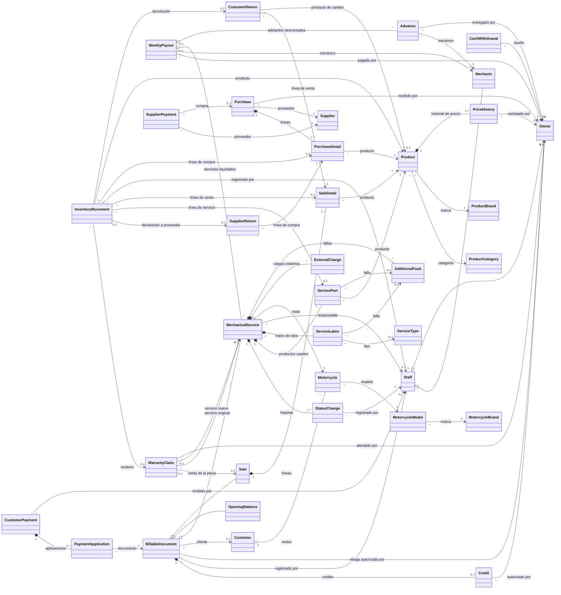
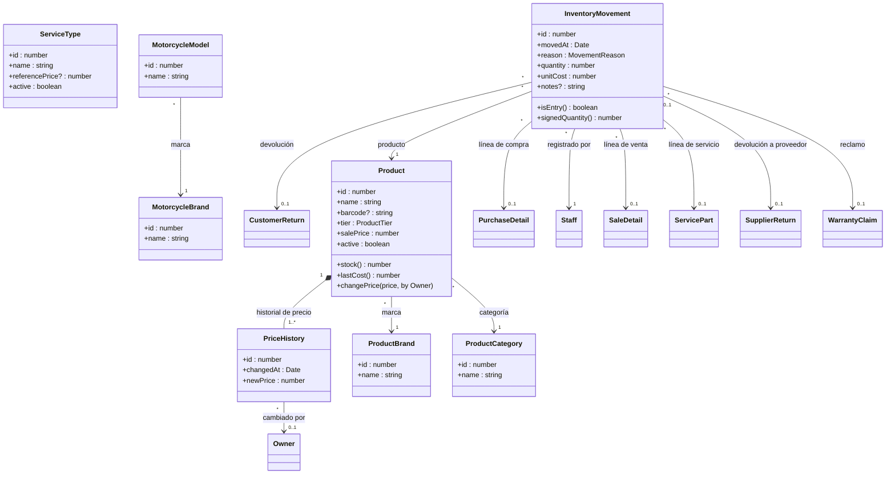
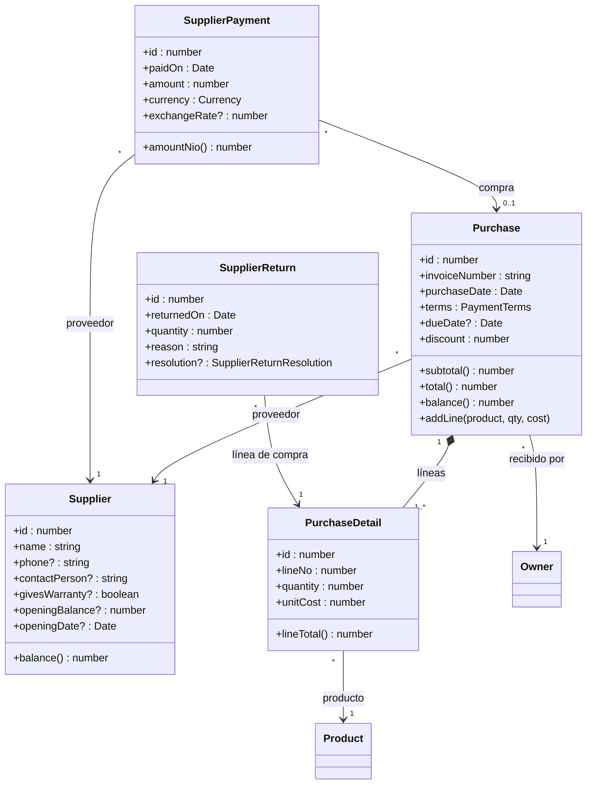
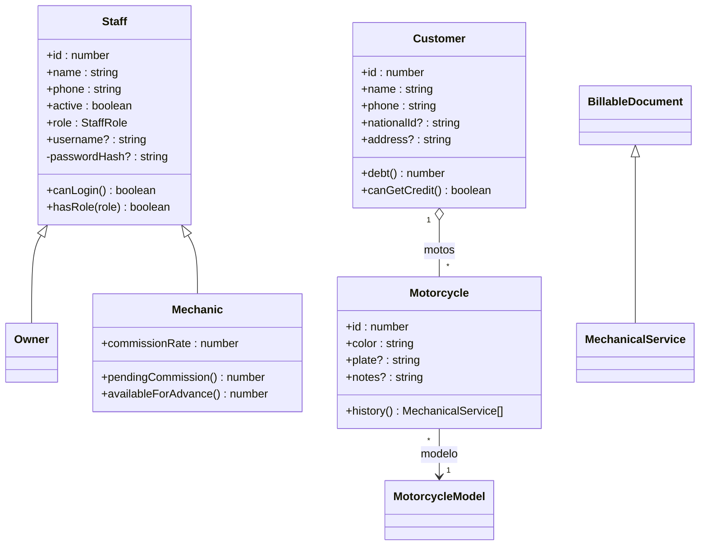
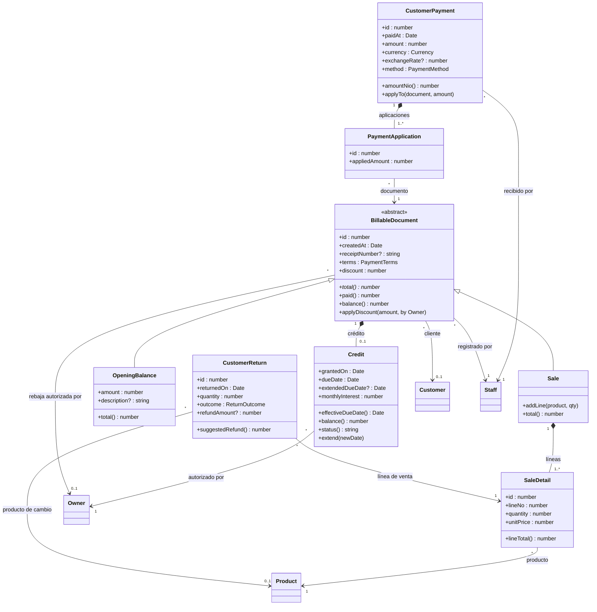
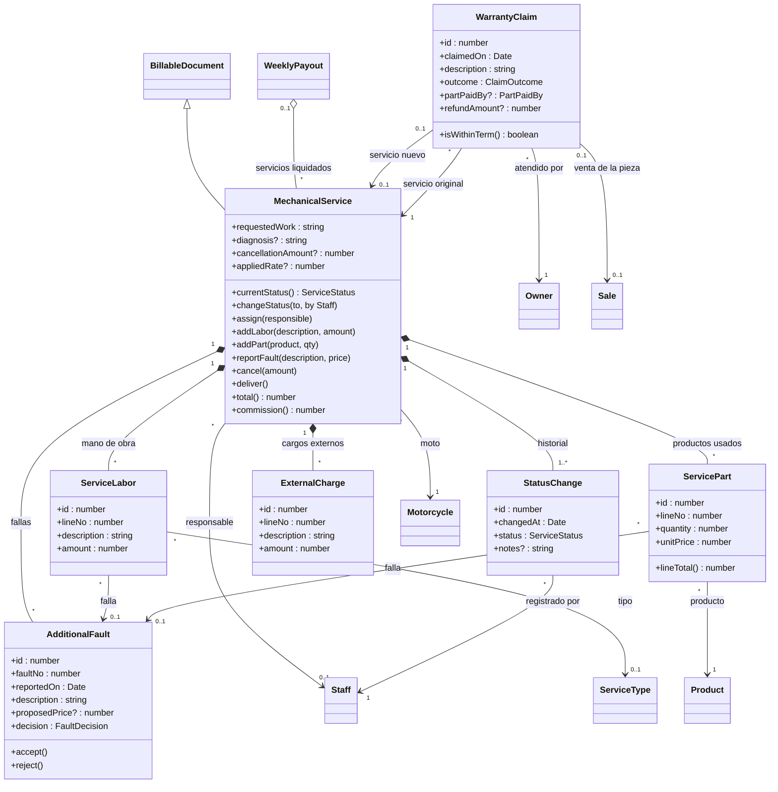
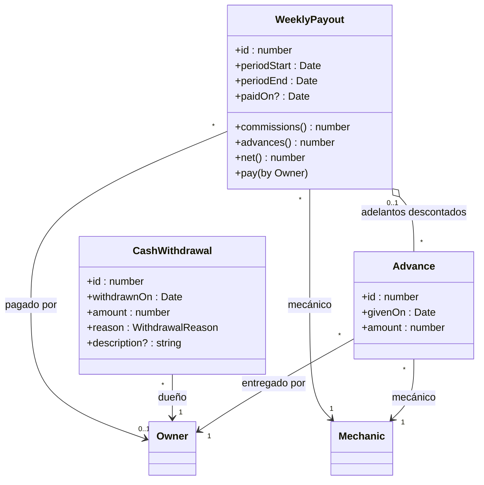

**[[Motor IRM|← Hub]]** · **[[S6 - Object-Oriented Model and Requirements - MIRM|← S6]]** · **[[S6 - Domain Model and Services - MIRM|Servicios y estados]]** · **[[S5 - Relational Schema - MIRM|Esquema relacional]]** · **[[Knowledge - Del modelo relacional al modelo orientado a objetos y el stack TypeScript|🧠 Knowledge]]**

# S6 - Domain Class Model - MIRM

> [!info] Qué es esta nota
> - El **modelo orientado a objetos completo** de Motor IRM: las 36 tablas como **clases** del dominio, con sus atributos, sus métodos (lo que cada una **sabe hacer**), la **herencia** y las **relaciones** con su tipo (asociación, agregación o composición) y su multiplicidad.
> - Complementa a [[S6 - Domain Model and Services - MIRM|Domain Model and Services]]: aquí está **qué es** cada cosa y **qué sabe hacer**; allá, **qué servicio del programa** lo hace y en qué transacción (§8 une las dos).
> - Clases, atributos, enumeraciones y relaciones salen **de la base** creada con `01_schema.sql` v2: si cambia el DDL, se regeneran. Conceptos de fondo: [[Knowledge - Del modelo relacional al modelo orientado a objetos y el stack TypeScript]].

---

## 1. Cómo leer los diagramas

| Símbolo | Significa | Ejemplo |
| --- | --- | --- |
| `+atributo : tipo` | Atributo público y su tipo en TypeScript | `+salePrice : number` |
| `-atributo` | Privado: no sale de la clase | `-passwordHash` |
| `atributo?` | Puede estar vacío (columna que admite nulo) | `+barcode? : string` |
| `+método() Tipo` | Lo que la clase sabe hacer y lo que devuelve | `+stock() number` |
| `A <\|-- B` (flecha con triángulo) | **Herencia**: B **es un** A | `Staff <\|-- Mechanic` |
| `A *-- B` (rombo negro) | **Composición**: B es **parte** de A y no existe sin A | `Sale *-- SaleDetail` |
| `A o-- B` (rombo blanco) | **Agregación**: A **agrupa** a B, pero B existe sin A | `WeeklyPayout o-- Advance` |
| `B --> A` (flecha) | **Asociación**: B **conoce** a A; las dos existen por separado | `Product --> ProductBrand` |
| `"1"`, `"0..1"`, `"*"`, `"1..*"` | **Multiplicidad**: cuántos objetos participan de cada lado | una venta tiene `1..*` líneas |
| `<<abstract>>` | Clase que no se crea sola, solo sus subclases | `BillableDocument` |
| `<<enumeration>>` | Lista fija de valores | `ServiceStatus` |

**Del relacional a objetos — tres reglas que se aplicaron en todas las clases:**
1. **Una FK no es un atributo, es una relación.** `product.id_product_brand` no aparece como atributo de `Product`: aparece como la flecha `Product --> ProductBrand`. En el código será `product.brand` (un objeto) o `product.idProductBrand` (su número), según lo que necesite cada pantalla.
2. **Nombres en camelCase** (estilo TypeScript): la columna `sale_price` es el atributo `salePrice`. La base sigue con `snake_case`.
3. **La PK de una subclase no se repite**: `Sale` no tiene `id` propio porque lo **hereda** de `BillableDocument` (en la base, `sale.id_sale` es a la vez PK y FK).

---

## 2. Correspondencia tabla ↔ clase

| Tabla | Clase | Tipo | Módulo | Área |
| --- | --- | --- | --- | --- |
| `product_category` | `ProductCategory` | Catálogo | `catalog` | Catálogos, productos e inventario |
| `product_brand` | `ProductBrand` | Catálogo | `catalog` | Catálogos, productos e inventario |
| `product` | `Product` | Entidad | `catalog` | Catálogos, productos e inventario |
| `price_history` | `PriceHistory` | Parte (historial) | `catalog` | Catálogos, productos e inventario |
| `service_type` | `ServiceType` | Catálogo | `catalog` | Catálogos, productos e inventario |
| `motorcycle_brand` | `MotorcycleBrand` | Catálogo | `catalog` | Catálogos, productos e inventario |
| `motorcycle_model` | `MotorcycleModel` | Catálogo | `catalog` | Catálogos, productos e inventario |
| `inventory_movement` | `InventoryMovement` | Entidad (evento) | `inventory` | Catálogos, productos e inventario |
| `supplier` | `Supplier` | Entidad | `purchases` | Compras |
| `purchase` | `Purchase` | Entidad (todo) | `purchases` | Compras |
| `purchase_detail` | `PurchaseDetail` | Parte (línea) | `purchases` | Compras |
| `supplier_payment` | `SupplierPayment` | Entidad | `purchases` | Compras |
| `supplier_return` | `SupplierReturn` | Entidad (evento) | `purchases` | Compras |
| `staff` | `Staff` | Superclase | `auth` | Personas y motos |
| `owner` | `Owner` | Subclase de Staff | `auth` | Personas y motos |
| `mechanic` | `Mechanic` | Subclase de Staff | `auth` | Personas y motos |
| `customer` | `Customer` | Entidad | `customers` | Personas y motos |
| `motorcycle` | `Motorcycle` | Entidad | `customers` | Personas y motos |
| `billable_document` | `BillableDocument` | Superclase abstracta | `sales · workshop · billing` | Documentos cobrables y cobros |
| `sale` | `Sale` | Subclase de BillableDocument (todo) | `sales` | Documentos cobrables y cobros |
| `sale_detail` | `SaleDetail` | Parte (línea) | `sales` | Documentos cobrables y cobros |
| `opening_balance` | `OpeningBalance` | Subclase de BillableDocument | `billing` | Documentos cobrables y cobros |
| `credit` | `Credit` | Parte (1 a 1 del documento) | `billing` | Documentos cobrables y cobros |
| `customer_payment` | `CustomerPayment` | Entidad (todo) | `billing` | Documentos cobrables y cobros |
| `payment_application` | `PaymentApplication` | Clase de asociación | `billing` | Documentos cobrables y cobros |
| `customer_return` | `CustomerReturn` | Entidad (evento) | `sales` | Documentos cobrables y cobros |
| `mechanical_service` | `MechanicalService` | Subclase de BillableDocument (todo) | `workshop` | Taller |
| `status_change` | `StatusChange` | Parte (historial) | `workshop` | Taller |
| `additional_fault` | `AdditionalFault` | Parte | `workshop` | Taller |
| `service_labor` | `ServiceLabor` | Parte (línea) | `workshop` | Taller |
| `service_part` | `ServicePart` | Parte (línea) | `workshop` | Taller |
| `external_charge` | `ExternalCharge` | Parte (línea) | `workshop` | Taller |
| `warranty_claim` | `WarrantyClaim` | Entidad (evento) | `workshop` | Taller |
| `weekly_payout` | `WeeklyPayout` | Entidad (agregado) | `payroll` | Mecánicos y caja |
| `advance` | `Advance` | Entidad | `payroll` | Mecánicos y caja |
| `cash_withdrawal` | `CashWithdrawal` | Entidad (evento) | `cash` | Mecánicos y caja |

**Tipos:** *Catálogo* (lista que amplían los dueños) · *Entidad* (existe por sí misma) · *Evento* (registra algo que pasó; no se modifica después) · *Parte* (no existe sin su todo) · *Clase de asociación* (une dos clases y guarda un dato de la unión: `PaymentApplication` guarda cuánto de un pago va a un documento).

---

## 3. Herencia

| Superclase | Subclases | Tipo de especialización | De dónde sale | Notas |
| --- | --- | --- | --- | --- |
| `BillableDocument` *(abstracta)* | `Sale`, `MechanicalService`, `OpeningBalance` | Total y disjunta: todo documento es exactamente uno de los tres | G-1 · [[DEC-011 - Billable Document Superclass - MIRM\|DEC-011]] · [[DEC-017 - Billable Document Table Mapping - MIRM\|DEC-017]] | El atributo `kind` de la tabla **no** aparece en la clase: el tipo lo da la subclase. `total()` es **abstracto**: cada subclase lo calcula a su manera (líneas − rebaja; mano de obra + productos + cargos − rebaja o monto por cancelación; monto del saldo). Esto es **polimorfismo**. |
| `Staff` | `Owner`, `Mechanic` (el encargado es un `Staff` con `role = ENCARGADO`) | Total y disjunta por `role` | G-2 · [[DEC-012 - Staff Disjoint Specialization - MIRM\|DEC-012]] · [[DEC-018 - Staff Table Mapping - MIRM\|DEC-018]] | `Staff` **no** es abstracta: el encargado se crea como `Staff` directamente. `Owner` no agrega atributos, pero existe para que las relaciones "solo un dueño autoriza" apunten a él. |

---

## 4. Relaciones

**57 relaciones:** 10 composiciones, 3 agregaciones y 44 asociaciones (más las 5 de herencia). Cada una sale de una FK del DDL (columna *FK*).

**La pregunta que decide el tipo:** *"Si borro el todo, ¿la parte tiene sentido sola?"*
- **No** → **composición** (◆). Se crean y se guardan juntas, en la misma transacción. Ejemplo: una línea de venta sin su venta no significa nada.
- **Sí, pero el todo la agrupa** → **agregación** (◇). Ejemplo: un adelanto existe desde que se entrega; el pago semanal solo lo **agrupa** al liquidarlo.
- **Solo la conoce** → **asociación** (→). Ejemplo: un producto conoce su marca; la marca existe con o sin ese producto.

> En la base no se borra nada ([[DEC-027 - No Cascade Delete - MIRM|DEC-027]]): la composición se nota en que **se crean juntas** (C-13) y en que la parte no se puede mover a otro todo.

| Relación | Tipo | Multiplicidad (todo/origen a parte/destino) | Rol | Por qué | FK |
| --- | --- | --- | --- | --- | --- |
| `BillableDocument` ◆ `Credit` | **Composición** | 1 a 0..1 | crédito | El crédito es el financiamiento de ese documento, 1 a 1 (DEC-009) | `id_credit` |
| `CustomerPayment` ◆ `PaymentApplication` | **Composición** | 1 a 1..* | aplicaciones | El reparto no existe sin su pago (C-07) | `id_customer_payment` |
| `MechanicalService` ◆ `AdditionalFault` | **Composición** | 1 a * | fallas | La falla adicional solo existe dentro de su servicio | `id_mechanical_service` |
| `MechanicalService` ◆ `ExternalCharge` | **Composición** | 1 a * | cargos externos | Línea del servicio (BR-097) | `id_mechanical_service` |
| `MechanicalService` ◆ `ServiceLabor` | **Composición** | 1 a * | mano de obra | Línea del servicio | `id_mechanical_service` |
| `MechanicalService` ◆ `ServicePart` | **Composición** | 1 a * | productos usados | Línea del servicio | `id_mechanical_service` |
| `MechanicalService` ◆ `StatusChange` | **Composición** | 1 a 1..* | historial | Un cambio de estado es débil del servicio (DEC-013); al menos RECIBIDA | `id_mechanical_service` |
| `Product` ◆ `PriceHistory` | **Composición** | 1 a 1..* | historial de precio | El historial pertenece al producto (DEC-022) | `id_product` |
| `Purchase` ◆ `PurchaseDetail` | **Composición** | 1 a 1..* | líneas | Una línea no existe sin su compra (C-13: al menos una) | `id_purchase` |
| `Sale` ◆ `SaleDetail` | **Composición** | 1 a 1..* | líneas | Una línea no existe sin su venta (C-13) | `id_sale` |
| `Customer` ◇ `Motorcycle` | **Agregación** | 1 a * | motos | La moto existe por sí misma y puede cambiar de dueño (BR-043) | `id_customer` |
| `WeeklyPayout` ◇ `Advance` | **Agregación** | 0..1 a * | adelantos descontados | El pago agrupa adelantos que existen antes y sin él | `id_weekly_payout, id_mechanic` |
| `WeeklyPayout` ◇ `MechanicalService` | **Agregación** | 0..1 a * | servicios liquidados | El pago agrupa servicios que existen antes y sin él (DEC-030) | `id_weekly_payout, id_responsible` |
| `ServiceLabor` → `AdditionalFault` | Asociación | * a 0..1 | falla | Solo la conoce (referencia); las dos existen por separado | `id_additional_fault, id_mechanical_service` |
| `ServicePart` → `AdditionalFault` | Asociación | * a 0..1 | falla | Solo la conoce (referencia); las dos existen por separado | `id_additional_fault, id_mechanical_service` |
| `PaymentApplication` → `BillableDocument` | Asociación | * a 1 | documento | El documento existe aunque no se le aplique nada | `id_billable_document` |
| `BillableDocument` → `Customer` | Asociación | * a 0..1 | cliente | Solo la conoce (referencia); las dos existen por separado | `id_customer` |
| `InventoryMovement` → `CustomerReturn` | Asociación | * a 0..1 | devolución | Solo la conoce (referencia); las dos existen por separado | `id_customer_return` |
| `Advance` → `Mechanic` | Asociación | * a 1 | mecánico | Solo la conoce (referencia); las dos existen por separado | `id_mechanic` |
| `WeeklyPayout` → `Mechanic` | Asociación | * a 1 | mecánico | Solo la conoce (referencia); las dos existen por separado | `id_mechanic` |
| `WarrantyClaim` → `MechanicalService` | Asociación | 0..1 a 0..1 | servicio nuevo | Solo la conoce (referencia); las dos existen por separado | `id_new_service` |
| `WarrantyClaim` → `MechanicalService` | Asociación | * a 1 | servicio original | Solo la conoce (referencia); las dos existen por separado | `id_original_service` |
| `MechanicalService` → `Motorcycle` | Asociación | * a 1 | moto | Solo la conoce (referencia); las dos existen por separado | `id_motorcycle` |
| `MotorcycleModel` → `MotorcycleBrand` | Asociación | * a 1 | marca | Solo la conoce (referencia); las dos existen por separado | `id_motorcycle_brand` |
| `Motorcycle` → `MotorcycleModel` | Asociación | * a 1 | modelo | Solo la conoce (referencia); las dos existen por separado | `id_motorcycle_model` |
| `Advance` → `Owner` | Asociación | * a 1 | entregado por | Solo la conoce (referencia); las dos existen por separado | `id_given_by` |
| `BillableDocument` → `Owner` | Asociación | * a 0..1 | rebaja autorizada por | Solo la conoce (referencia); las dos existen por separado | `id_discount_authorized_by` |
| `CashWithdrawal` → `Owner` | Asociación | * a 1 | dueño | Solo la conoce (referencia); las dos existen por separado | `id_owner` |
| `Credit` → `Owner` | Asociación | * a 1 | autorizado por | Solo la conoce (referencia); las dos existen por separado | `id_authorized_by` |
| `PriceHistory` → `Owner` | Asociación | * a 0..1 | cambiado por | Solo la conoce (referencia); las dos existen por separado | `id_changed_by` |
| `Purchase` → `Owner` | Asociación | * a 1 | recibido por | Solo la conoce (referencia); las dos existen por separado | `id_received_by` |
| `WarrantyClaim` → `Owner` | Asociación | * a 1 | atendido por | Solo la conoce (referencia); las dos existen por separado | `id_attended_by` |
| `WeeklyPayout` → `Owner` | Asociación | * a 0..1 | pagado por | Solo la conoce (referencia); las dos existen por separado | `id_paid_by` |
| `CustomerReturn` → `Product` | Asociación | * a 0..1 | producto de cambio | Solo la conoce (referencia); las dos existen por separado | `id_exchange_product` |
| `InventoryMovement` → `Product` | Asociación | * a 1 | producto | Solo la conoce (referencia); las dos existen por separado | `id_product` |
| `PurchaseDetail` → `Product` | Asociación | * a 1 | producto | Solo la conoce (referencia); las dos existen por separado | `id_product` |
| `SaleDetail` → `Product` | Asociación | * a 1 | producto | Solo la conoce (referencia); las dos existen por separado | `id_product` |
| `ServicePart` → `Product` | Asociación | * a 1 | producto | Solo la conoce (referencia); las dos existen por separado | `id_product` |
| `Product` → `ProductBrand` | Asociación | * a 1 | marca | Solo la conoce (referencia); las dos existen por separado | `id_product_brand` |
| `Product` → `ProductCategory` | Asociación | * a 1 | categoría | Solo la conoce (referencia); las dos existen por separado | `id_product_category` |
| `SupplierPayment` → `Purchase` | Asociación | * a 0..1 | compra | Solo la conoce (referencia); las dos existen por separado | `id_purchase, id_supplier` |
| `InventoryMovement` → `PurchaseDetail` | Asociación | * a 0..1 | línea de compra | Solo la conoce (referencia); las dos existen por separado | `id_purchase_detail, id_product` |
| `SupplierReturn` → `PurchaseDetail` | Asociación | * a 1 | línea de compra | Solo la conoce (referencia); las dos existen por separado | `id_purchase_detail` |
| `WarrantyClaim` → `Sale` | Asociación | 0..1 a 0..1 | venta de la pieza | Solo la conoce (referencia); las dos existen por separado | `id_sale` |
| `CustomerReturn` → `SaleDetail` | Asociación | * a 1 | línea de venta | Solo la conoce (referencia); las dos existen por separado | `id_sale_detail` |
| `InventoryMovement` → `SaleDetail` | Asociación | * a 0..1 | línea de venta | Solo la conoce (referencia); las dos existen por separado | `id_sale_detail, id_product` |
| `InventoryMovement` → `ServicePart` | Asociación | * a 0..1 | línea de servicio | Solo la conoce (referencia); las dos existen por separado | `id_service_part, id_product` |
| `ServiceLabor` → `ServiceType` | Asociación | * a 0..1 | tipo | Solo la conoce (referencia); las dos existen por separado | `id_service_type` |
| `BillableDocument` → `Staff` | Asociación | * a 1 | registrado por | Solo la conoce (referencia); las dos existen por separado | `id_registered_by` |
| `CustomerPayment` → `Staff` | Asociación | * a 1 | recibido por | Solo la conoce (referencia); las dos existen por separado | `id_received_by` |
| `InventoryMovement` → `Staff` | Asociación | * a 1 | registrado por | Solo la conoce (referencia); las dos existen por separado | `id_registered_by` |
| `MechanicalService` → `Staff` | Asociación | * a 0..1 | responsable | Solo la conoce (referencia); las dos existen por separado | `id_responsible` |
| `StatusChange` → `Staff` | Asociación | * a 1 | registrado por | Solo la conoce (referencia); las dos existen por separado | `id_registered_by` |
| `Purchase` → `Supplier` | Asociación | * a 1 | proveedor | Solo la conoce (referencia); las dos existen por separado | `id_supplier` |
| `SupplierPayment` → `Supplier` | Asociación | * a 1 | proveedor | Solo la conoce (referencia); las dos existen por separado | `id_supplier` |
| `InventoryMovement` → `SupplierReturn` | Asociación | 0..1 a 0..1 | devolución a proveedor | Solo la conoce (referencia); las dos existen por separado | `id_supplier_return` |
| `InventoryMovement` → `WarrantyClaim` | Asociación | * a 0..1 | reclamo | Solo la conoce (referencia); las dos existen por separado | `id_warranty_claim` |

---

## 5. Enumeraciones

Cada lista fija del DDL (`CHECK … IN (…)`, [[DEC-026 - Value Lists as Check Constraints - MIRM|DEC-026]]) es una **enumeración**. En TypeScript se escriben como un tipo unión (`type PaymentTerms = 'CONTADO' | 'CREDITO'`): el compilador avisa si se escribe mal un valor, **antes** de llegar a la base.

| Enumeración | Valores | Usada en |
| --- | --- | --- |
| `PaymentTerms` | `CONTADO`, `CREDITO` | BillableDocument.terms, Purchase.terms |
| `Currency` | `NIO`, `USD` | CustomerPayment.currency, SupplierPayment.currency |
| `PaymentMethod` | `EFECTIVO`, `TRANSFERENCIA` | CustomerPayment.method |
| `StaffRole` | `DUENO`, `MECANICO`, `ENCARGADO` | Staff.role |
| `ProductTier` | `ALTA`, `MEDIA`, `BAJA` | Product.tier |
| `ServiceStatus` | `RECIBIDA`, `EN_DIAGNOSTICO`, `EN_PROCESO`, `ESPERA_REPUESTO`, `ESPERA_CLIENTE`, `TERMINADA`, `EN_PRUEBA`, `ENTREGADA`, `CANCELADA` | StatusChange.status |
| `FaultDecision` | `PENDIENTE`, `ACEPTADA`, `RECHAZADA` | AdditionalFault.decision |
| `MovementReason` | `COMPRA`, `DEVOLUCION_CLIENTE`, `INVENTARIO_INICIAL`, `AJUSTE_ENTRADA`, `VENTA`, `USO_SERVICIO`, `CAMBIO_CLIENTE`, `DEVOLUCION_PROVEEDOR`, `GARANTIA`, `AJUSTE_SALIDA` | InventoryMovement.reason |
| `ReturnOutcome` | `CAMBIO`, `REEMBOLSO` | CustomerReturn.outcome |
| `ClaimOutcome` | `CUBIERTO`, `FALLA_DISTINTA`, `FUERA_DE_PLAZO`, `REEMBOLSO` | WarrantyClaim.outcome |
| `PartPaidBy` | `TIENDA`, `CLIENTE` | WarrantyClaim.partPaidBy |
| `SupplierReturnResolution` | `REPOSICION`, `DINERO`, `DESCUENTO` | SupplierReturn.resolution |
| `WithdrawalReason` | `CONSUMO_INTERNO`, `VIAJE`, `IMPUESTO`, `OTRO` | CashWithdrawal.reason |
| `DocumentKind` | `VENTA`, `SERVICIO`, `SALDO_INICIAL` | BillableDocument.kind |

```mermaid
classDiagram
    class PaymentTerms {
        <<enumeration>>
        CONTADO
        CREDITO
    }
    class Currency {
        <<enumeration>>
        NIO
        USD
    }
    class PaymentMethod {
        <<enumeration>>
        EFECTIVO
        TRANSFERENCIA
    }
    class StaffRole {
        <<enumeration>>
        DUENO
        MECANICO
        ENCARGADO
    }
    class ProductTier {
        <<enumeration>>
        ALTA
        MEDIA
        BAJA
    }
    class ServiceStatus {
        <<enumeration>>
        RECIBIDA
        EN_DIAGNOSTICO
        EN_PROCESO
        ESPERA_REPUESTO
        ESPERA_CLIENTE
        TERMINADA
        EN_PRUEBA
        ENTREGADA
        CANCELADA
    }
    class FaultDecision {
        <<enumeration>>
        PENDIENTE
        ACEPTADA
        RECHAZADA
    }
    class MovementReason {
        <<enumeration>>
        COMPRA
        DEVOLUCION_CLIENTE
        INVENTARIO_INICIAL
        AJUSTE_ENTRADA
        VENTA
        USO_SERVICIO
        CAMBIO_CLIENTE
        DEVOLUCION_PROVEEDOR
        GARANTIA
        AJUSTE_SALIDA
    }
    class ReturnOutcome {
        <<enumeration>>
        CAMBIO
        REEMBOLSO
    }
    class ClaimOutcome {
        <<enumeration>>
        CUBIERTO
        FALLA_DISTINTA
        FUERA_DE_PLAZO
        REEMBOLSO
    }
    class PartPaidBy {
        <<enumeration>>
        TIENDA
        CLIENTE
    }
    class SupplierReturnResolution {
        <<enumeration>>
        REPOSICION
        DINERO
        DESCUENTO
    }
    class WithdrawalReason {
        <<enumeration>>
        CONSUMO_INTERNO
        VIAJE
        IMPUESTO
        OTRO
    }
    class DocumentKind {
        <<enumeration>>
        VENTA
        SERVICIO
        SALDO_INICIAL
    }
```

---

## 6. Diagrama general

Las 36 clases y todas sus relaciones, sin atributos (están en §7). Se lee mejor por áreas; este sirve para ver el conjunto.

---

## 7. Diagramas por área

Cada clase aparece **completa** (atributos y métodos) en un solo diagrama; en los demás aparece solo la caja.

### 7.1 Catálogos, productos e inventario

### 7.2 Compras

### 7.3 Personas y motos

### 7.4 Documentos cobrables y cobros

### 7.5 Taller

### 7.6 Mecánicos y caja

---

## 8. Métodos del dominio → dónde se implementan

Un método del modelo dice **qué sabe hacer** la clase. En el programa ([[DEC-034 - DDL as Single Source of Truth - MIRM|DEC-034]]) se implementa en uno de tres lugares:
- **Vista o consulta** de la base (datos derivados, [[DEC-020 - Derived Attributes as Views - MIRM|DEC-020]]): totales, saldos, existencia, comisiones.
- **Servicio** de [[S6 - Domain Model and Services - MIRM|Domain Model and Services]]: todo lo que **escribe** (y valida antes de escribir).
- **Función pura en TypeScript**: cálculos pequeños sobre datos ya leídos.

| Clase.método | Qué hace | Dónde se implementa |
| --- | --- | --- |
| `Product.stock()` · `lastCost()` | Existencia; último costo | Vista `v_product_stock` (Q04) · `InventoryService.lastCost` |
| `Product.changePrice()` | Nuevo precio + historial | `CatalogService.changePrice` |
| `Purchase.subtotal()` · `total()` · `balance()` | Líneas; − descuento; − pagos | Vista `v_purchase_balance` (Q22) |
| `Purchase.addLine()` | Línea + movimiento COMPRA | `PurchaseService.registerPurchase` |
| `PurchaseDetail.lineTotal()` · `SaleDetail.lineTotal()` · `ServicePart.lineTotal()` | cantidad × costo o precio | Función TS |
| `Supplier.balance()` | Saldo con el proveedor | Vista `v_supplier_balance` (Q19) |
| `SupplierPayment.amountNio()` · `CustomerPayment.amountNio()` | Monto × tipo de cambio | Función TS (y en las vistas) |
| `Customer.debt()` | Suma de saldos de sus créditos | Vista `v_customer_debt` |
| `Customer.canGetCredit()` | Tiene cédula y dirección | `CustomerService.ensureCreditData` |
| `Motorcycle.history()` | Servicios de la moto | Consulta Q12 |
| `Staff.canLogin()` · `hasRole()` | Usuario activo; permisos | `AuthService.login` · `requireRole` |
| `Mechanic.pendingCommission()` · `availableForAdvance()` | Lo ganado sin pagar | Vista `v_mechanic_pending` (Q21) · `PayrollService.pendingFor` |
| `BillableDocument.total()` *(abstracto)* · `paid()` · `balance()` | Total según la subclase; lo pagado; lo que falta | Vista `v_document_total` (Q07) |
| `BillableDocument.applyDiscount()` | Rebaja autorizada por un dueño | `SaleService.registerSale` · `WorkshopService.deliver` |
| `Sale.addLine()` | Línea + movimiento VENTA | `SaleService.registerSale` |
| `MechanicalService.currentStatus()` | Último cambio de estado | Vista `v_service_status` (Q11) |
| `MechanicalService.changeStatus()` · `assign()` · `addLabor()` · `addPart()` · `reportFault()` · `cancel()` · `deliver()` | Lo que pasa en el taller | `WorkshopService` (mismo nombre de método) |
| `MechanicalService.commission()` | (mano de obra − rebaja o cancelación) × porcentaje | Vista `v_service_commission` (Q15) |
| `AdditionalFault.accept()` · `reject()` | Decisión del cliente | `WorkshopService.decideFault` |
| `Credit.effectiveDueDate()` · `balance()` · `status()` | Vencimiento (con prórroga), saldo y estado | Vista `v_credit_status` (Q17) |
| `Credit.extend()` | Prórroga | `BillingService.extendCredit` |
| `CustomerPayment.applyTo()` | Crea una `PaymentApplication` | `BillingService.charge` |
| `CustomerReturn.suggestedRefund()` | Lo que pagó por esa línea | `SaleService.registerReturn` (10-dic) |
| `WarrantyClaim.isWithinTerm()` | Dentro del plazo de garantía | `WarrantyService.openClaim` (10-dic) |
| `WeeklyPayout.commissions()` · `advances()` · `net()` | Comisiones − adelantos | Vista `v_weekly_payout_summary` (Q16) |
| `WeeklyPayout.pay()` | Marca pagado | `PayrollService.pay` |
| `InventoryMovement.isEntry()` · `signedQuantity()` | El motivo da la dirección ([[DEC-021 - Movement Reason Includes Direction - MIRM\|DEC-021]]) | Función TS (y en Q04) |

---

## 9. Qué cambia respecto al modelo relacional

| Tema | Relacional (S5) | Orientado a objetos (S6) |
| --- | --- | --- |
| Unidad | Tabla con filas | Clase con objetos |
| Relaciones | Columna FK | Referencia a otro objeto (asociación, agregación, composición) |
| Especialización | Tabla padre + tabla hija con la misma PK, y `kind` | Herencia (`<\|--`); el tipo lo da la clase |
| Listas fijas | `VARCHAR` + `CHECK` | Enumeración |
| Datos derivados | Vistas | Métodos (`total()`, `stock()`) |
| Reglas de una fila | `CHECK` | La base las sigue cumpliendo; el método valida antes |
| Reglas entre tablas | No caben en un `CHECK` | Métodos de los servicios (§8 y [[S6 - Domain Model and Services - MIRM\|servicios]]) |

> Redactado por Claude a pedido de Kenry (07-nov); pendiente de revisión del equipo.
