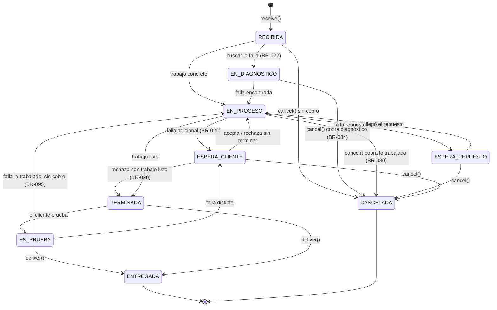
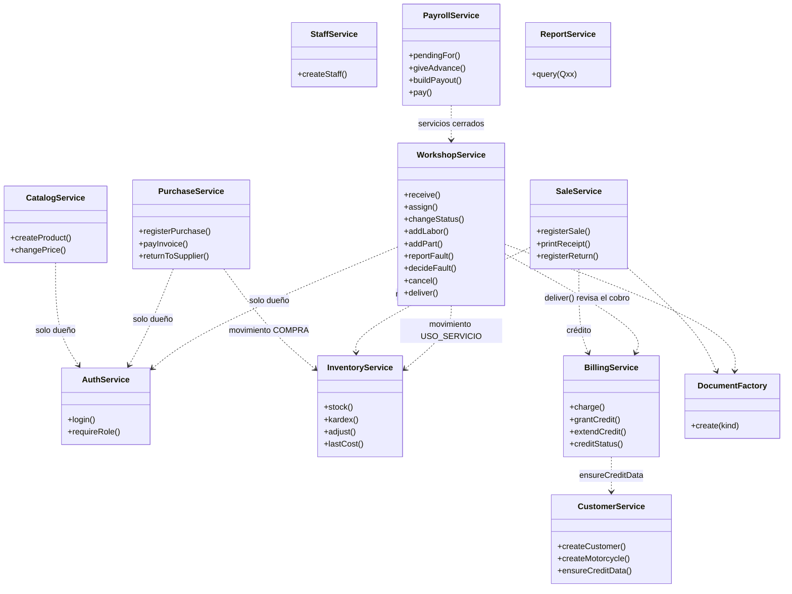

**[[Motor IRM|← Hub]]** · **[[S6 - Object-Oriented Model and Requirements - MIRM|← S6]]** · **[[Requirements - MIRM|📋 Requirements]]** · **[[Traceability - MIRM|🔗 Traceability]]** · **[[S5 - DDL PostgreSQL - MIRM|DDL]]**

# S6 - Domain Model and Services - MIRM

> [!info] Qué es esta nota (S6 ligera, [[DEC-036 - Lightweight S6 Before Programming - MIRM|DEC-036]])
> - El esquema ya está fijo en el DDL ([[DEC-034 - DDL as Single Source of Truth - MIRM|DEC-034]]): las **tablas son los datos** del programa. Esta nota responde lo que el DDL no dice: **quién hace qué** con esos datos.
> - **§1** módulos del programa y sus tablas · **§2** servicios y sus métodos · **§3** cada regla que "va en la aplicación" con su método responsable · **§4** estados del servicio mecánico (transiciones permitidas) · **§5** diagrama de clases ligero.
> - Los nombres de servicios y métodos son una **propuesta** para el código en TypeScript; el equipo puede cambiarlos en S8 sin cambiar esta lógica.

---

## 1. Módulos y tablas

Un **módulo** agrupa las tablas que cambian juntas y el servicio que las escribe. Cada tabla tiene **un solo dueño** (el único servicio que hace `INSERT`/`UPDATE` en ella); los demás solo la leen.

| Módulo | Servicio | Tablas que escribe | Versión 1 (clase) |
| --- | --- | --- | --- |
| `auth` | `AuthService` · `StaffService` | `staff`, `owner`, `mechanic` | ✅ |
| `catalog` | `CatalogService` | `product_category`, `product_brand`, `product`, `price_history`, `service_type`, `motorcycle_brand`, `motorcycle_model` | ✅ |
| `customers` | `CustomerService` | `customer`, `motorcycle` | ✅ |
| `inventory` | `InventoryService` | `inventory_movement` | ✅ |
| `purchases` | `PurchaseService` | `supplier`, `purchase`, `purchase_detail` · `supplier_payment`, `supplier_return` (10-dic) | ✅ compra · ⏭️ pagos y devoluciones |
| `sales` | `SaleService` | `billable_document` (VENTA), `sale`, `sale_detail` · `customer_return` (10-dic) | ✅ venta · ⏭️ devoluciones |
| `workshop` | `WorkshopService` · `WarrantyService` (10-dic) | `billable_document` (SERVICIO), `mechanical_service`, `status_change`, `additional_fault`, `service_labor`, `service_part`, `external_charge` · `warranty_claim` (10-dic) | ✅ servicio · ⏭️ garantía |
| `billing` | `BillingService` | `customer_payment`, `payment_application`, `credit` · `opening_balance` (10-dic) | ✅ básico |
| `payroll` | `PayrollService` | `weekly_payout`, `advance` · `mechanical_service.applied_rate` e `id_weekly_payout` | ✅ básico |
| `cash` | `CashService` | `cash_withdrawal` | ⏭️ 10-dic |
| `reports` | `ReportService` | — (solo lee: vistas y consultas Q01–Q22) | ✅ |

> [!note] Dos tablas con dos "dueños"
> - `billable_document` la escriben `SaleService` (VENTA), `WorkshopService` (SERVICIO) y `BillingService` (SALDO_INICIAL). Las tres usan **un mismo ayudante**, `DocumentFactory.create(kind, …)`, que inserta el documento **y** su subclase en la misma transacción (así `kind` siempre coincide con la subclase).
> - `mechanical_service`: `WorkshopService` la crea y la trabaja; `PayrollService` solo llena `applied_rate` e `id_weekly_payout` al liquidar.

---

## 2. Servicios y métodos

Cada método es **una transacción** (`BEGIN … COMMIT`): o se guarda todo o nada. Entre corchetes, las reglas que cumple.

| Servicio | Método | Qué hace | v1 |
| --- | --- | --- | --- |
| `AuthService` | `login(username, password)` | Verifica el hash; rechaza a un usuario inactivo [DEC-035] | ✅ |
| | `requireRole(user, roles)` | Permisos: el encargado solo vende [BR-008, C-03] | ✅ |
| `StaffService` | `createStaff(datos, role)` | Inserta `staff` y su fila en `owner` o `mechanic` según el rol [DEC-018] | ✅ |
| `CatalogService` | `createProduct(…)` | Producto + primer precio en `price_history` [BR-015] | ✅ |
| | `changePrice(product, price, owner)` | Actualiza `product.sale_price` **e** inserta el historial juntos [BR-016, DEC-022] | ✅ |
| `CustomerService` | `createCustomer(…)` · `createMotorcycle(…)` | Cliente y moto [BR-039, BR-041] | ✅ |
| | `ensureCreditData(customer)` | Exige cédula y dirección antes de un crédito [BR-040, C-06] | ✅ |
| `InventoryService` | `stock(product)` · `kardex(product)` | Existencia y movimientos (Q04, Q06) [BR-020] | ✅ |
| | `adjust(product, qty, in/out, notes)` | Ajuste con observación; también el inventario inicial [BR-036] | ✅ |
| | `lastCost(product)` | Costo de las salidas [DEC-024] | ✅ |
| `PurchaseService` | `registerPurchase(factura, líneas, descuento, condición)` | Compra + líneas + un movimiento `COMPRA` por línea; descuento ≤ subtotal; vencimiento sugerido a un mes [BR-013, BR-014, BR-100, BR-105, C-13, C-16] | ✅ |
| | `payInvoice(purchase, monto)` · `returnToSupplier(…)` | Pago de una factura (saldo Q22) · devolución [BR-018, BR-101] | ⏭️ |
| `SaleService` | `registerSale(líneas, condición, cliente?, rebaja?)` | Documento VENTA + líneas con el precio actual + movimiento `VENTA` por línea; rebaja solo con dueño; si es crédito → `BillingService.grantCredit`; calcula el vuelto sin guardarlo [BR-002, BR-010, BR-038, BR-059, BR-061, C-13] | ✅ |
| | `printReceipt(document)` | Asigna `receipt_number` e imprime (formato fijo en v1) [BR-060] | ✅ |
| | `registerReturn(…)` | Devolución: cantidad ≤ vendida, producto aceptable, reembolso propuesto [BR-069, BR-070, BR-102, C-11] | ⏭️ |
| `WorkshopService` | `receive(customer, moto, pedido)` | Documento SERVICIO + `mechanical_service` + estado `RECIBIDA` [BR-021, BR-022, C-13] | ✅ |
| | `assign(service, responsible)` | Solo un dueño asigna; responsable dueño o mecánico [BR-023, BR-024, BR-025, C-02] | ✅ |
| | `changeStatus(service, to, notes)` | Solo transiciones de §4 [DEC-013, BR-095] | ✅ |
| | `addLabor(…)` · `addPart(…)` · `addExternalCharge(…)` | Líneas del servicio; `addPart` crea el movimiento `USO_SERVICIO` [BR-003, BR-029, BR-037, BR-097, C-13] | ✅ |
| | `reportFault(…)` · `decideFault(fault, decision)` | Falla adicional → ESPERA_CLIENTE; aceptada genera líneas [BR-026 a BR-028] | ✅ |
| | `cancel(service, monto)` | CANCELADA con lo trabajado (0 desde RECIBIDA) [BR-080, BR-084] | ✅ |
| | `deliver(service)` | ENTREGADA solo si está cobrado o con crédito autorizado [BR-035, BR-009] | ✅ |
| `WarrantyService` | `openClaim(…)` · `resolve(…)` | Reclamo dentro del plazo; resultado [BR-071 a BR-074, BR-085 a BR-088] | ⏭️ |
| `BillingService` | `charge(documents[], pago)` | Pago (NIO/USD) repartido entre documentos del **mismo cliente**; sin destino → al crédito más antiguo; suma aplicada = monto en córdobas [BR-056 a BR-058, BR-096, C-07, C-15] | ✅ |
| | `grantCredit(document, owner, vence)` | Solo documentos `CREDITO`; vencimiento sugerido a un mes; interés 8 % si es a tres meses [BR-009, BR-062 a BR-068, C-06] | ✅ |
| | `extendCredit(credit, nuevaFecha)` · `creditStatus(…)` | Prórroga · saldo y estado (Q17) [BR-065, BR-066] | ✅ |
| `PayrollService` | `pendingFor(mechanic)` | Comisión pendiente, adelantos pendientes y disponible (Q21) [BR-103, BR-104] | ✅ |
| | `giveAdvance(mechanic, monto, owner)` | Registra el adelanto; **avisa** si pasa del disponible [BR-048, BR-103, C-17] | ✅ |
| | `buildPayout(mechanic, inicio, fin)` | Crea el pago del periodo y le une los servicios terminados y adelantos pendientes hasta `fin` (también de semanas anteriores); fija `applied_rate`; sin traslapes [BR-046, BR-047, BR-049, BR-104, C-10, C-18] | ✅ |
| | `pay(payout, owner)` | Marca pagado en efectivo [BR-081] | ✅ |
| `CashService` | `withdraw(…)` | Retiro de caja [BR-011, BR-075 a BR-078] | ⏭️ |
| `ReportService` | consultas Q01–Q22 | Ventas del día, dinero recibido, más vendidos, existencia baja, motos en taller, créditos | ✅ |

---

## 3. Reglas que "van en la aplicación" → método responsable

Todas las filas de [[Traceability - MIRM|Traceability]] marcadas **"va en la aplicación"** y las restricciones C-xx de la §6 del [[S5 - Relational Schema - MIRM|esquema]]. Cuando la base **también** la garantiza, el método valida antes para mostrar un mensaje claro.

| Regla | Qué se valida | Responsable |
| --- | --- | --- |
| BR-005 | El aceite se registra por litro (1 L = 1 unidad) | `SaleService.registerSale` (etiqueta "litros" en productos de la categoría Lubricantes) |
| BR-008 · C-03 | El encargado solo vende; servicios, compras, créditos y retiros, solo dueños | `AuthService.requireRole` |
| BR-016 | Precio y su historial en la misma transacción | `CatalogService.changePrice` |
| BR-022 | Diagnóstico solo si el cliente lo pide | `WorkshopService.receive` (estado inicial EN_DIAGNOSTICO o EN_PROCESO) |
| BR-023 · BR-024 · BR-025 · C-02 | Solo un dueño asigna; responsable dueño o mecánico; sin responsable mientras RECIBIDA | `WorkshopService.assign` |
| BR-035 | Cobra un dueño | `AuthService.requireRole` en `BillingService.charge` |
| BR-040 · C-06 | Cédula y dirección para dar crédito | `CustomerService.ensureCreditData` |
| BR-047 · C-10 (fechas) | Se liquida lo terminado hasta el fin del periodo | `PayrollService.buildPayout` |
| BR-050 | La rebaja de un servicio se acordó con el mecánico | `WorkshopService.deliver` (confirmación en pantalla) |
| BR-051 · C-09 | Responsable dueño → sin porcentaje ni pago | `PayrollService.buildPayout` (los ignora) |
| BR-054 | Trabajo en la moto propia del mecánico: sin servicio; productos como venta | `SaleService.registerSale` |
| BR-059 | Vuelto calculado, no guardado | `SaleService.registerSale` |
| BR-060 | Número e impresión del comprobante | `SaleService.printReceipt` |
| BR-064 · BR-100 | Plazo de un mes como valor sugerido | `BillingService.grantCredit` · `PurchaseService.registerPurchase` |
| BR-070 | Producto devuelto sin cambios; eléctricos no | `SaleService.registerReturn` (10-dic) |
| BR-072 | Plazo de la garantía | `WarrantyService.openClaim` (10-dic) |
| BR-084 · BR-095 · DEC-013 | Transiciones del servicio (§4) | `WorkshopService.changeStatus` |
| BR-096 · C-07 · C-15 | Reparto al crédito más antiguo; suma = monto; mismo cliente | `BillingService.charge` |
| BR-102 | Reembolso propuesto = lo pagado | `SaleService.registerReturn` (10-dic) |
| BR-103 · C-17 | Aviso si el adelanto pasa del disponible | `PayrollService.giveAdvance` |
| BR-105 · C-16 | Descuento ≤ subtotal | `PurchaseService.registerPurchase` |
| C-11 | Cantidad devuelta ≤ vendida | `SaleService.registerReturn` (10-dic) |
| C-13 | Documento con líneas; servicio con estado; cada línea con su movimiento (misma cantidad) | `registerPurchase`, `registerSale`, `receive`, `addPart` |
| C-18 | Periodos de pago sin traslape | `PayrollService.buildPayout` |
| — | `kind` coincide con la subclase; `credit` solo en documentos CREDITO | `DocumentFactory.create` · `BillingService.grantCredit` |
| — | `owner`/`mechanic` coinciden con `staff.role` | `StaffService.createStaff` |
| — | Errores de la base (`23503` FK, `23505` UQ, `23514` CHECK) → mensaje para el usuario | Capa de la API (manejo de errores común) |

---

## 4. Estados del servicio mecánico

Del [[S3 - Conceptual Model - MIRM|modelo conceptual]] §4.1 y [[DEC-013 - Status Change Weak Entity - MIRM|DEC-013]]. `WorkshopService.changeStatus` **solo acepta** las transiciones de esta tabla; cada una inserta una fila en `status_change`.

**Para el código** (lista que usa `changeStatus`):

| Desde | Puede pasar a |
| --- | --- |
| RECIBIDA | EN_DIAGNOSTICO · EN_PROCESO · CANCELADA |
| EN_DIAGNOSTICO | EN_PROCESO · CANCELADA |
| EN_PROCESO | ESPERA_REPUESTO · ESPERA_CLIENTE · TERMINADA · CANCELADA |
| ESPERA_REPUESTO | EN_PROCESO · CANCELADA |
| ESPERA_CLIENTE | EN_PROCESO · TERMINADA · CANCELADA |
| TERMINADA | EN_PRUEBA · ENTREGADA |
| EN_PRUEBA | EN_PROCESO · ESPERA_CLIENTE · ENTREGADA |
| ENTREGADA · CANCELADA | — (estados finales) |

- **ENTREGADA** exige que el documento esté cobrado completo o tenga `credit` (`deliver()`).
- **CANCELADA** guarda `cancellation_amount` (0 desde RECIBIDA); si hubo trabajo, el mecánico gana comisión sobre ese monto (BR-083).
- La **fecha de cierre** (ENTREGADA o CANCELADA) es la que usa `buildPayout` para saber en qué periodo entra el servicio.

---

## 5. Diagrama de clases (ligero)

Solo servicios y sus dependencias. Las clases de datos son las tablas del DDL (§5 del [[S5 - Relational Schema - MIRM|esquema]]); en TypeScript serán **tipos** (`type Product = { id_product: number; … }`), sin comportamiento.

> El diagrama de clases **completo** (una clase por tabla, con asociación, agregación y composición justificadas) está en [[S6 - Domain Class Model - MIRM|Domain Class Model]] (07-nov).
