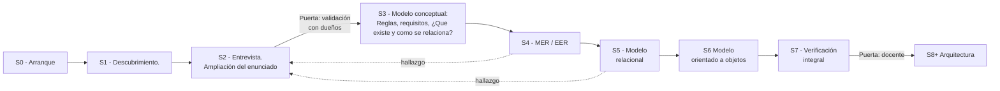

# S0 - Start Of Cycle 2 - MIRM

## Objetivo de la etapa

Poder trazar un plan coherente para empezar el ciclo 2, documentarse correctamente, alineados como equipo, tomando en cuenta cada error ya cometido.

En esta etapa no se entrevista a los dueños, no se modela, escribe código ni se corrige versiones anteriores; todo es puramente el trazado de un plan funcional.
## Insumos

- [[First Try Review - MIRM]].
- Calendario del proyecto de Bases de Datos
- Integrantes: Devans, Gustavo, Kenry.
- [[Plan de reinicio - MIRM]]

## Actividades

- [x] Archivar intento 1. ✅ 2026-10-19
- [x] Empezar retrospectiva del intento 1. ✅ 2026-10-19
- [x] Crear notas con registros. ✅ 2026-10-19
- [x] Acordar roles y calendario. ✅ 2026-10-19
- [x] Planear como compartir la documentación. ✅ 2026-10-19

---
## Producto

### 1. Roles (establecidos por conveniencia)

- **Documentación:** Kenry
- **Evaluación y ajustes:** Devans, Gustavo
- **Contacto con los dueños:** Kenry

Cambios en la documentación de GitHub los pueden hacer todos los miembros del equipo, pero tiene que registrar en el LogBook, consultar con el equipo y pasar los filtros necesarios, acordados como equipo de trabajo.

**Filtros**

- Sugerencias en cuanto a los registros se presentan al grupo de WhatsApp.
- Si una sugerencia supone cambios relevantes al sistema o desarrollo actual deriva en una decisión.
- Las decisiones se conversan como equipo, justificando correctamente y la registra Kenry, si no está disponible la escribe quien la propuso.
- Si no está de acuerdo al menos uno del grupo para confirmar el cambio hay que esperar.
- Responder ¿Qué voy a documentar? ¿Para qué lo voy a documentar? ¿En qué afecta el proyecto? ¿De donde surgió la idea? ¿Presento información profesional necesaria en caso de ser necesaria?

### 2. Calendario

| Etapa                                                                                                                 | Inicio                           | Fecha objetivo               |
| --------------------------------------------------------------------------------------------------------------------- | -------------------------------- | ---------------------------- |
| **S1** - Descubrimiento: [[First Try Review - MIRM\|Revisión crítica]], segmentar el enunciado, preparar entrevistas. | Martes: 20-oct                   | Martes: 20-oct - 11:50AM     |
| **S2** - Entrevista: entrevistar a los dueños y ampliar el enunciado.                                                 | Miércoles: 21-oct                | Miércoles: 21-oct - 09:00 PM |
| **S3** - Modelo conceptual: definir reglas y requisitos, identificar qué cosas existen y cómo se relacionan.          | Jueves: 22-oct - 08:30 AM (UNI)  | Jueves: 22-oct - 11:00 PM    |
| **S4** - MER / EER: formalizar atributos, identificadores, cardinalidades y participación.                            | Viernes: 23-oct - 08:30 AM (UNI) | Viernes: 23-oct - 11:00 AM   |
| **S5** - Modelo relacional                                                                                            | Sábado: 24-oct - 07:30 PM        | Lunes 26-oct                 |
| **S6** - Modelo orientado a objetos                                                                                   | Martes 27-oct                    | Miércoles 28-oct             |
| **S7** - Verificación integral: probar el modelo con datos reales.                                                                                 | Jueves 29-oct                    | Viernes 30-oct               |
| **S8** - Arquitectura y construcción:                                                                                 | Lunes 02-nov                     | -                            |

## 2. El workflow en una imagen

### 4. Acuerdos de trabajo

 - Entrevistar dueños: Miércoles 21 - Octubre / 10:00 AM
 - Reunirnos en la UNI: Jueves y Viernes (22 y 23 Octubre) / 08:30 AM
 - Llamada en Discord: Jueves 22 - Octubre / 8:30 PM
 - Llamada en Discord: Viernes 23 - Octubre / 8:30 PM
 - Reunirnos en la UNI: Martes 27 Octubre / 08:30 AM
- El documentador escribe la bitácora **el mismo día** de la reunión.
- Antes de discutir un modelo, cada uno **trabaja por separado**.
- Si alguien falta, lee la bitácora y revisa las **Stage** antes de la siguiente reunión.
- Se preparará un nuevo calendario cuando se hayan cerrado las etapas de modelado y entremos en arquitectura y desarrollo del sistema.

### 5. Decisiones de esta etapa

- [[Projects/Motor IRM/Decisions/DEC-001 - Sharing information - MIRM|Compartir información en GitHub]]

---
### Revisión de IA (Claude responde esto)

> [!info] Cómo leer esta revisión
> - **Revisor:** Claude (IA), como revisor crítico, no como autor. **Fecha:** 2026-10-19.
> - **Qué se revisó:** esta nota (S0) y [[Projects/Motor IRM/Decisions/DEC-001 - Sharing information - MIRM|DEC-001]].
> - **Contra qué:** [[Plan de reinicio - MIRM]] y [[First Try Review - MIRM]].
> - **No incluye soluciones:** cada hallazgo termina en una pregunta para el equipo.
> - **Severidad:** 🔴 Alta (afecta el método o puede repetir un error del intento 1) · 🟠 Media (afecta la confianza en un resultado) · 🟡 Baja (claridad u orden).

| #   | Hallazgo                                                                                                                                                                                                                                                                                                                                                                                                                          | Evidencia                                                                                              | Severidad | Pregunta para el equipo                                                                                                                               |
| --- | --------------------------------------------------------------------------------------------------------------------------------------------------------------------------------------------------------------------------------------------------------------------------------------------------------------------------------------------------------------------------------------------------------------------------------- | ------------------------------------------------------------------------------------------------------ | --------- | ----------------------------------------------------------------------------------------------------------------------------------------------------- |
| 1   | El calendario no deja tiempo para las puertas del plan. S1 dura una mañana; S2 (entrevista + enunciado + reglas) un día; S3 y S4 un día cada una. La validación del enunciado con los dueños (puerta de S2) cae el mismo día de la entrevista, sin tiempo para escribir el enunciado y volver a validarlo.                                                                                                                        | §2 Calendario: S1 20-oct hasta 11:50 a. m.; S2 21-oct; S3 22-oct; S4 23-oct.                           | 🔴        | ¿Qué pasa con el calendario si una puerta no se cumple en la fecha? ¿Se avanza igual o se mueve todo?                                                 |
| 2   | El calendario cambia el contenido de las etapas respecto al plan: la entrevista pasa de S1 a S2, y las reglas y requisitos pasan de S2 a S3. S7 (verificación) no aparece: se salta de S6 a S8.                                                                                                                                                                                                                                   | §2 Calendario vs. [[Plan de reinicio - MIRM]] §4.                                                      | 🔴        | ¿El equipo decidió cambiar las etapas del plan? Si es así, ¿dónde queda registrado ese cambio y por qué se hizo?                                      |
| 3   | La retrospectiva, que era el insumo principal de S0, no está en la nota. La actividad dice "Empezar retrospectiva" (marcada como hecha) y el criterio "Retrospectiva escrita con al menos 3 cambios concretos" desapareció del criterio de cierre.                                                                                                                                                                                | §Actividades; §Criterio de cierre; no hay sección de retrospectiva en §Producto.                       | 🔴        | ¿Qué aprendió el equipo del intento 1 y qué va a hacer distinto? ¿Dónde lo puede leer alguien que no estuvo en la reunión?                            |
| 4   | Una sola persona concentra la documentación y el contacto con los dueños, que son los dos problemas señalados en el intento 1 (W-06 y W-09). La DEC-001 refuerza esto: "Kenry será quien documente lo demás… al ser el único que tiene contacto directo con los dueños".                                                                                                                                                          | §1 Roles; DEC-001 §Contexto; [[First Try Review - MIRM]] W-06, W-09.                                   | 🟠        | Si Kenry no puede asistir a una entrevista o se enferma una semana, ¿quién la hace y quién la documenta?                                              |
| 5   | El repositorio de GitHub y el vault de Obsidian pueden convertirse en **dos fuentes de verdad**: una parte se edita en GitHub (Records, Stages, Sources…) y el resto solo en el vault. No se define qué copia manda si las dos difieren.                                                                                                                                                                                          | DEC-001 §Contexto (lista de carpetas que se suben) y §Riesgos ("que no se sincronicen correctamente"). | 🟠        | Si un compañero edita una regla en GitHub y Kenry la edita en Obsidian el mismo día, ¿cuál queda como válida y cómo se entera el otro?                |
| 6   | Las carpetas que se comparten dejan fuera **Decisions**, **Reviews**, el Hub y el Centro de trabajo. El equipo no vería las decisiones que debe discutir, las revisiones que debe responder, el estado del proyecto ni la próxima tarea. Además, la lista menciona "Sources", que no existe en la carpeta del proyecto.                                                                                                           | DEC-001 §Contexto; estructura actual del proyecto.                                                     | 🟠        | ¿Cómo sabe un compañero cuál es la próxima tarea o qué decisiones están abiertas si esas notas no están en el repositorio?                            |
| 7   | En la DEC-001, la opción elegida no tiene desventajas reales: su columna "En contra" lista beneficios. Por eso obtiene ✅ en todo. El costo que sí se reconoce después ("doble trabajo de parte de Kenry") no aparece en las opciones ni en los criterios. La justificación ("cumple con todos los criterios más coherentes") es circular. Falta "Cuándo revisarla". Los enlaces de navegación apuntan a la panadería del ejemplo. | DEC-001 §Opciones (fila D), §Comparación, §Decisión, §Consecuencias.                                   | 🟠        | Si se escribieran las desventajas reales de D, ¿seguiría ganando con la misma claridad? ¿Qué señal concreta haría que el equipo reabra esta decisión? |
| 8   | Los filtros de trabajo permiten que una sola persona bloquee un cambio sin plazo ("si no está de acuerdo al menos uno… hay que esperar"), con un calendario de un día por etapa. Además, las sugerencias se discuten por WhatsApp: el razonamiento queda fuera de la documentación, el mismo patrón que hizo perder la primera entrevista.                                                                                        | §1 Roles → Filtros.                                                                                    | 🟠        | Si el desacuerdo dura más de un día, ¿cómo se resuelve? ¿Dónde queda escrito lo que se discutió por WhatsApp?                                         |
| 9   | El resultado y el criterio de cierre no coinciden con el producto y no siempre se pueden verificar. "Tabla de roles para 2 semanas" no existe (los roles son una lista fija); "Definición de las demás Stage, dejando el camino para luego programar" va más allá del objetivo de S0; "Solo quien puede escribir la documentación" sigue siendo ambiguo. Ningún criterio indica dónde está su evidencia.                          | §Resultado; §Criterio de cierre.                                                                       | 🟠        | ¿Podría alguien externo marcar cada casilla del criterio de cierre leyendo solo esta nota?                                                            |
| 10  | El diagrama del workflow está copiado del plan dentro del producto de S0 (dos copias de lo mismo). La numeración de secciones salta ("## 2." después de "### 2.", falta el 3). `source:` está vacío. Hay mezcla de idiomas: carpetas en inglés (`Records`), pero el resultado dice "Registros vacíos en `Registros/`".                                                                                                            | §Producto; propiedades; §Resultado.                                                                    | 🟡        | ¿Qué convención de idioma y de numeración va a seguir el equipo en todas las notas?                                                                   |

**Respuesta del equipo**

| #   | ¿De acuerdo?                                                                                                                                                              | Por qué                                                                                                                                                                                                                                                           | Acción (si aplica)                                                                                                                                                |
| --- | ------------------------------------------------------------------------------------------------------------------------------------------------------------------------- | ----------------------------------------------------------------------------------------------------------------------------------------------------------------------------------------------------------------------------------------------------------------- | ----------------------------------------------------------------------------------------------------------------------------------------------------------------- |
| 1   | Si, pero con matices. No hay tiempo, tenemos que ajustarnos, si sobre la marcha surgen retrasos se puede extender el calendario.                                          | Queda poco tiempo para la entrega del proyecto.                                                                                                                                                                                                                   | Se queda el calendario actual. Si una puerta no cumple con la fecha se retrasa el calendario.                                                                     |
| 2   | Se acordó de esa forma por conveniencia como equipo y la forma de distribuir el tiempo, ademas, la disponibilidad con los dueños y choques con horarios/tareas de clases. | No decidimos seguir al pie de la letra el plan, decidimos trazar lo que mejor nos conviene.                                                                                                                                                                       | Mantenemos la distribución trazada en el calendario.                                                                                                              |
| 3   | La retrospectiva fue un acuerdo hablado como grupo.                                                                                                                       | Se usó el tiempo para otras cuestiones. Al evaluarse [[First Try Review - MIRM]] surgirán criterios, pero la retrospectiva no se vió como prioridad por cuestión de tiempo y disponibilidad.                                                                      | Se decidió no registrarse, así ese tiempo de reunión fue utilizado para trazar un plan estricto y ajustado en las etapas.                                         |
| 4   | Totalmente de acuerdo, pero no por ser ese el caso es definición de la verdad en lo que se falló al hacer el primer intento.                                              | El negocio queda a 200km de distancia y el único conocido con los dueños es Kenry, ademas, tienden a mantener bastante ocupados, a eso se le suma que inicialmente Kenry es quien usaba Obsidian. El enfoque de el segundo intento es usar menos IA, no Obsidian. | Se mantiene la forma de trabajar, pero con mayor intervención del resto del equipo, reforzado con reuniones presenciales.                                         |
| 5   | Será registrado en conjunto.                                                                                                                                              | Hay privacidad en el vault que se quiere mantener.                                                                                                                                                                                                                | Cada cambio en GitHub será notificado para registrarse en Obsidian.                                                                                               |
| 6   | El Hub y el centro de trabajo es descripción del proyecto, el Hub es basicamente el Readme. Decisions está en GitHub, fue error de contexto.                              |                                                                                                                                                                                                                                                                   | El Hub es personal cada quien tendrá acceso a las Stage y se repartirá según convenga, ademas que la mayoría de Stage se harán en reuniones presenciales          |
| 7   | Totalmente de acuerdo.                                                                                                                                                    | Se tomaron en cuenta esos criterios según las facilidades del equipo.                                                                                                                                                                                             | Se mantiene la decisión tal cual, no hay tiempo.                                                                                                                  |
| 8   | Si.                                                                                                                                                                       | Se necesita decidir como equipo, asi que se tiene que corroborar una decisión importante, ademas de los cortos tiempos son acompañados con reuniones presenciales como equipo.                                                                                    | Se mantiene, si algo se discute por whatsapp quedan los chats para registrar en Obsidian.                                                                         |
| 9   | Hubo errores de reporte, ya corregidos.                                                                                                                                   | La evidencia en esta etapa no se vió necesario registrar, los demas si se registrará en la medida de lo posible.                                                                                                                                                  | Se corrigen errores de ideas. La ambiguedad se mantieene en caso de cambiar algo conrespecto a quien reporta en Obsidian (muy poco probable, imposible diriamos). |
| 10  | si                                                                                                                                                                        | no tiene nada de malo de copiar el plan, solo se cambiaran cuestionesde escritura en el diagrama                                                                                                                                                                  | se mantiene tal cual está.                                                                                                                                        |

## Resultado

- Definición de las demás Stage, dejando el camino para luego programar.
- Calendario para 2 semanas con mucho trabajo.
- [[Projects/Motor IRM/Decisions/DEC-001 - Sharing information - MIRM|Compartir información en GitHub]]
- Intento 1 en [[000 - Motor IRM - First Version]]
- Registros vacíos en `Records/`

## Criterio de cierre

- [x] Intento 1 archivado y estructura nueva creada. ✅ 2026-10-19
- [x] Calendario con fecha objetivo por etapa. ✅ 2026-10-19
- [x] Solo quien puede escribir la documentación. ✅ 2026-10-19
- [x] Decisión sobre como compartir documentación. ✅ 2026-10-19
- [x] Stages definidas. ✅ 2026-10-19

