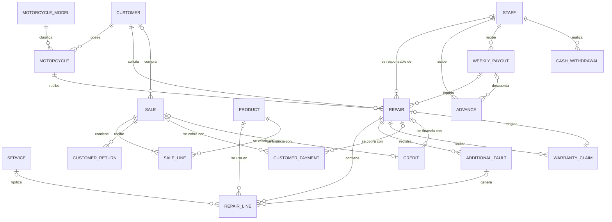
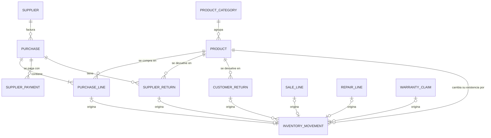
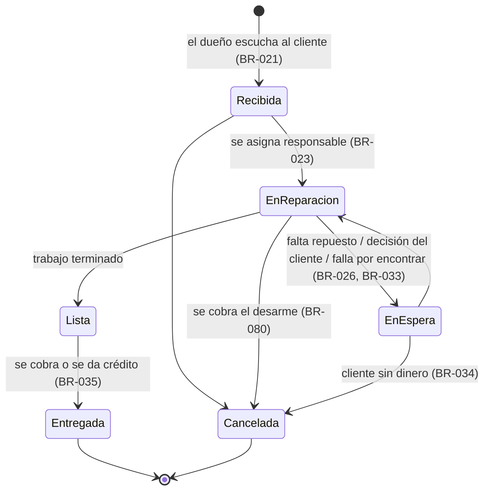

**[[Motor IRM|← Hub]]** · **[[S3 - Develop a Conceptual Model - MIRM|← S3]]** · **[[S3 - Potential Entities - MIRM|Potential Entities]]** · **[[Business Rules - MIRM|📏 Business Rules]]** · **[[Traceability - MIRM|🔗 Traceability]]**

# S3 - Conceptual Model - MIRM

> [!warning] Hecho por IA — pendiente de revisión del equipo
> Cada entidad, atributo y relación cita la regla (`BR`) que lo justifica. Lo que no tiene regla está marcado **S (sugerido)** y se puede quitar sin romper nada. Cuando el equipo esté de acuerdo, marquen `reviewed` y llenen el criterio de cierre de [[S3 - Develop a Conceptual Model - MIRM|S3]].

> [!info] Cómo leer esta nota
> - **Qué es:** el modelo conceptual dice **qué existe** en el negocio, **qué datos tiene** y **cómo se relaciona**, sin pensar todavía en tablas.
> - **Qué no es:** aquí no hay llaves primarias, tipos de datos ni normalización. Las cardinalidades están **en palabras** ("una o varias") y en el diagrama son **preliminares**: se formalizan en S4 (MER/EER).
> - **Nombres:** en español, como en el [[Glossary - MIRM|glosario]]. La columna **ID (S4/S5)** propone el nombre en inglés para el diagrama y para las tablas, según la convención del proyecto.
> - **Marcas de los atributos:**
> 	- **O** — opcional (puede quedar vacío).
> 	- **D** — derivado: se **calcula**, no se escribe a mano (ver §6).
> 	- **H** — histórico: se **copia en el momento** y no cambia aunque cambie el original (por ejemplo, el precio con el que se vendió).
> 	- **S** — sugerido por la IA, sin regla que lo pida. Confirmar o quitar.
> 	- *(sin marca)* — obligatorio y con fuente.
> - **"Básico":** atributo sin regla explícita pero necesario para distinguir una cosa de otra (por ejemplo, el nombre de un proveedor).

---

## 1. Vista general

| ID | Entidad | ID (S4/S5) | Qué es | Grupo |
| --- | --- | --- | --- | --- |
| E-01 | Cliente | `Customer` | Persona que compra o trae una moto al taller. | Personas |
| E-02 | Personal | `Staff` | Dueños, mecánicos y encargado. | Personas |
| E-03 | Moto | `Motorcycle` | Moto de un cliente que entra al taller. | Motos |
| E-04 | Modelo de moto | `MotorcycleModel` | Catálogo de modelos (con su marca). | Motos |
| E-05 | Categoría de producto | `ProductCategory` | Repuestos, accesorios, lubricantes, llantas… | Inventario |
| E-06 | Producto | `Product` | Lo que se compra, se vende y se cuenta. | Inventario |
| E-07 | Movimiento de inventario | `InventoryMovement` | Cada entrada o salida de un producto, con su motivo. | Inventario |
| E-08 | Proveedor | `Supplier` | Quien le vende mercancía al negocio. | Compras |
| E-09 | Compra | `Purchase` | Una factura de compra a un proveedor. | Compras |
| E-10 | Detalle de compra | `PurchaseLine` | Un producto de la factura, con su costo. | Compras |
| E-11 | Pago a proveedor | `SupplierPayment` | Pago de una compra al crédito. | Compras |
| E-12 | Devolución a proveedor | `SupplierReturn` | Producto dañado que cubre el proveedor. | Compras |
| E-13 | Venta | `Sale` | Venta de productos en la tienda. | Ventas |
| E-14 | Detalle de venta | `SaleLine` | Un producto vendido, con su precio. | Ventas |
| E-15 | Devolución de cliente | `CustomerReturn` | Producto empacado que el cliente devuelve. | Ventas |
| E-16 | Servicio | `Service` | Catálogo de servicios del taller (opcional). | Taller |
| E-17 | Reparación | `Repair` | Trabajo que se le hace a una moto. | Taller |
| E-18 | Detalle de reparación | `RepairLine` | Cada línea que se cobra en una reparación. | Taller |
| E-19 | Falla adicional | `AdditionalFault` | Falla nueva que se le consulta al cliente. | Taller |
| E-20 | Reclamo de garantía | `WarrantyClaim` | El cliente regresa por una reparación anterior. | Taller |
| E-21 | Pago de cliente | `CustomerPayment` | Cada cobro (efectivo o transferencia, C$ o US$). | Cobros |
| E-22 | Crédito | `Credit` | Venta o reparación que se paga después. | Cobros |
| E-23 | Adelanto | `Advance` | Dinero que se le adelanta a un mecánico. | Mecánicos |
| E-24 | Pago semanal | `WeeklyPayout` | El pago del sábado a un mecánico. | Mecánicos |
| E-25 | Retiro de caja | `CashWithdrawal` | Dinero que los dueños sacan de la caja (viajes, limpieza, impuesto). | Caja |
| E-26 | Historial de precio *(versión 2)* | `PriceHistory` | Precio anterior de un producto (Q-001: deseable). | Inventario |

---

## 2. Diagramas (cardinalidades preliminares)

> Notación pata de gallo: `||` exactamente uno · `|o` cero o uno · `|{` uno o varios · `o{` cero o varios. Se revisa en S4.

### 2.1 Taller, ventas, cobros y mecánicos

### 2.2 Productos, compras e inventario

> [!note] Lo que el diagrama no puede mostrar
> - Un **Pago de cliente** se aplica a **una venta o a una reparación, nunca a las dos** (arco exclusivo). Lo mismo un **Crédito**.
> - Un **Movimiento de inventario** tiene **un solo origen** (o ninguno, si es inventario inicial o ajuste).
> - Estas "o exclusivas" son la señal para la **generalización** de §7, que se decide en S4.

---

## 3. Entidades y atributos

### E-01 Cliente
Persona que compra en la tienda o trae una moto al taller. En una venta rápida de contado no se registra (BR-038). Un mecánico que compra productos para su propia moto también es cliente (DEC-003).

| Atributo | Descripción | Marca | Origen |
| --- | --- | --- | --- |
| nombre | Nombre del cliente. | | BR-039 |
| teléfono | Número de contacto. | | BR-039 |
| cédula | Solo se pide para dar crédito. | O | BR-040 |
| dirección | Solo se pide para dar crédito. | O | BR-040 |

### E-02 Personal
Las personas que trabajan en el negocio. El **rol** dice qué puede hacer cada una.

| Atributo | Descripción | Marca | Origen |
| --- | --- | --- | --- |
| nombre | | | Básico |
| rol | Dueño, mecánico o encargado. | | BR-007, BR-008, BR-044 |
| porcentaje de comisión | Solo para mecánicos (hoy 60 % y 100 %). | O | BR-044 |
| teléfono | | O, S | — |
| activo | Si sigue trabajando; un mecánico que se va no se borra, porque sus reparaciones quedan en el historial. | S | — |

> **Restricciones:** solo el **dueño** autoriza créditos, rebajas y retiros (BR-009 a BR-011). El **encargado** solo atiende ventas (BR-008). Los mecánicos no usan el sistema (BR-007).
> Las cuentas de acceso (usuario y contraseña) son parte del diseño del programa (S6), no del negocio.

### E-03 Moto

| Atributo | Descripción | Marca | Origen |
| --- | --- | --- | --- |
| color | | | BR-041 |
| modelo | → E-04 (relación R-02). | | BR-041 |
| cliente actual | → E-01 (relación R-01). | | BR-041 |
| placa | Ayuda a no confundir dos motos iguales del mismo cliente. Los dueños dijeron "solo modelo y color". | O, S | Q-048 |
| observaciones | | O, S | — |

### E-04 Modelo de moto

| Atributo | Descripción | Marca | Origen |
| --- | --- | --- | --- |
| nombre del modelo | | | BR-041 |
| marca | Nombre de la marca. Atributo, no entidad (ver Potential Entities #9). | O | BR-041 |

### E-05 Categoría de producto

| Atributo | Descripción | Marca | Origen |
| --- | --- | --- | --- |
| nombre | Repuestos, accesorios, lubricantes, llantas… | | BR-004 |

### E-06 Producto

| Atributo | Descripción | Marca | Origen |
| --- | --- | --- | --- |
| nombre | | | Básico |
| código | Para buscarlo rápido al vender (los dueños quieren "dilatarse menos vendiendo"). | O, S | SRC-05 (Q-004) |
| unidad de venta | *Unidad* o *litro* (el aceite solo por litro). | | BR-005 |
| precio de venta | Lo fija el dueño. | | BR-015, BR-016 |
| último costo | Costo de la última factura de compra. | D | BR-014, BR-016 |
| existencia | Entradas − salidas de sus movimientos. | D | BR-020 |
| categoría | → E-05. | | BR-004 |
| marca | Pendiente. | O | Q-066 |
| activo | Para dejar de venderlo sin borrar su historia. | S | — |

### E-07 Movimiento de inventario
Cada vez que un producto entra o sale, queda un movimiento. Es el "kardex" del negocio: de aquí se calcula la existencia.

| Atributo | Descripción | Marca | Origen |
| --- | --- | --- | --- |
| fecha y hora | | | BR-020 |
| producto | → E-06. | | BR-020 |
| tipo | Entrada o salida. | | BR-020 |
| motivo | Compra · venta · uso en reparación · devolución de cliente · devolución a proveedor · garantía · consumo interno · inventario inicial o ajuste. | | BR-079, Q-072 |
| cantidad | En la unidad del producto (litros para el aceite). | | BR-005, BR-020 |
| costo unitario | Costo en ese momento. | H | BR-014 |
| origen | El documento que lo causó (relación R-25). Vacío en inventario inicial o ajuste. | O | BR-079 |
| registrado por | → E-02. | | BR-007 |
| observación | Obligatoria en ajustes. | O, S | — |

### E-08 Proveedor

| Atributo | Descripción | Marca | Origen |
| --- | --- | --- | --- |
| nombre | | | BR-012 |
| teléfono | | O | Q-002 (abierta) |
| persona de contacto | | O | Q-002 (abierta) |

### E-09 Compra
Corresponde a una **factura de compra**.

| Atributo | Descripción | Marca | Origen |
| --- | --- | --- | --- |
| número de factura | El que trae la factura del proveedor. | | BR-013 |
| fecha | | | BR-013 |
| proveedor | → E-08. | | BR-013 |
| condición | Contado o crédito. | | BR-017 |
| fecha límite de pago | Solo si es al crédito. | O, S | — |
| total | Suma de sus detalles. | D | BR-013 |
| saldo pendiente | Total − pagos al proveedor. | D | BR-017 |
| recibida por | → E-02 (dueño). | | BR-007 |

### E-10 Detalle de compra

| Atributo | Descripción | Marca | Origen |
| --- | --- | --- | --- |
| producto | → E-06. | | BR-014 |
| cantidad | | | BR-014 |
| costo unitario | El de la factura. | H | BR-014 |
| subtotal | Cantidad × costo. | D | — |

### E-11 Pago a proveedor

| Atributo | Descripción | Marca | Origen |
| --- | --- | --- | --- |
| fecha | | | BR-017 |
| monto | | | BR-017 |
| moneda | Córdobas o dólares (a proveedores se les puede pagar en dólares). | | BR-057, SRC-04 (Q-051) |
| tipo de cambio | Si se pagó en dólares. | O, H | BR-058 |
| compra | → E-09 (si un pago puede cubrir varias facturas, cambia: Q-070). | | BR-017 |

### E-12 Devolución a proveedor

| Atributo | Descripción | Marca | Origen |
| --- | --- | --- | --- |
| fecha | | | BR-018 |
| compra | → E-09. | | BR-018 |
| producto | → E-06. | | BR-018 |
| cantidad | | | BR-018 |
| motivo | Producto dañado. | | BR-018 |
| resolución | Reposición, dinero o descuento en otra compra. | O | Q-074 (abierta) |

### E-13 Venta

| Atributo | Descripción | Marca | Origen |
| --- | --- | --- | --- |
| fecha y hora | Para saber cuánto se vendió en el día (SRC-01: "no saben, literalmente nada"). | | Básico, SRC-01 |
| número de comprobante | El que va impreso. | | BR-060 |
| cliente | → E-01. Obligatorio solo si es al crédito. | O | BR-038, BR-062 |
| registrada por | → E-02 (dueño o encargado). | | BR-007, BR-008 |
| condición | Contado o crédito. | | BR-056 |
| rebaja | Monto rebajado. | O | BR-061 |
| rebaja autorizada por | → E-02 (dueño). | O | BR-010 |
| total | Suma de detalles − rebaja. | D | — |
| estado | Vigente o anulada (para corregir errores sin borrar). | S | — |

### E-14 Detalle de venta

| Atributo | Descripción | Marca | Origen |
| --- | --- | --- | --- |
| producto | → E-06. | | BR-002 |
| cantidad | En litros para el aceite. | | BR-005 |
| precio unitario | El precio en el momento de la venta. | H | BR-016 |
| subtotal | | D | — |

### E-15 Devolución de cliente

| Atributo | Descripción | Marca | Origen |
| --- | --- | --- | --- |
| fecha | | | BR-069 |
| venta | → E-13. | | BR-069 |
| producto devuelto y cantidad | → E-06. Debe estar empacado; no eléctrico ni maltratado. | | BR-069, BR-070 |
| resultado | Cambio o reembolso. | | BR-069 |
| producto entregado a cambio | Solo si es cambio. | O | BR-069 |
| monto reembolsado | Solo si es reembolso. | O | BR-069 |
| autorizada por | → E-02 (dueño). | S | — |

### E-16 Servicio *(catálogo, opcional)*

| Atributo | Descripción | Marca | Origen |
| --- | --- | --- | --- |
| nombre | Engrase, trabajo de motor… | | BR-030 |
| precio de referencia | Solo orienta: el engrase varía según la moto. | O | BR-030, BR-031 |

### E-17 Reparación
El trabajo que se le hace a **una moto** de **un cliente**. Puede crecer mientras está en el taller (fallas adicionales) y termina **entregada** o **cancelada**.

| Atributo | Descripción | Marca | Origen |
| --- | --- | --- | --- |
| fecha de ingreso | | | BR-021 |
| moto | → E-03. | | BR-042 |
| cliente | → E-01. Quien la trae y paga (se guarda aunque la moto cambie de dueño). | | BR-039, BR-043 |
| lo que pide el cliente | Falla reportada o trabajo concreto: define el alcance. | | BR-021, BR-022 |
| diagnóstico | Lo que se encontró. | O | BR-022 |
| responsable | → E-02 (mecánico o dueño). Vacío mientras está *Recibida*. | O | BR-023, BR-024 |
| estado | Ver §4.1. | | BR-033, BR-080, Q-071 |
| motivo de espera | Repuesto, decisión del cliente o falla por encontrar. | O | BR-033 |
| fecha de entrega | Reemplaza a la candidata *Entrega_Motocicleta*. | O | BR-035 |
| número de comprobante | | O | BR-060 |
| condición | Contado o crédito. | | BR-056 |
| rebaja | Acordada con el mecánico. | O | BR-050 |
| monto por cancelación | Lo que se cobra si se cancela con trabajo hecho (ej. desarme). | O | BR-080 |
| porcentaje aplicado | Porcentaje del responsable **en ese momento**. Vacío si lo hizo un dueño. | H | BR-044, BR-051 |
| total mano de obra | Suma de líneas de mano de obra − rebaja. | D | BR-045 |
| comisión | Total mano de obra × porcentaje aplicado (cero si la hizo un dueño). | D | BR-045, BR-051 |
| total | Suma de todas las líneas − rebaja (o monto por cancelación). | D | — |
| recibida por | → E-02 (dueño). | | BR-021 |

### E-18 Detalle de reparación

| Atributo | Descripción | Marca | Origen |
| --- | --- | --- | --- |
| tipo de línea | Mano de obra · producto de la tienda · producto del cliente · trabajo externo (torno). | | BR-003, BR-032, BR-037, BR-082 |
| descripción | | | BR-003 |
| servicio | → E-16, si corresponde a uno del catálogo. | O | BR-030 |
| producto | → E-06, solo si es de la tienda (genera salida de inventario). | O | BR-003, BR-020 |
| cantidad | Solo para productos. | O | BR-003 |
| monto | Precio cobrado. Cero para producto del cliente; costo del torno para trabajo externo. | H | BR-029, BR-032, BR-082 |
| falla adicional | → E-19, si la línea es un agregado aceptado. | O | BR-027 |

### E-19 Falla adicional
Queda registrada **aunque el cliente la rechace**: es la prueba de que se le advirtió (no hay garantía sobre esa falla).

| Atributo | Descripción | Marca | Origen |
| --- | --- | --- | --- |
| fecha | | | BR-026 |
| descripción | | | BR-026 |
| precio propuesto | | O | BR-027 |
| decisión del cliente | Pendiente, aceptada o rechazada. | | BR-026 a BR-028 |

### E-20 Reclamo de garantía

| Atributo | Descripción | Marca | Origen |
| --- | --- | --- | --- |
| fecha | Debe ser pocos días después de la entrega. | | BR-072 |
| reparación original | → E-17. | | BR-071 |
| descripción | Lo que reporta el cliente. | | BR-071 |
| resultado | Cubierto por garantía · falla distinta (nueva reparación) · fuera de plazo. | | BR-071 a BR-073 |
| atendido por | → E-02 (dueño). | | BR-074 |
| reparación nueva | → E-17, si es falla distinta y el cliente acepta. | O | BR-073 |

### E-21 Pago de cliente

| Atributo | Descripción | Marca | Origen |
| --- | --- | --- | --- |
| fecha | | | BR-056 |
| monto | | | BR-056 |
| moneda | Córdobas o dólares. | | BR-057 |
| tipo de cambio | El que fijó el dueño, si fue en dólares. | O, H | BR-058 |
| método | Efectivo o transferencia. | | BR-056 |
| aplica a | Una venta **o** una reparación (R-26). | | BR-056 |
| recibido por | → E-02. | | BR-007, BR-035 |

> El **vuelto** no se guarda: se calcula en el momento (BR-059).

### E-22 Crédito

| Atributo | Descripción | Marca | Origen |
| --- | --- | --- | --- |
| fecha de otorgamiento | | | BR-062 |
| operación | La venta **o** la reparación que financia (R-27). | | BR-062 |
| autorizado por | → E-02 (dueño). | | BR-009 |
| fecha de vencimiento | Normalmente un mes. | | BR-064 |
| nueva fecha de vencimiento | Si el dueño alarga el plazo. | O | BR-066 |
| interés mensual | 8 % si se pidió a tres meses; cero normalmente. | O | BR-067, BR-068 |
| monto | Total de la operación (+ interés). | D | BR-065, BR-068 |
| saldo | Monto − pagos aplicados. | D | BR-066 |
| estado | Vigente, vencido o pagado (vencido se calcula con la fecha). | D | BR-064 a BR-066 |

### E-23 Adelanto

| Atributo | Descripción | Marca | Origen |
| --- | --- | --- | --- |
| fecha | | | BR-048 |
| monto | | | BR-048 |
| mecánico | → E-02. | | BR-048 |
| entregado por | → E-02 (dueño). | | BR-007 |
| pago semanal | → E-24 donde se descontó. Vacío hasta el sábado. | O | BR-049 |

### E-24 Pago semanal

| Atributo | Descripción | Marca | Origen |
| --- | --- | --- | --- |
| mecánico | → E-02. | | BR-046 |
| fecha de inicio y fin de la semana | | | BR-046 |
| fecha de pago | Normalmente sábado; otro día si hay feriado. | | BR-046 |
| total de comisiones | Suma de las comisiones de las reparaciones que liquida. | D | BR-045, BR-047 |
| total de adelantos | | D | BR-049 |
| monto neto | Comisiones − adelantos. Se paga en efectivo. | D | BR-049, BR-081 |
| pagado por | → E-02 (dueño). | | BR-007 |

### E-25 Retiro de caja

| Atributo | Descripción | Marca | Origen |
| --- | --- | --- | --- |
| fecha | | | BR-075 |
| monto | | | BR-075 |
| motivo | Viaje de compras · limpieza · impuesto · otro. | | BR-075, BR-076, BR-078 |
| descripción | | O | — |
| realizado por | → E-02 (dueño). | | BR-011 |

### E-26 Historial de precio *(versión 2)*

| Atributo | Descripción | Marca | Origen |
| --- | --- | --- | --- |
| producto | → E-06. | | BR-016 |
| precio anterior y precio nuevo | | | SRC-05 (Q-001) |
| fecha del cambio | | | SRC-05 (Q-001) |

---

## 4. Estados y procesos

### 4.1 Reparación

> Los nombres de los estados se confirman con los dueños (Q-071). *"Apartada"* (glosario) parece una ubicación física de una moto *Lista* o *En espera*, no un estado aparte.

### 4.2 Falla adicional
**Pendiente** → **Aceptada** (genera líneas en el detalle, BR-027) · **Rechazada** (sin garantía sobre esa falla, BR-028).

### 4.3 Crédito

### 4.4 Otros
- **Reclamo de garantía:** Abierto → Cubierto · Falla distinta (nueva reparación) · Fuera de plazo (BR-071 a BR-073).
- **Compra al crédito:** Pendiente → Pagada (cuando el saldo llega a cero; se calcula).
- **Pago semanal:** Calculado → Pagado.

### 4.5 Procesos principales

| ID | Proceso | Pasos (en lenguaje del negocio) | Entidades | Reglas |
| --- | --- | --- | --- | --- |
| P-01 | **Venta rápida** | El dueño o el encargado busca los productos → se anotan con su precio actual → si es al crédito, se identifica al cliente y un dueño lo autoriza → se cobra (C$ o US$, efectivo o transferencia) → se imprime el comprobante → cada producto sale del inventario. | E-13, E-14, E-21, E-22, E-07 | BR-002, BR-008, BR-009, BR-056 a BR-060 |
| P-02 | **Reparación** | El dueño recibe al cliente y la moto y anota lo que pide → asigna un responsable → se trabaja y se agregan líneas; cada falla adicional se consulta → si falta un repuesto o una decisión, queda *En espera* → *Lista* → se cobra o se da crédito → *Entregada*. Si el cliente cancela, se cobra lo trabajado → *Cancelada*. | E-01, E-03, E-17 a E-19, E-21, E-22, E-07 | BR-021 a BR-037, BR-080 |
| P-03 | **Compra** | Llega la factura → se anotan los productos con su costo → entran al inventario → el dueño revisa el precio de venta → si es al crédito, se registran los pagos después → si algo llegó dañado, devolución al proveedor. | E-08 a E-12, E-07 | BR-012 a BR-018 |
| P-04 | **Cobro de un crédito** | Se registran los pagos hasta que el saldo llega a cero; el dueño puede alargar el plazo. | E-22, E-21 | BR-062 a BR-068 |
| P-05 | **Pago semanal** | Para cada mecánico: reparaciones que hizo en la semana (no las de los dueños) → suma de comisiones − adelantos → pago en efectivo; las reparaciones y los adelantos quedan marcados como liquidados. | E-02, E-17, E-23, E-24 | BR-044 a BR-051, BR-081 |
| P-06 | **Garantía** | El cliente reclama → un dueño revisa → si es la misma falla y está en plazo: se repara sin cobrar (si se cambia una pieza, sale del inventario por garantía) → si es otra falla: se ofrece una reparación nueva → si pasó el plazo: no aplica. | E-20, E-17, E-07 | BR-071 a BR-074 |
| P-07 | **Retiro de caja** | Un dueño saca dinero y anota monto y motivo (viaje, limpieza, impuesto, otro). | E-25 | BR-011, BR-075 a BR-078 |

---

## 5. Relaciones

| ID | Relación (en palabras) | Cardinalidad (preliminar) | Reglas |
| --- | --- | --- | --- |
| R-01 | Un **cliente** posee **motos**. | Un cliente: cero o varias motos. Una moto: un cliente actual. | BR-041 |
| R-02 | Una **moto** es de un **modelo**. | Una moto: un modelo. Un modelo: varias motos. | BR-041 |
| R-03 | Una **reparación** se hace a una **moto**. | Una reparación: una moto. Una moto: cero o varias reparaciones (su historial). | BR-042 |
| R-04 | Una **reparación** la solicita un **cliente**. | Una reparación: un cliente. Un cliente: cero o varias. | BR-039, BR-043 |
| R-05 | Un miembro del **personal** es responsable de una **reparación**. | Una reparación: cero (recibida) o uno. Una persona: varias. | BR-023 a BR-025 |
| R-06 | Una **reparación** contiene **líneas de detalle**. | Una reparación: cero o varias líneas. Una línea: una reparación. | BR-003 |
| R-07 | Una **línea de reparación** usa un **producto**. | Una línea: cero o un producto. Un producto: varias líneas. | BR-003 |
| R-08 | Una **línea de reparación** corresponde a un **servicio** del catálogo. | Cero o uno. | BR-030 |
| R-09 | Una **reparación** registra **fallas adicionales**. | Una reparación: cero o varias. | BR-026 |
| R-10 | Una **falla adicional** aceptada genera **líneas de reparación**. | Una falla: cero (rechazada) o varias líneas. | BR-027, BR-028 |
| R-11 | Un **reclamo de garantía** es sobre una **reparación**. | Un reclamo: una reparación. Una reparación: cero o varios reclamos. | BR-071 |
| R-12 | Un **reclamo** origina una **reparación nueva**. | Cero o una. | BR-073 |
| R-13 | Un **reclamo** lo atiende un **dueño**. | Uno. | BR-074 |
| R-14 | Una **venta** contiene **líneas de detalle**. | Una o varias. | BR-002 |
| R-15 | Una **línea de venta** es de un **producto**. | Una línea: un producto. | BR-002 |
| R-16 | Una **venta** puede ser a un **cliente**. | Cero o uno (obligatorio si es al crédito). | BR-038, BR-062 |
| R-17 | Una **venta** la registra un miembro del **personal**. | Uno (dueño o encargado). | BR-007, BR-008 |
| R-18 | Una **devolución de cliente** es sobre una **venta**. | Una devolución: una venta. Una venta: cero o varias. | BR-069 |
| R-19 | Un **producto** pertenece a una **categoría**. | Uno. Una categoría: varios productos. | BR-004 |
| R-20 | Una **compra** es a un **proveedor**. | Una compra: un proveedor. Un proveedor: varias compras. | BR-012, BR-013 |
| R-21 | Una **compra** contiene **líneas**; cada línea es de un **producto**. | Una o varias líneas. | BR-013, BR-014 |
| R-22 | Un **pago a proveedor** abona a una **compra**. | Una compra al crédito: cero o varios pagos. | BR-017, Q-070 |
| R-23 | Una **devolución a proveedor** es sobre una **compra** y un **producto**. | Una compra: cero o varias devoluciones. | BR-018 |
| R-24 | Un **movimiento de inventario** afecta a un **producto**. | Un movimiento: un producto. Un producto: cero o varios. | BR-020 |
| R-25 | Un **movimiento** tiene un **origen**: línea de compra, línea de venta, línea de reparación, devolución de cliente, devolución a proveedor o reclamo de garantía. | Uno solo de ellos, o ninguno (inventario inicial / ajuste). | BR-079 |
| R-26 | Un **pago de cliente** se aplica a una **venta o** a una **reparación**. | Exactamente una de las dos. Una operación: cero o varios pagos. | BR-056, BR-066 |
| R-27 | Un **crédito** financia una **venta o** una **reparación**. | Exactamente una. Una operación: cero o un crédito. | BR-062, Q-069 |
| R-28 | Un **crédito** lo autoriza un **dueño**. | Uno. | BR-009 |
| R-29 | Un **mecánico** recibe **adelantos**. | Cero o varios. | BR-048 |
| R-30 | Un **mecánico** recibe **pagos semanales**. | Cero o varios (uno por semana). | BR-046 |
| R-31 | Un **pago semanal** liquida **reparaciones**. | Un pago: cero o varias. Una reparación con comisión: un pago semanal (cuando se liquida). | BR-045, BR-047 |
| R-32 | Un **pago semanal** descuenta **adelantos**. | Un pago: cero o varios. Un adelanto: un pago (cuando se descuenta). | BR-049 |
| R-33 | Un **retiro de caja** lo hace un **dueño**. | Uno. | BR-011 |
| R-34 | Una **rebaja** de venta la autoriza un **dueño**. | Cero o uno. | BR-010 |

---

## 6. Datos derivados e históricos

**Derivados** (no se escriben: se calculan; en S5 serán consultas o vistas):

| Dato | Cómo se calcula | Reglas |
| --- | --- | --- |
| Existencia de un producto | Entradas − salidas de sus movimientos | BR-020 |
| Total de venta / de reparación | Suma de líneas − rebaja | BR-003 |
| Comisión de una reparación | Mano de obra × porcentaje aplicado (cero si la hizo un dueño) | BR-045, BR-051 |
| Monto neto del pago semanal | Comisiones − adelantos | BR-049 |
| Saldo de un crédito / crédito vencido | Monto − pagos · fecha de hoy > vencimiento | BR-064 a BR-066 |
| Saldo con un proveedor | Total de compras al crédito − pagos | BR-017 |
| Historial de una moto | Reparaciones de esa moto | BR-042 |
| Ventas del día, ganancia, dinero en caja | Reportes sobre ventas, pagos, compras, retiros y pagos semanales | SRC-01 |

**Históricos** (se copian en el momento, porque el original puede cambiar):

| Dato | Por qué | Reglas |
| --- | --- | --- |
| Precio unitario en el detalle de venta | El precio del producto cambia con cada factura nueva. | BR-016 |
| Costo unitario en detalle de compra y en movimiento | Cada compra puede tener un costo distinto. | BR-014 |
| Porcentaje aplicado en la reparación | Si el porcentaje de un mecánico cambia, las comisiones viejas no deben cambiar. | BR-044 |
| Tipo de cambio en el pago | Lo fijan los dueños y varía. | BR-058 |

---

## 7. Candidatas a generalización (para decidir en S4)

| # | Superclase posible | Subclases | Señal en el modelo | Qué ganarían |
| --- | --- | --- | --- | --- |
| G-1 | **Operación cobrable** | Venta, Reparación | Pagos y créditos se aplican a "venta **o** reparación" (R-26, R-27); las dos tienen cliente, comprobante, condición y rebaja. | Pago y crédito apuntan a un solo lugar; desaparecen las "o exclusivas". |
| G-2 | **Personal** | Dueño, Mecánico, Encargado | Solo el mecánico tiene porcentaje; solo el dueño autoriza. | Separar atributos y permisos por rol. |
| G-3 | **Origen de movimiento** | Líneas de compra, venta y reparación; devoluciones; reclamo | Un movimiento tiene uno de seis orígenes (R-25). | Una sola relación en vez de seis opcionales. |

Cada una que adopten se justifica en una **DEC** (lo pide el criterio de cierre de S4).

---

## 8. Lo que no está en el modelo y por qué

| Tema | Por qué no está | Fuente |
| --- | --- | --- |
| Compatibilidad producto–modelo | Decisión del equipo. | DEC-004 |
| Historial de reparaciones como entidad | Es un dato derivado. | BR-042 |
| Asistencia y horario | No se controla y no afecta el pago. | BR-052 |
| Trabajo del mecánico sobre su moto como reparación | No genera mano de obra; los productos se registran como venta. | DEC-003, BR-054, BR-055 |
| Reparto del gasto de viaje entre productos | Decisión del equipo. | DEC-005, BR-077 |
| Vencimiento de productos | Sin respuesta. | Q-003 |
| Marca del producto | Sin respuesta (queda como atributo opcional). | Q-066 |
| Cuentas de usuario y contraseñas | Es diseño del programa, no del negocio. | S6 |

---

## 9. Preguntas abiertas que pueden cambiar el modelo

| Pregunta | Qué cambiaría |
| --- | --- |
| **Q-069** 🔴 ¿Un crédito agrupa varias operaciones del cliente? | Si sí, *Crédito* pasa a ser una **cuenta del cliente** con varias operaciones (R-27 cambia a uno a muchos). |
| **Q-072** 🔴 Inventario inicial y conteos | Confirma el motivo *inventario inicial / ajuste* en E-07. |
| **Q-067** ¿Comisión en reparaciones canceladas? | Cambia la fórmula de comisión. |
| **Q-068** Garantía: pago al mecánico, pieza, devolución de dinero | Puede agregar un resultado *reembolso* y una salida de inventario por garantía. |
| **Q-070** ¿Un pago a proveedor cubre varias facturas? | R-22 pasa a muchos a muchos. |
| **Q-071** Estados de la moto en el taller | Nombres de §4.1. |
| **Q-048** (respuesta cortada) | Confirma R-04 (el cliente queda en cada reparación). |

---

## 10. Checklist de revisión para el equipo

- [ ] ¿Cada entidad tiene al menos una regla que la justifica? (columna *Origen*)
- [ ] ¿Algún atributo **S** debe quitarse o confirmarse con los dueños?
- [ ] ¿Las 82 reglas aparecen en alguna entidad o relación? → [[Traceability - MIRM|Traceability]] (columna conceptual).
- [ ] ¿Los estados de §4.1 tienen los nombres que usan los dueños? (Q-071)
- [ ] ¿Las cardinalidades en palabras coinciden con las restricciones? (se formalizan en S4)
- [ ] ¿Las generalizaciones G-1 a G-3 se discuten antes de S4?
- [ ] Registrar la decisión *Movimiento de inventario + Retiro de caja* (DEC-007).
