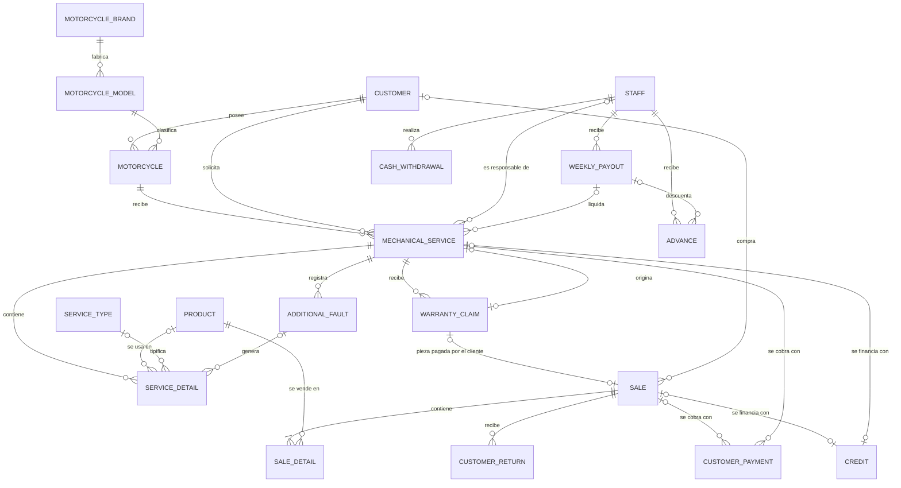
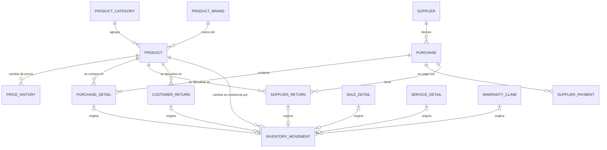
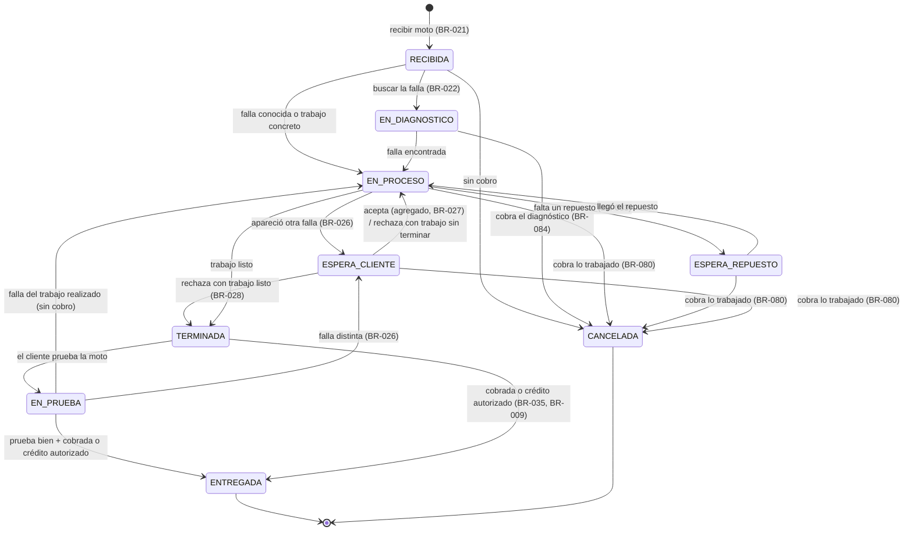
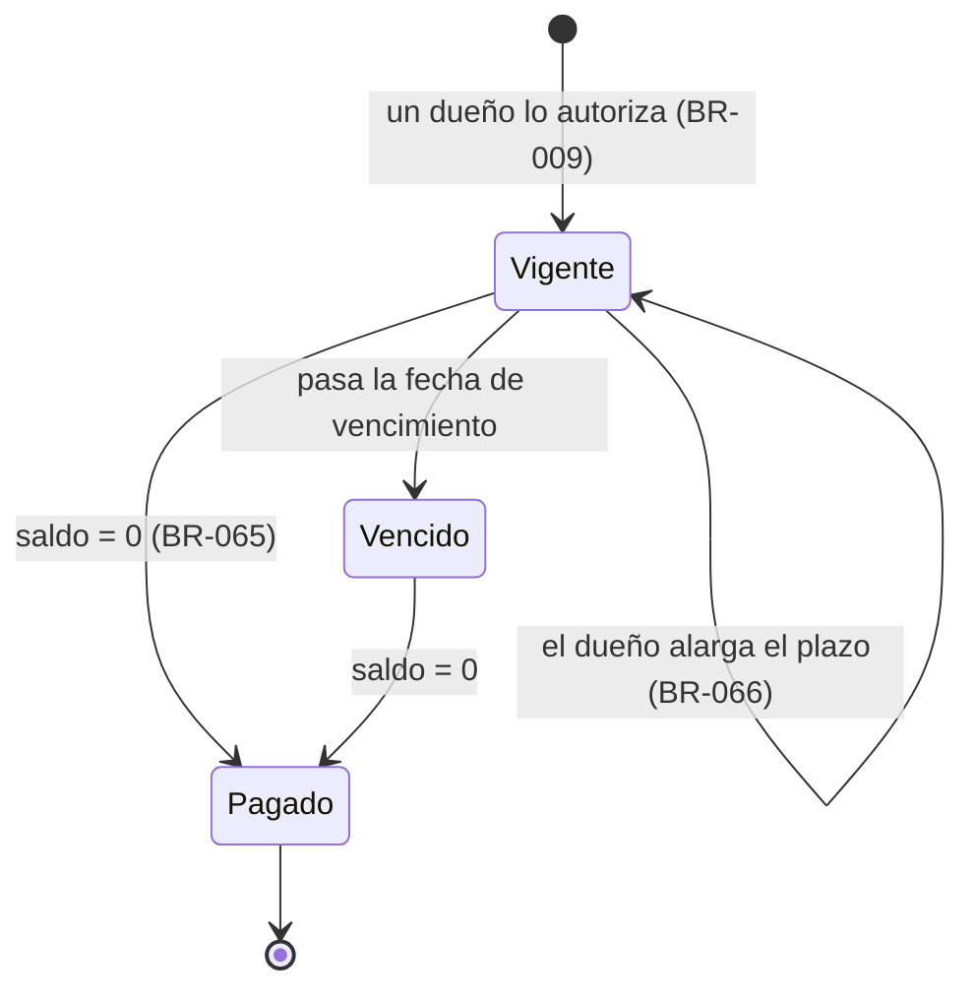

**[[Motor IRM|← Hub]]** · **[[S3 - Develop a Conceptual Model - MIRM|← S3]]** · **[[S4 - Entity-Relationship Model and EER - MIRM|S4 →]]** · **[[Business Rules - MIRM|📏 Business Rules]]** · **[[Traceability - MIRM|🔗 Traceability]]**

# S3 - Conceptual Model - MIRM

> [!info] Cómo leer esta nota
> - **Qué es:** el modelo conceptual dice **qué existe** en el negocio, **qué datos tiene** y **cómo se relaciona**, sin pensar todavía en tablas.
> - **Qué no es:** no hay llaves primarias, tipos de datos ni normalización. Las cardinalidades están en palabras y en el diagrama son preliminares: se formalizan en S4.
> - **Nombres:** en español, como en el [[Glossary - MIRM|glosario]]. La columna **ID (S4/S5)** propone el nombre en inglés.
> - **Marcas de los atributos:** **O** opcional · **D** derivado (se calcula) · **H** histórico (se copia en el momento y no cambia) · **S** sugerido por la IA · *(sin marca)* obligatorio con fuente. **Básico** = necesario para distinguir una cosa de otra.

---

## 1. Vista general

| ID   | Entidad                  | ID (S4/S5)          | Qué es                                                                                            | Grupo      |
| ---- | ------------------------ | ------------------- | ------------------------------------------------------------------------------------------------- | ---------- |
| E-01 | Cliente                  | `Customer`          | Persona que compra o trae una moto al taller.                                                     | Personas   |
| E-02 | Personal                 | `Staff`             | Dueños, mecánicos y encargado.                                                                    | Personas   |
| E-03 | Moto                     | `Motorcycle`        | Moto de un cliente que entra al taller.                                                           | Motos      |
| E-04 | Modelo de moto           | `MotorcycleModel`   | Catálogo de modelos.                                                                              | Motos      |
| E-27 | Marca_moto               | `MotorcycleBrand`   | Marcas de motos                                                                                   | Motos      |
| E-28 | Marca_producto           | `ProductBrand`      | Marcas de productos, accesorios, repuestos, lubricantes, llantas, cascos...                       | Inventario |
| E-05 | Categoría de producto    | `ProductCategory`   | Repuestos, accesorios, lubricantes, llantas…                                                      | Inventario |
| E-06 | Producto                 | `Product`           | Lo que se compra, se vende y se cuenta. Cada marca de un repuesto es un producto.                 | Inventario |
| E-26 | Historial de precio      | `PriceHistory`      | Cada cambio del precio de venta de un producto.                                                   | Inventario |
| E-07 | Movimiento de inventario | `InventoryMovement` | Cada entrada o salida de un producto, con su motivo.                                              | Inventario |
| E-08 | Proveedor                | `Supplier`          | Quien le vende mercancía al negocio.                                                              | Compras    |
| E-09 | Compra                   | `Purchase`          | Una factura de compra a un proveedor.                                                             | Compras    |
| E-10 | Detalle de compra        | `PurchaseDetail`    | Un producto de la factura, con su costo.                                                          | Compras    |
| E-11 | Pago a proveedor         | `SupplierPayment`   | Pago de una compra al crédito.                                                                    | Compras    |
| E-12 | Devolución a proveedor   | `SupplierReturn`    | Producto dañado que cubre el proveedor.                                                           | Compras    |
| E-13 | Venta                    | `Sale`              | Venta de productos en la tienda.                                                                  | Ventas     |
| E-14 | Detalle de venta         | `SaleDetail`        | Un producto vendido, con su precio.                                                               | Ventas     |
| E-15 | Devolución de cliente    | `CustomerReturn`    | Producto empacado que el cliente devuelve.                                                        | Ventas     |
| E-16 | Tipo de servicio         | `ServiceType`       | Catálogo de servicios genéricos (engrase, instalación de accesorio…). Opcional.                   | Taller     |
| E-17 | Servicio mecánico        | `MechanicalService` | Trabajo que el taller le hace a una moto: reparación, cambio de pieza o instalación de accesorio. | Taller     |
| E-18 | Detalle de servicio      | `ServiceDetail`     | Cada línea que se cobra en un servicio mecánico.                                                  | Taller     |
| E-19 | Falla adicional          | `AdditionalFault`   | Falla nueva que se le consulta al cliente.                                                        | Taller     |
| E-20 | Reclamo de garantía      | `WarrantyClaim`     | El cliente regresa por un servicio anterior.                                                      | Taller     |
| E-21 | Pago de cliente          | `CustomerPayment`   | Cada cobro (efectivo o transferencia, C$ o US$).                                                  | Cobros     |
| E-22 | Crédito                  | `Credit`            | Venta o servicio que se paga después; uno por operación.                                          | Cobros     |
| E-23 | Adelanto                 | `Advance`           | Dinero que se le adelanta a un mecánico.                                                          | Mecánicos  |
| E-24 | Pago semanal             | `WeeklyPayout`      | El pago del sábado a un mecánico.                                                                 | Mecánicos  |
| E-25 | Retiro de caja           | `CashWithdrawal`    | Dinero que los dueños sacan de la caja para gastos (consumo interno, viajes, impuesto).           | Caja       |

**Total: 28 entidades · 38 relaciones (R-01 a R-38).** Es el único conteo del proyecto: las demás notas enlazan aquí.

Los IDs `E-xx` no se reutilizan: E-26, E-27 y E-28 se agregaron después y por eso no siguen el orden de la tabla.

---

## 2. Diagramas (cardinalidades preliminares)

### 2.1 Taller, ventas, cobros y mecánicos

### 2.2 Productos, compras e inventario

> [!note] Lo que el diagrama no puede mostrar
> - Un **Pago de cliente** y un **Crédito** se aplican a **una venta o a un servicio mecánico, nunca a los dos** (arco exclusivo).
> - Un **Movimiento de inventario** tiene **un solo origen**, o ninguno si es inventario inicial o ajuste.
> - Estas "o exclusivas" son la señal para la **generalización** de §7, que se decide en S4.

---

## 3. Entidades y atributos

### E-01 Cliente
Persona que compra en la tienda o trae una moto al taller. En una venta rápida de contado no se registra (BR-038). Un mecánico que compra productos para su propia moto también es cliente (DEC-003).

| Atributo | Descripción | Marca | Origen |
| --- | --- | --- | --- |
| nombre | | | BR-039 |
| teléfono | | | BR-039 |
| cédula | Solo para dar crédito. Solo la ven los dueños. | O | BR-040, SRC-06 |
| dirección | Solo para dar crédito. Solo la ven los dueños. | O | BR-040, SRC-06 |
| deuda total | Suma de los saldos de sus créditos. | D | BR-092, DEC-009 |
| ¿debe? | deuda total > 0. | D | DEC-009 |
| créditos vencidos | Sus créditos con saldo y fecha de vencimiento pasada. | D | BR-064 |

### E-02 Personal

| Atributo | Descripción | Marca | Origen |
| --- | --- | --- | --- |
| nombre | | | Básico |
| rol | Dueño, mecánico o encargado. | | BR-007, BR-008, BR-044 |
| porcentaje de comisión | Solo mecánicos (hoy 60 % y 100 %). | O | BR-044 |
| teléfono | | O, S | — |
| activo | Un mecánico que se va no se borra: sus servicios quedan en el historial. | S | — |

> **Restricciones:** solo los **dueños** administran el sistema y autorizan créditos, rebajas y retiros (BR-009 a BR-011, SRC-06). El **encargado** solo atiende ventas (BR-008). Los mecánicos no usan el sistema (BR-007). Las cuentas de acceso son diseño del programa (S6).

### E-03 Moto

| Atributo | Descripción | Marca | Origen |
| --- | --- | --- | --- |
| color | | | BR-041 |
| modelo | → E-04 (R-02). | | BR-041 |
| cliente actual | → E-01 (R-01). | | BR-041 |
| placa | Ayuda a distinguir dos motos iguales del mismo cliente. | O, S | Q-048 |
| observaciones | | O, S | — |

### E-04 Modelo de moto

| Atributo | Descripción | Marca | Origen |
| --- | --- | --- | --- |
| nombre del modelo | Por ejemplo, XTZ 125. | | BR-041 |
| marca | → E-27 Marca_moto (R-35). | | BR-041, DEC-008 |

### E-27 Marca_moto *(DEC-008)*

| Atributo | Descripción | Marca | Origen |
| --- | --- | --- | --- |
| nombre | Yamaha, UMA… | | BR-041, DEC-008 |

### E-28 Marca_producto *(DEC-008)*

| Atributo | Descripción | Marca | Origen |
| --- | --- | --- | --- |
| nombre | Yamaha, Vini, Genérico… (repuestos, accesorios, lubricantes, llantas, cascos). | | BR-089, DEC-008 |

### E-05 Categoría de producto

| Atributo | Descripción | Marca | Origen |
| --- | --- | --- | --- |
| nombre | Repuestos, accesorios, lubricantes, llantas… | | BR-004 |

### E-06 Producto
Cada **marca** de un repuesto es un producto distinto, con su precio y su existencia: el kit de pistón XTZ 125 Yamaha, el Vini y el genérico son tres productos (BR-089).

| Atributo | Descripción | Marca | Origen |
| --- | --- | --- | --- |
| nombre | Con una **regla de nombres** acordada al cargar el inventario, para que las marcas de un mismo repuesto aparezcan juntas al buscar. | | Básico, DEC-008 |
| código de barras | Para vender con el escáner. | O | BR-093 |
| marca | → E-28 Marca_producto (R-36). | | BR-089, DEC-008 |
| gama | Alta (original), media (calidad-precio) o baja (genérica). La escribe el dueño; no se calcula (DEC-004). | | BR-090, DEC-008 |
| categoría | → E-05. | | BR-004 |
| precio de venta | Lo fija el dueño. Cada cambio queda en E-26. | | BR-015, BR-016 |
| último costo | Costo de la última factura de compra. | D | BR-014, BR-016 |
| existencia | Entradas − salidas de sus movimientos. Se cuenta en unidades: 1 litro de aceite = 1 unidad. | D | BR-005, BR-020 |
| activo | Para dejar de venderlo sin borrar su historia. | S | — |

### E-26 Historial de precio *(entra en la versión 1)*

| Atributo | Descripción | Marca | Origen |
| --- | --- | --- | --- |
| producto | → E-06 (R-37). | | BR-016 |
| precio anterior | | | SRC-05 (Q-001) |
| precio nuevo | | | SRC-05 (Q-001) |
| fecha del cambio | | | SRC-05 (Q-001) |
| cambiado por | → E-02 (dueño). | S | — |

### E-07 Movimiento de inventario
Cada vez que un producto entra o sale, queda un movimiento. De aquí se calcula la existencia.

| Atributo | Descripción | Marca | Origen |
| --- | --- | --- | --- |
| fecha y hora | | | BR-020 |
| producto | → E-06. | | BR-020 |
| tipo | Entrada o salida. | | BR-020 |
| motivo | Compra · venta · uso en servicio · devolución de cliente · devolución a proveedor · garantía · inventario inicial · ajuste. | | BR-020, BR-079, BR-086 |
| cantidad | En unidades (1 litro de aceite = 1 unidad; Q-079). | | BR-005, BR-020 |
| costo unitario | Costo en ese momento. | H | BR-014 |
| origen | El documento que lo causó (R-25). Vacío en inventario inicial o ajuste. | O | BR-079 |
| registrado por | → E-02. | | BR-007 |
| observación | Obligatoria en ajustes. | O, S | — |

### E-08 Proveedor

| Atributo | Descripción | Marca | Origen |
| --- | --- | --- | --- |
| nombre | | | BR-012 |
| teléfono | | O | Q-002 |
| persona de contacto | | O | Q-002 |
| da garantía | Si cubre garantía de sus productos (solo algunos). | O | BR-091, Q-077 |
| saldo pendiente | Suma de sus compras al crédito − suma de sus pagos. | D | BR-017 |
| ¿se le debe? | saldo pendiente > 0. | D | BR-017 |
| compras pendientes | Sus compras al crédito con saldo. | D | BR-017 |
| pagos vencidos | Compras pendientes con fecha límite pasada. | D | BR-017 (requiere *fecha límite de pago*, S) |

### E-09 Compra

| Atributo | Descripción | Marca | Origen |
| --- | --- | --- | --- |
| número de factura | | | BR-013 |
| fecha | | | BR-013 |
| proveedor | → E-08. | | BR-013 |
| condición | Contado o crédito. | | BR-017 |
| fecha límite de pago | Solo si es al crédito. | O, S | — |
| total | Suma de sus detalles. | D | BR-013 |
| saldo pendiente | Total − pagos al proveedor. | D | BR-017 |
| recibida por | → E-02 (dueño). | | BR-007 |

### E-10 Detalle de compra

| Atributo | Descripción | Marca | Origen |
| --- | --- | --- | --- |
| producto | → E-06. | | BR-014 |
| cantidad | | | BR-014 |
| costo unitario | El de la factura. | H | BR-014 |
| subtotal | | D | — |

### E-11 Pago a proveedor

| Atributo | Descripción | Marca | Origen |
| --- | --- | --- | --- |
| fecha | | | BR-017 |
| monto | | | BR-017 |
| moneda | Córdobas o dólares. | | BR-057 |
| tipo de cambio | Si fue en dólares. | O, H | BR-058 |
| compra | → E-09 (si un pago puede cubrir varias facturas, cambia: Q-070). | | BR-017 |

### E-12 Devolución a proveedor

| Atributo | Descripción | Marca | Origen |
| --- | --- | --- | --- |
| fecha | | | BR-018 |
| compra | → E-09. | | BR-018 |
| producto y cantidad | → E-06. | | BR-018 |
| motivo | Producto dañado. | | BR-018 |
| resolución | Reposición, dinero o descuento en otra compra. | O | Q-074 |

### E-13 Venta

| Atributo | Descripción | Marca | Origen |
| --- | --- | --- | --- |
| fecha y hora | Para saber cuánto se vendió en el día. | | Básico, SRC-01 |
| número de comprobante | Formato del comprobante ajustable (Q-075). | | BR-060, SRC-06 |
| cliente | → E-01. Obligatorio solo si es al crédito. | O | BR-038, BR-062 |
| registrada por | → E-02 (dueño o encargado). | | BR-007, BR-008 |
| condición | Contado o crédito. | | BR-056 |
| rebaja | | O | BR-061 |
| rebaja autorizada por | → E-02 (dueño). | O | BR-010 |
| total | Suma de detalles − rebaja. | D | — |
| estado | Vigente o anulada. | S | — |

### E-14 Detalle de venta

| Atributo | Descripción | Marca | Origen |
| --- | --- | --- | --- |
| producto | → E-06. | | BR-002 |
| cantidad | En unidades. | | BR-005 |
| precio unitario | El precio en el momento de la venta. | H | BR-016 |
| subtotal | | D | — |

### E-15 Devolución de cliente

| Atributo | Descripción | Marca | Origen |
| --- | --- | --- | --- |
| fecha | | | BR-069 |
| venta | → E-13. | | BR-069 |
| producto devuelto y cantidad | Empacado; no eléctrico ni maltratado. | | BR-069, BR-070 |
| resultado | Cambio o reembolso. | | BR-069 |
| producto entregado a cambio | | O | BR-069 |
| monto reembolsado | | O | BR-069 |

### E-16 Tipo de servicio *(catálogo opcional)*
Responde la duda del equipo sobre R-08: el catálogo **no** describe una reparación concreta, sino **tipos genéricos** que se repiten: engrase, cambio de aceite, trabajo de motor, instalación de accesorio, diagnóstico, desarme, otro. Sirve para registrar más rápido y para saber cuántos servicios de cada tipo se hacen. El precio final siempre se escribe en la línea.

| Atributo | Descripción | Marca | Origen |
| --- | --- | --- | --- |
| nombre | | | BR-030 |
| precio de referencia | Solo orienta (el engrase varía según la moto). | O | BR-030, BR-031 |

### E-17 Servicio mecánico
El trabajo que el taller le hace a **una moto** de **un cliente**: una reparación, un cambio de pieza o la instalación de un accesorio. Puede crecer mientras está en el taller (fallas adicionales) y termina **entregado** o **cancelado**.

| Atributo | Descripción | Marca | Origen |
| --- | --- | --- | --- |
| fecha de ingreso | | | BR-021 |
| moto | → E-03. | | BR-042 |
| cliente | → E-01. Quien lo trae y paga; queda guardado aunque la moto cambie de dueño. | | BR-039, BR-043 |
| lo que pide el cliente | Falla reportada, trabajo concreto o accesorio a instalar. Define el alcance. | | BR-021, BR-022 |
| diagnóstico | Lo que se encontró. | O | BR-022 |
| responsable | → E-02 (mecánico o dueño). Vacío mientras está *Recibida*. | O | BR-023, BR-024 |
| estado | Ver §4.1. | | SRC-06, BR-033, BR-080 |
| fecha de entrega | | O | BR-035 |
| número de comprobante | | O | BR-060 |
| condición | Contado o crédito. | | BR-056 |
| rebaja | Acordada con el mecánico. | O | BR-050 |
| monto por cancelación | Lo trabajado que se cobra si se cancela (desarme o diagnóstico). | O | BR-080, BR-084 |
| porcentaje aplicado | Porcentaje del responsable en ese momento. Vacío si lo hizo un dueño. | H | BR-044, BR-051 |
| total mano de obra | Líneas de mano de obra − rebaja; o el monto por cancelación. | D | BR-045, BR-083 |
| comisión | Total mano de obra × porcentaje aplicado. Cero si lo hizo un dueño o si se canceló sin tocar la moto. | D | BR-045, BR-051, BR-083 |
| total | Suma de todas las líneas − rebaja (o monto por cancelación). | D | — |
| recibido por | → E-02 (dueño). | | BR-021 |

### E-18 Detalle de servicio

| Atributo | Descripción | Marca | Origen |
| --- | --- | --- | --- |
| tipo de línea | Mano de obra · producto de la tienda · producto del cliente · trabajo externo (torno). | | BR-003, BR-032, BR-037, BR-082 |
| descripción | | | BR-003 |
| tipo de servicio | → E-16, si corresponde. | O | BR-030 |
| producto | → E-06, solo si es de la tienda (genera salida de inventario). | O | BR-003, BR-020 |
| cantidad | Solo para productos. | O | BR-003 |
| monto | Precio cobrado. Cero para producto del cliente; costo del torno para trabajo externo. | H | BR-029, BR-032, BR-082 |
| falla adicional | → E-19, si la línea es un agregado aceptado. | O | BR-027 |

### E-19 Falla adicional
Queda registrada **aunque el cliente la rechace**: es la prueba de que se le advirtió.

| Atributo | Descripción | Marca | Origen |
| --- | --- | --- | --- |
| fecha | | | BR-026 |
| descripción | | | BR-026 |
| precio propuesto | | O | BR-027 |
| decisión del cliente | Pendiente, aceptada o rechazada. | | BR-026 a BR-028 |

### E-20 Reclamo de garantía

| Atributo | Descripción | Marca | Origen |
| --- | --- | --- | --- |
| fecha | Pocos días después de la entrega. | | BR-072 |
| servicio original | → E-17. | | BR-071 |
| descripción | Lo que reporta el cliente. | | BR-071 |
| resultado | Cubierto por garantía · falla distinta (nuevo servicio) · fuera de plazo · reembolso. | | BR-071 a BR-073, BR-088 |
| quién asume la pieza | Tienda o cliente (si se cambió una pieza). Si la asume la tienda, sale del inventario por garantía; si la paga el cliente, es una venta (R-38). | O | BR-086, BR-087 |
| monto devuelto | Si se le devolvió el dinero al cliente. | O | BR-088 |
| atendido por | → E-02 (dueño). | | BR-074 |
| nuevo servicio | → E-17, si es una falla distinta y el cliente acepta. | O | BR-073 |

> La **revisión** por reclamo no se cobra (BR-085), por eso el reclamo no tiene líneas de cobro.

### E-21 Pago de cliente

| Atributo | Descripción | Marca | Origen |
| --- | --- | --- | --- |
| fecha | | | BR-056 |
| monto | | | BR-056 |
| moneda | Córdobas o dólares. | | BR-057 |
| tipo de cambio | El que fijó el dueño, si fue en dólares. | O, H | BR-058 |
| método | Efectivo o transferencia. | | BR-056 |
| aplica a | Una venta **o** un servicio mecánico (R-26). | | BR-056 |
| recibido por | → E-02. | | BR-007, BR-035 |

> El **vuelto** no se guarda: se calcula en el momento (BR-059). Todos los pagos quedan guardados: son el historial de pagos del cliente (DEC-009).

### E-22 Crédito
**Uno por operación** (DEC-009): cada venta o servicio al crédito es un crédito con su propio vencimiento.

| Atributo | Descripción | Marca | Origen |
| --- | --- | --- | --- |
| fecha de otorgamiento | | | BR-062 |
| operación | La venta **o** el servicio que financia (R-27). | | BR-062, BR-092 |
| autorizado por | → E-02 (dueño). | | BR-009 |
| fecha de vencimiento | Normalmente un mes. | | BR-064 |
| nueva fecha de vencimiento | Si el dueño alarga el plazo. | O | BR-066 |
| interés mensual | 8 % si se pidió a tres meses; cero normalmente. | O | BR-067, BR-068 |
| monto | Total de la operación (+ interés). | D | BR-065, BR-068 |
| saldo | Monto − pagos aplicados. | D | BR-066 |
| estado | Vigente, vencido o pagado. | D | BR-064 a BR-066 |

### E-23 Adelanto

| Atributo | Descripción | Marca | Origen |
| --- | --- | --- | --- |
| fecha | | | BR-048 |
| monto | | | BR-048 |
| mecánico | → E-02. | | BR-048 |
| entregado por | → E-02 (dueño). | | BR-007 |
| pago semanal | → E-24 donde se descontó. Vacío hasta el día de pago. | O | BR-049 |

### E-24 Pago semanal

| Atributo | Descripción | Marca | Origen |
| --- | --- | --- | --- |
| mecánico | → E-02. | | BR-046 |
| inicio y fin de la semana | | | BR-046 |
| fecha de pago | Normalmente sábado; otro día si hay feriado. | | BR-046 |
| total de comisiones | | D | BR-045, BR-047, BR-083 |
| total de adelantos | | D | BR-049 |
| monto neto | Comisiones − adelantos. En efectivo. | D | BR-049, BR-081 |
| pagado por | → E-02 (dueño). | | BR-007 |

### E-25 Retiro de caja

| Atributo | Descripción | Marca | Origen |
| --- | --- | --- | --- |
| fecha | | | BR-075 |
| monto | | | BR-075 |
| motivo | Consumo interno (limpieza…) · viaje de compras · impuesto · otro. | | BR-075, BR-076, BR-078, DEC-007 |
| descripción | | O | — |
| realizado por | → E-02 (dueño). | | BR-011 |

> [!question] Retiro de caja, adelanto y pago semanal no son lo mismo
> Los tres sacan dinero de la caja, pero son cosas distintas, por eso son tres entidades:
> - **Retiro de caja:** un **gasto del negocio** que no es compra de mercancía (limpieza, viaje, impuesto). Lo **hace** un dueño; nadie lo "recibe".
> - **Adelanto:** dinero que se le da a un **mecánico** antes del sábado, a cuenta de su comisión.
> - **Pago semanal:** lo que se le paga al mecánico el sábado: comisiones − adelantos.
>
> En el diagrama, *Personal → realiza → Retiro de caja* significa que **un dueño hace el retiro**, no que un mecánico lo reciba.

---

## 4. Estados y procesos

### 4.1 Servicio mecánico
Los dueños no tienen el proceso formalizado (SRC-06, Q-071): estos estados los define el equipo.

| Estado          | Qué significa                                                                                                                                                                                                                 | ¿Ocupa espacio? |
| --------------- | ----------------------------------------------------------------------------------------------------------------------------------------------------------------------------------------------------------------------------- | --------------- |
| RECIBIDA        | Llegó la moto; todavía no tiene responsable (incluye "esperando mecánico", BR-025).                                                                                                                                           | Sí              |
| EN_DIAGNOSTICO  | Se busca la falla. Si tarda, se queda aquí y se revisa cuando el taller está vacío (SRC-03, Q-019).                                                                                                                           | Sí              |
| EN_PROCESO      | Se trabaja.                                                                                                                                                                                                                   | Sí              |
| ESPERA_REPUESTO | Falta un repuesto (se busca en otro lado o se manda a traer).                                                                                                                                                                 | Sí              |
| ESPERA_CLIENTE  | Se espera la decisión del cliente sobre una falla adicional.                                                                                                                                                                  | Sí              |
| TERMINADA       | Trabajo listo y armado, sin fallas pendientes de decisión; falta la prueba (opcional), el cobro y la entrega.                                                                                                                 | Sí              |
| EN_PRUEBA       | El cliente prueba la moto antes de recibirla. Si sale bien, se cobra y se entrega; si falla lo trabajado, vuelve a EN_PROCESO; si aparece otra falla, a ESPERA_CLIENTE. _(Agregado del equipo: BR-094 y BR-095; confirmación con los dueños solo para el registro, Q-080.)_ | Sí              |
| ENTREGADA       | Se cobró o se dio crédito, y el cliente se la llevó.                                                                                                                                                                          | No              |
| CANCELADA       | El cliente decidió no seguir; se cobra lo trabajado (cero desde RECIBIDA). Con comisión si hubo trabajo (BR-083).                                                                                                             | No              |

### 4.2 Falla adicional
**Pendiente** → **Aceptada** (genera líneas, BR-027) · **Rechazada** (sin garantía sobre esa falla, BR-028).

### 4.3 Crédito

### 4.4 Otros
- **Reclamo de garantía:** Abierto → Cubierto · Falla distinta (nuevo servicio) · Fuera de plazo · Reembolso (BR-071 a BR-073, BR-085 a BR-088).
- **Compra al crédito:** Pendiente → Pagada (se calcula con el saldo).
- **Pago semanal:** Calculado → Pagado.

### 4.5 Procesos principales

| ID | Proceso | Pasos (en lenguaje del negocio) | Entidades | Reglas |
| --- | --- | --- | --- | --- |
| P-01 | **Venta rápida** | Se escanea o busca el producto (aparecen sus marcas y gamas) → se anota con su precio actual → si es al crédito, se identifica al cliente y un dueño autoriza → se cobra → se imprime el comprobante → el producto sale del inventario. | E-06, E-13, E-14, E-21, E-22, E-07 | BR-002, BR-008, BR-009, BR-056 a BR-060, BR-089, BR-093 |
| P-02 | **Servicio mecánico** | Recepción (cliente, moto, lo que pide) → responsable → diagnóstico si hace falta → trabajo; cada falla adicional se consulta → esperas → *Terminada* → cobro o crédito → *Entregada*. Si se cancela, se cobra lo trabajado. | E-01, E-03, E-17 a E-19, E-21, E-22, E-07 | BR-021 a BR-037, BR-080, BR-083, BR-084 |
| P-03 | **Compra** | Factura → productos con su costo → entran al inventario → el dueño revisa el precio (queda en el historial) → pagos si es al crédito → devolución si llegó dañado. | E-08 a E-12, E-07, E-26 | BR-012 a BR-018, BR-016 |
| P-04 | **Cobro de créditos** | Pagos hasta saldo cero; el dueño puede alargar el plazo; la deuda total del cliente se ve en su ficha. | E-22, E-21, E-01 | BR-062 a BR-068, BR-092 |
| P-05 | **Pago semanal** | Por mecánico: servicios de la semana (no los de los dueños) → comisiones − adelantos → pago en efectivo. | E-02, E-17, E-23, E-24 | BR-044 a BR-051, BR-081, BR-083 |
| P-06 | **Garantía** | Reclamo → un dueño revisa sin cobrar → misma falla en plazo: se repara; si se cambia pieza, la asume la tienda (o el cliente la paga como venta) → otra falla: nuevo servicio → si sigue molesto, se puede devolver el dinero. | E-20, E-17, E-07, E-13 | BR-071 a BR-074, BR-085 a BR-088 |
| P-07 | **Retiro de caja** | Un dueño saca dinero y anota monto y motivo (consumo interno, viaje, impuesto, otro). | E-25 | BR-011, BR-075 a BR-078 |
| P-08 | **Puesta en marcha** | Al montar el sistema (con Kenry en el negocio): cargar productos, existencias iniciales y deudas que ya existían con proveedores y clientes. | E-06, E-07, E-22, E-09 | SRC-06, Q-072, Q-078 |

---

## 5. Relaciones

| ID   | Relación (en palabras)                                                                                                                                          | Cardinalidad (preliminar)                                      | Reglas          |
| ---- | --------------------------------------------------------------------------------------------------------------------------------------------------------------- | -------------------------------------------------------------- | --------------- |
| R-01 | Un **cliente** posee **motos**.                                                                                                                                 | Un cliente: cero o varias. Una moto: un cliente actual.        | BR-041          |
| R-02 | Una **moto** es de un **modelo**.                                                                                                                               | Una moto: un modelo. Un modelo: varias motos.                  | BR-041          |
| R-03 | Un **servicio mecánico** se hace a una **moto**.                                                                                                                | Un servicio: una moto. Una moto: cero o varios (su historial). | BR-042          |
| R-04 | Un **servicio** lo solicita un **cliente**.                                                                                                                     | Un servicio: un cliente. Un cliente: cero o varios.            | BR-039, BR-043  |
| R-05 | Un miembro del **personal** es responsable de un **servicio**.                                                                                                  | Un servicio: cero (recibida) o uno.                            | BR-023 a BR-025 |
| R-06 | Un **servicio** contiene **líneas de detalle**.                                                                                                                 | Cero o varias.                                                 | BR-003          |
| R-07 | Una **línea de servicio** usa un **producto**.                                                                                                                  | Cero o uno.                                                    | BR-003          |
| R-08 | Una **línea de servicio** corresponde a un **tipo de servicio**.                                                                                                | Cero o uno.                                                    | BR-030          |
| R-09 | Un **servicio** registra **fallas adicionales**.                                                                                                                | Cero o varias.                                                 | BR-026          |
| R-10 | Una **falla adicional** aceptada genera **líneas**.                                                                                                             | Cero (rechazada) o varias.                                     | BR-027, BR-028  |
| R-11 | Un **reclamo de garantía** es sobre un **servicio**.                                                                                                            | Un reclamo: un servicio. Un servicio: cero o varios.           | BR-071          |
| R-12 | Un **reclamo** origina un **nuevo servicio**.                                                                                                                   | Cero o uno.                                                    | BR-073          |
| R-13 | Un **reclamo** lo atiende un **dueño**.                                                                                                                         | Uno.                                                           | BR-074          |
| R-14 | Una **venta** contiene **líneas**.                                                                                                                              | Una o varias.                                                  | BR-002          |
| R-15 | Una **línea de venta** es de un **producto**.                                                                                                                   | Uno.                                                           | BR-002          |
| R-16 | Una **venta** puede ser a un **cliente**.                                                                                                                       | Cero o uno (obligatorio si es al crédito).                     | BR-038, BR-062  |
| R-17 | Una **venta** la registra un miembro del **personal**.                                                                                                          | Uno.                                                           | BR-007, BR-008  |
| R-18 | Una **devolución de cliente** es sobre una **venta**.                                                                                                           | Una venta: cero o varias.                                      | BR-069          |
| R-19 | Un **producto** pertenece a una **categoría**.                                                                                                                  | Uno.                                                           | BR-004          |
| R-20 | Una **compra** es a un **proveedor**.                                                                                                                           | Uno. Un proveedor: varias compras.                             | BR-012, BR-013  |
| R-21 | Una **compra** contiene **líneas**; cada línea es de un **producto**.                                                                                           | Una o varias.                                                  | BR-013, BR-014  |
| R-22 | Un **pago a proveedor** abona a una **compra**.                                                                                                                 | Una compra al crédito: cero o varios.                          | BR-017, Q-070   |
| R-23 | Una **devolución a proveedor** es sobre una **compra** y un **producto**.                                                                                       | Una compra: cero o varias.                                     | BR-018          |
| R-24 | Un **movimiento de inventario** afecta a un **producto**.                                                                                                       | Uno. Un producto: cero o varios.                               | BR-020          |
| R-25 | Un **movimiento** tiene un **origen**: línea de compra, línea de venta, línea de servicio, devolución de cliente, devolución a proveedor o reclamo de garantía. | Uno solo, o ninguno (inventario inicial / ajuste).             | BR-079          |
| R-26 | Un **pago de cliente** se aplica a una **venta o** a un **servicio**.                                                                                           | Exactamente uno. Una operación: cero o varios pagos.           | BR-056, BR-066  |
| R-27 | Un **crédito** financia una **venta o** un **servicio**.                                                                                                        | Exactamente uno. Una operación: cero o un crédito.             | BR-062, BR-092  |
| R-28 | Un **crédito** lo autoriza un **dueño**.                                                                                                                        | Uno.                                                           | BR-009          |
| R-29 | Un **mecánico** recibe **adelantos**.                                                                                                                           | Cero o varios.                                                 | BR-048          |
| R-30 | Un **mecánico** recibe **pagos semanales**.                                                                                                                     | Cero o varios.                                                 | BR-046          |
| R-31 | Un **pago semanal** liquida **servicios**.                                                                                                                      | Un servicio con comisión: un pago semanal.                     | BR-045, BR-047  |
| R-32 | Un **pago semanal** descuenta **adelantos**.                                                                                                                    | Un adelanto: un pago.                                          | BR-049          |
| R-33 | Un **retiro de caja** lo hace un **dueño**.                                                                                                                     | Uno.                                                           | BR-011          |
| R-34 | Una **rebaja** de venta la autoriza un **dueño**.                                                                                                               | Cero o uno.                                                    | BR-010          |
| R-35 | Un **modelo de moto** es de una **marca de moto**.                                                                                                              | Uno. Una marca: cero o varios modelos.                         | BR-041, DEC-008 |
| R-36 | Un **producto** es de una **marca de producto**.                                                                                                                | Uno. Una marca: cero o varios productos.                       | BR-089, DEC-008 |
| R-37 | Un **producto** tiene **cambios de precio**.                                                                                                                    | Cero o varios.                                                 | BR-016, SRC-05  |
| R-38 | Un **reclamo** puede generar una **venta** (pieza que paga el cliente).                                                                                         | Cero o una.                                                    | BR-087          |

---

## 6. Datos derivados e históricos

**Derivados** (se calculan; en S5 serán consultas o vistas):

| Dato | Cómo se calcula | Reglas |
| --- | --- | --- |
| Existencia de un producto | Entradas − salidas de sus movimientos | BR-020 |
| Total de venta / de servicio | Suma de líneas − rebaja | BR-003 |
| Comisión de un servicio | Mano de obra (o monto por cancelación) × porcentaje aplicado | BR-045, BR-051, BR-083 |
| Monto neto del pago semanal | Comisiones − adelantos | BR-049 |
| Saldo y estado de un crédito | Monto − pagos · vencido si pasó la fecha | BR-064 a BR-066 |
| Deuda total de un cliente | Suma de los saldos de sus créditos | BR-092 |
| Saldo con un proveedor | Compras al crédito − pagos | BR-017 |
| Historial de una moto | Servicios de esa moto | BR-042 |
| Ventas del día, ganancia, dinero en caja | Reportes sobre ventas, pagos, compras, retiros, adelantos y pagos semanales | SRC-01 |

**Históricos** (se copian en el momento):

| Dato | Por qué | Reglas |
| --- | --- | --- |
| Precio unitario en el detalle de venta | El precio del producto cambia. | BR-016 |
| Costo unitario en detalle de compra y movimiento | Cada compra puede costar distinto. | BR-014 |
| Porcentaje aplicado en el servicio | Si cambia el porcentaje, las comisiones viejas no cambian. | BR-044 |
| Tipo de cambio en el pago | Lo fijan los dueños y varía. | BR-058 |

---

## 7. Candidatas a generalización (se deciden en S4)

| # | Superclase posible | Subclases | Señal en el modelo | Qué ganarían |
| --- | --- | --- | --- | --- |
| G-1 | **Operación cobrable** | Venta, Servicio mecánico | Pagos y créditos se aplican a "venta **o** servicio" (R-26, R-27). | Pago y crédito apuntan a un solo lugar. |
| G-2 | **Personal** | Dueño, Mecánico, Encargado | Solo el mecánico tiene porcentaje; solo el dueño autoriza. | Atributos y permisos por rol. |
| G-3 | **Origen de movimiento** | Líneas de compra, venta y servicio; devoluciones; reclamo | Un movimiento tiene uno de seis orígenes (R-25). | Una sola relación en vez de seis opcionales. |

---

## 8. Lo que no está en el modelo y por qué

| Tema | Por qué no está | Fuente |
| --- | --- | --- |
| Compatibilidad producto–modelo | Decisión del equipo. | DEC-004 |
| Agrupar las marcas de un mismo repuesto | Versión 1: se resuelve con la regla de nombres. | DEC-008 |
| Gama calculada automáticamente | Exige compatibilidad. | DEC-004, DEC-008 |
| Unidad de medida | 1 litro de aceite = 1 unidad; se revisa si hay otros casos. | Q-079 |
| Historial como entidad | Es un dato derivado. | BR-042 |
| Cambio de estado (historia de estados) | Se decide en S4. | §4.1 |
| Asistencia y horario | No se controla y no afecta el pago. | BR-052 |
| Consumo interno como salida de inventario | Es un retiro de caja. | DEC-007 |
| Reparto del gasto de viaje entre productos | Decisión del equipo. | DEC-005 |
| Vencimiento de productos | Sin respuesta. | Q-003 |
| Cuentas de usuario y contraseñas | Diseño del programa. | S6 |

---

## 9. Lo que pasa a S4

| Tema | Qué decidir o preguntar |
| --- | --- |
| G-1 a G-3 | Generalizaciones, cada una con su DEC. |
| Cambio de estado | ¿Se guarda la historia de estados? |
| Abono "a la cuenta" | ¿A qué crédito se aplica? (propuesta: al más antiguo) — DEC-009. |
| Saldos iniciales | Cómo se cargan las deudas que ya existían (Q-078). |
| G-2 | **Decidido por el equipo (28-oct): especialización** de *Personal*. Se dibuja en el EER: cada relación se cuelga de la subclase que la cumple. |
| Preguntas abiertas | Q-002, Q-003, Q-005, Q-057, Q-070, Q-074, Q-075, Q-077, Q-078, Q-079. |
| Confirmar con los dueños | BR-083 y BR-084 (deducciones del equipo), BR-089 a BR-091 (SRC-06). |

---

## 10. Candidatas descartadas o fusionadas (resumen de *Potential Entities*)

La puerta de S3 pide que las candidatas descartadas tengan su razón escrita. Este es el resumen de la revisión del 26-oct, que queda aquí porque *Potential Entities* se archivó (`Archive/`, 28-oct).

| Candidata del equipo | Resultado | Razón |
| --- | --- | --- |
| Entrega_Motocicleta | Atributo *fecha de entrega* + estados *Entregada*/*Cancelada* | Ocurre una vez por servicio y no tiene datos propios. |
| Garantía_Servicio | Redefinida como **Reclamo de garantía** | Lo que existe es el reclamo, con fecha, resultado y pieza. |
| Marca_Moto y Marca_producto | **Aceptadas, separadas** (E-27 y E-28) | Decisión del equipo (DEC-008). |
| Deuda_Proveedor | **Pago a proveedor** + saldo derivado | La deuda se calcula; lo que se registra son los pagos. |
| Credito_Cliente | Fusionada con **Crédito** | Estaba repetida. |
| Devolución | Dividida en **Devolución de cliente** y **Devolución a proveedor** | Distinta contraparte y distinta relación. |
| Diagnóstico | Atributo de **Servicio mecánico** + estado *En diagnóstico* | Es parte del servicio. |
| Mecánico | Ampliada a **Personal** con rol | Los dueños también hacen servicios y autorizan. |
| Historial_Reparacion | Descartada (dato derivado) | Son los servicios de una moto. |
| Pago_Tributario | Fusionada con **Retiro de caja** (motivo impuesto) | Mismos datos y relaciones. |
| Servicio_Mecánico | Se mantiene el nombre **Servicio mecánico** | No siempre es reparación (cambio de pieza, accesorio). |
| Faltaban | **Moto**, **Falla adicional**, **Historial de precio** | Sin la moto no hay historial; la falla rechazada prueba que se advirtió; el historial de precio lo pidió el equipo. |

---

## 11. Checklist de revisión para el equipo

- [x] ¿Cada entidad tiene al menos una regla o decisión que la justifica? ✅ 2026-10-28
- [x] ¿Algún atributo **S** debe quitarse o confirmarse? ✅ 2026-10-28
- [x] ¿Las 93 reglas aparecen en Traceability (columna conceptual)? ✅ 2026-10-28
- [x] DEC-008: marcas de moto y de producto separadas (28-oct).
- [x] ¿Los estados de §4.1 reflejan lo que acordaron? ✅ 2026-10-28
