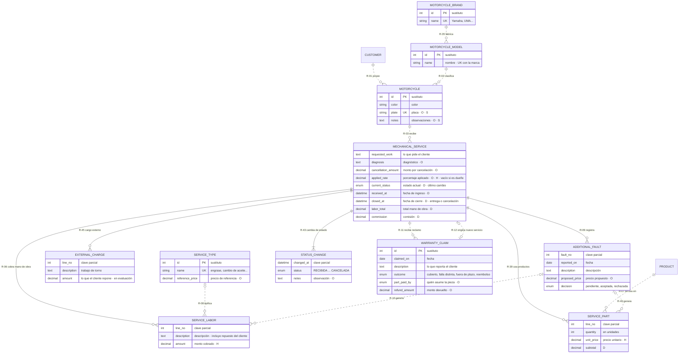
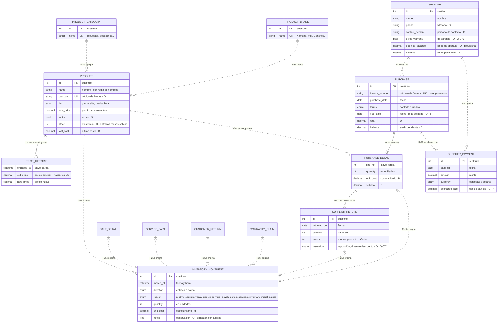
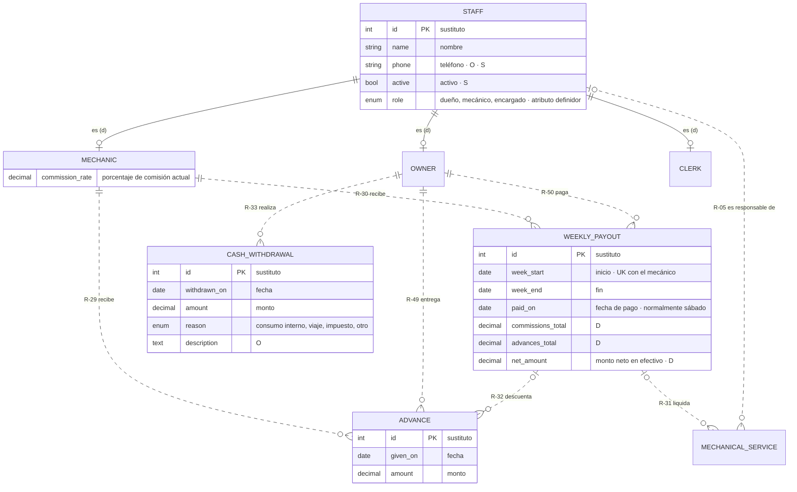
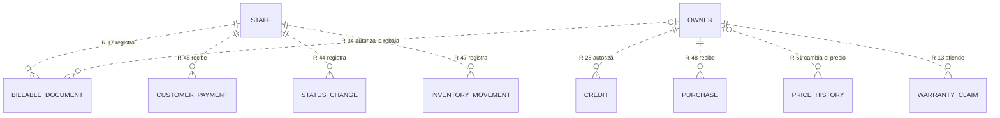
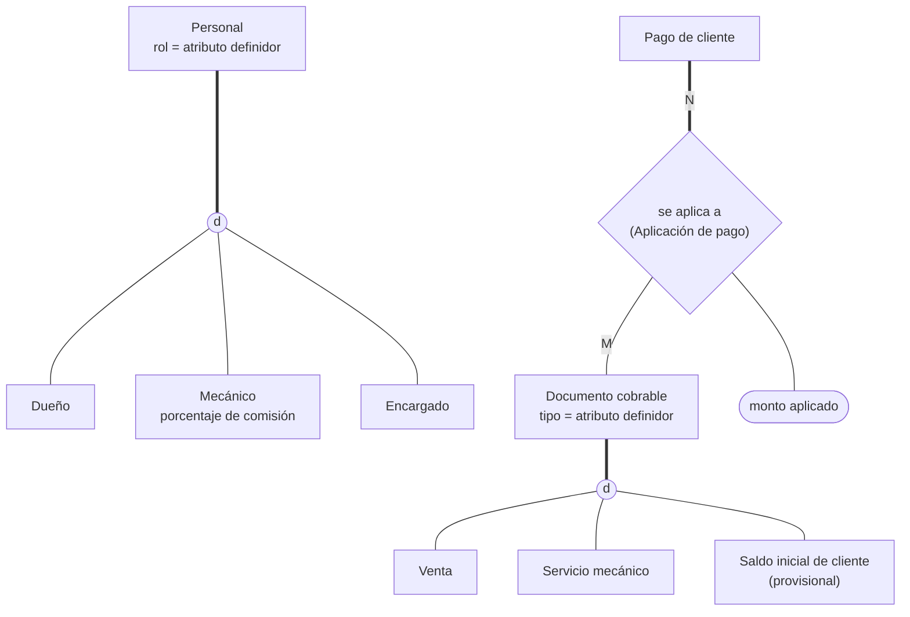
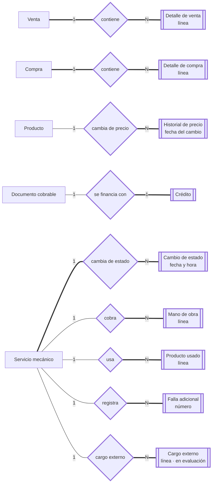
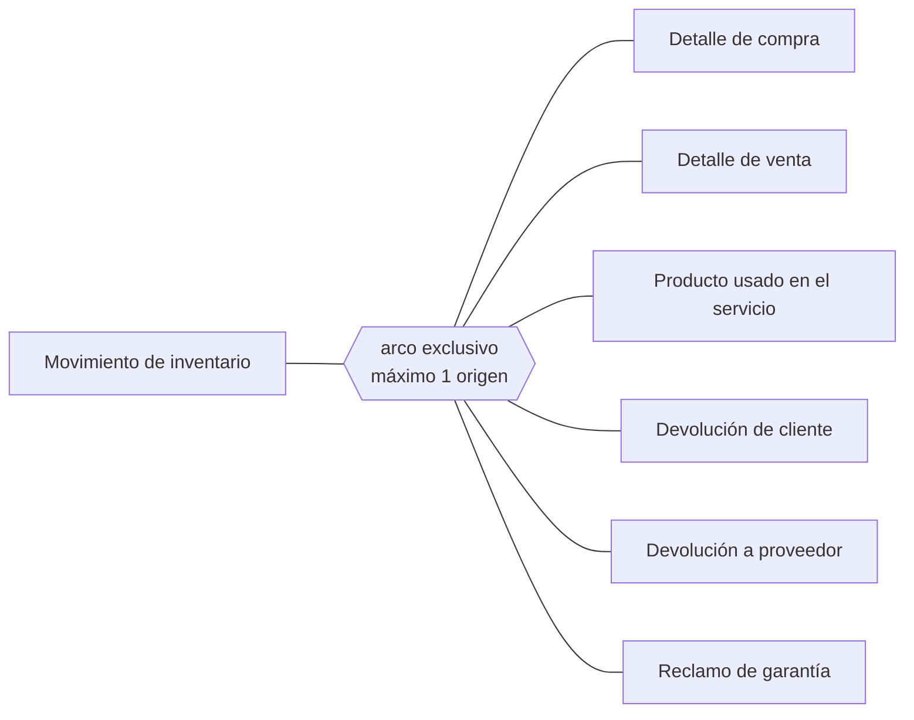

**[[Motor IRM|← Hub]]** · **[[S4 - Entity-Relationship Model and EER - MIRM|← S4]]** · **[[S3 - Conceptual Model - MIRM|Modelo conceptual]]** · **[[Business Rules - MIRM|📏 Business Rules]]** · **[[Traceability - MIRM|🔗 Traceability]]**

# S4 - ER and EER Model - MIRM

> [!info] Cómo leer esta nota
> - **Qué es:** el modelo conceptual (S3) pasado a **MER/EER**: cada entidad con su **identificador**, sus atributos clasificados y cada relación con **cardinalidad y participación formales**, citando su regla.
> - **Qué no es todavía:** no hay llaves foráneas, tipos de SQL ni normalización. Las FK **aparecen al transformar** a tablas en S5: en el MER las conexiones son **relaciones**, no columnas.
> - **Nombres:** los diagramas usan el ID en inglés (el que tendrán las tablas); el nombre en español está en la tabla de entidades y en los comentarios.
> - **Marcas** (igual que en S3): **O** opcional · **D** derivado · **H** histórico · **S** sugerido por la IA · **UK** único (clave candidata).
> - **Provisional:** lo marcado así es recomendación de la IA para una decisión que el equipo todavía no toma (decisiones 3 y 6 de S4) o algo que el equipo está evaluando (*Aplicación de pago*, *Cargo externo*).

---

## 1. Decisiones aplicadas

| # (S4) | Decisión | Estado | Dónde se ve |
| --- | --- | --- | --- |
| 1 | Superclase **Documento cobrable** (Venta, Servicio mecánico) | ✅ Equipo, 28-oct | §3 diagrama A · §4 EER-1 |
| 2 | Especialización disjunta de **Personal** | ✅ Equipo, 28-oct | §3 diagrama D · §4 EER-1 |
| 3 | **Origen del movimiento** (G-3) como arco exclusivo | 🟡 Provisional (IA) | §3 diagrama C · §4 EER-3 · C-04 |
| 4 | **Cambio de estado** como entidad débil | ✅ Equipo, 28-oct | §3 diagrama B · §4 EER-2 |
| 5 | Abono al crédito más antiguo → **Aplicación de pago** (M:N) | ✅ DEC-009 · 🟡 entidad en evaluación | §3 diagrama A · §4 EER-1 |
| 6 | **Saldos iniciales**: subclase *Saldo inicial de cliente*; saldo de apertura en *Proveedor* | 🟡 Provisional (IA) | §3 diagramas A y C |
| 9 | Rechazo de falla adicional con trabajo sin terminar → EN_PROCESO | ✅ Ya en el diagrama de estados | Modelo conceptual §4.1 |
| 10 | **Producto usado en el servicio** como entidad; *Detalle de servicio* queda como mano de obra | ✅ Equipo, 28-oct · *Cargo externo* en evaluación | §3 diagrama B · §4 EER-2 |
| — | **Identificadores**: llave sustituta en entidades fuertes; claves naturales como UK; entidades débiles con clave parcial | 🟡 Propuesta (IA) | §2 |

---

## 2. Entidades e identificadores

**Criterio de identificadores (propuesta):**

1. **Entidades fuertes → identificador sustituto** (`id`). En este negocio las claves naturales son **opcionales** (cédula, placa, código de barras), **cambian** (el nombre de un producto, el formato del comprobante, Q-075) o **no son únicas** (dos motos XTZ 125 rojas del mismo cliente). Además, Django trabaja de forma natural con una llave de una sola columna (DEC-006).
2. **Claves naturales → UK** (clave candidata): se siguen garantizando como únicas, aunque no sean el identificador.
3. **Entidades débiles → clave parcial** (por ejemplo, número de línea). Se identifican por su dueña + la clave parcial. En S5 se decide si eso queda como llave compuesta o como sustituta + UK.

| Entidad | ID | Tipo | Identificador | Claves candidatas (UK) | Cambio respecto a S3 |
| --- | --- | --- | --- | --- | --- |
| Cliente | `CUSTOMER` | Fuerte | id | cédula (si existe) | — |
| Personal | `STAFF` | Superclase (G-2) | id | — | Especializada |
| Dueño · Mecánico · Encargado | `OWNER` · `MECHANIC` · `CLERK` | Subclases (G-2) | el de Personal | — | Nuevas como subclases |
| Moto | `MOTORCYCLE` | Fuerte | id | placa (si existe) | — |
| Modelo de moto | `MOTORCYCLE_MODEL` | Fuerte | id | marca + nombre | — |
| Marca de moto | `MOTORCYCLE_BRAND` | Fuerte | id | nombre | — |
| Marca de producto | `PRODUCT_BRAND` | Fuerte | id | nombre | — |
| Categoría de producto | `PRODUCT_CATEGORY` | Fuerte | id | nombre | — |
| Producto | `PRODUCT` | Fuerte | id | código de barras (si existe) | — |
| Historial de precio | `PRICE_HISTORY` | **Débil** (de Producto) | producto + fecha del cambio | — | Ahora débil |
| Movimiento de inventario | `INVENTORY_MOVEMENT` | Fuerte | id | — | Origen como arco exclusivo |
| Proveedor | `SUPPLIER` | Fuerte | id | — | + saldo de apertura (provisional) |
| Compra | `PURCHASE` | Fuerte | id | proveedor + número de factura | — |
| Detalle de compra | `PURCHASE_DETAIL` | **Débil** (de Compra) | compra + línea | — | Ahora débil |
| Pago a proveedor | `SUPPLIER_PAYMENT` | Fuerte | id | — | Ligado al proveedor; la compra es opcional (provisional) |
| Devolución a proveedor | `SUPPLIER_RETURN` | Fuerte | id | — | Ligada a la **línea** de compra |
| Documento cobrable | `BILLABLE_DOCUMENT` | **Superclase** (G-1) | id | número de comprobante (si existe) | **Nueva** |
| Venta | `SALE` | Subclase (G-1) | el del documento | — | Pasa a subclase |
| Servicio mecánico | `MECHANICAL_SERVICE` | Subclase (G-1) | el del documento | — | Pasa a subclase |
| Saldo inicial de cliente | `OPENING_BALANCE` | Subclase (G-1) | el del documento | — | **Nueva** (provisional, decisión 6) |
| Detalle de venta | `SALE_DETAIL` | **Débil** (de Venta) | venta + línea | — | Ahora débil |
| Devolución de cliente | `CUSTOMER_RETURN` | Fuerte | id | — | Ligada a la **línea** de venta |
| Pago de cliente | `CUSTOMER_PAYMENT` | Fuerte | id | — | Se reparte entre documentos |
| Aplicación de pago | `PAYMENT_APPLICATION` | **Relación M:N con atributo** | pago + documento | — | **Nueva** (en evaluación) |
| Crédito | `CREDIT` | **Débil 1:1** (de Documento cobrable) | el del documento | — | Ahora depende del documento |
| Tipo de servicio | `SERVICE_TYPE` | Fuerte | id | nombre | — |
| Mano de obra del servicio | `SERVICE_LABOR` | **Débil** (de Servicio) | servicio + línea | — | Antes *Detalle de servicio* |
| Producto usado en el servicio | `SERVICE_PART` | **Débil** (de Servicio) | servicio + línea | — | **Nueva** (decisión 10) |
| Cargo externo | `EXTERNAL_CHARGE` | **Débil** (de Servicio) | servicio + línea | — | **Nueva, en evaluación** |
| Falla adicional | `ADDITIONAL_FAULT` | **Débil** (de Servicio) | servicio + número | — | Ahora débil |
| Cambio de estado | `STATUS_CHANGE` | **Débil** (de Servicio) | servicio + fecha y hora | — | **Nueva** (decisión 4) |
| Reclamo de garantía | `WARRANTY_CLAIM` | Fuerte | id | — | — |
| Adelanto | `ADVANCE` | Fuerte | id | — | — |
| Pago semanal | `WEEKLY_PAYOUT` | Fuerte | id | mecánico + inicio de semana | — |
| Retiro de caja | `CASH_WITHDRAWAL` | Fuerte | id | — | — |

---

## 3. Diagramas del MER (pata de gallo)

> [!tip] Cómo leerlos
> - **Línea continua** = relación **identificadora** (la entidad del otro lado es débil o es una subclase). **Línea punteada** = relación normal.
> - `||` uno y solo uno · `|o` cero o uno · `|{` uno o más · `o{` cero o más. El símbolo que está **junto a una entidad** dice cuántas de **esa** entidad le tocan a cada una del otro lado.
> - **"es (d)"** = subclase de una especialización **disjunta**. Mermaid no dibuja los círculos del EER: la especialización formal está en §4.
> - Cada entidad tiene sus atributos en **un solo diagrama**; en los demás aparece solo la caja.

### A. Cobros y ventas

```mermaid
erDiagram
    CUSTOMER {
        int id PK "sustituto"
        string name "nombre"
        string phone "teléfono"
        string national_id UK "cédula · O · solo la ven los dueños"
        string address "dirección · O · solo la ven los dueños"
        decimal total_debt "deuda total · D"
        bool has_debt "debe · D"
    }
    BILLABLE_DOCUMENT {
        int id PK "sustituto"
        string receipt_number UK "número de comprobante · O hasta cobrar"
        datetime created_at "fecha y hora de registro"
        enum kind "tipo: venta, servicio, saldo inicial · atributo definidor"
        enum terms "condición: contado o crédito"
        decimal discount "rebaja · O"
        decimal total "D · según el tipo"
    }
    OPENING_BALANCE {
        decimal amount "lo que ya debía al empezar"
        string description "O"
    }
    SALE_DETAIL {
        int line_no "clave parcial"
        int quantity "en unidades"
        decimal unit_price "precio unitario · H"
        decimal subtotal "D"
    }
    CUSTOMER_RETURN {
        int id PK "sustituto"
        date returned_on "fecha"
        int quantity "cantidad devuelta"
        enum outcome "cambio o reembolso"
        decimal refund_amount "monto reembolsado · O"
    }
    CUSTOMER_PAYMENT {
        int id PK "sustituto"
        datetime paid_at "fecha y hora"
        decimal amount "monto"
        enum currency "córdobas o dólares"
        decimal exchange_rate "tipo de cambio · O · H"
        enum method "efectivo o transferencia"
    }
    PAYMENT_APPLICATION {
        decimal applied_amount "monto aplicado · M:N con atributo · en evaluación"
    }
    CREDIT {
        date granted_on "fecha de otorgamiento"
        date due_date "vencimiento · normalmente un mes"
        date extended_due_date "nuevo vencimiento · O"
        decimal monthly_interest "interés mensual · O · 8 por ciento a tres meses"
        decimal amount "D"
        decimal balance "saldo · D"
        enum status "vigente, vencido, pagado · D"
    }
    CUSTOMER |o..o{ BILLABLE_DOCUMENT : "R-04 es cliente de"
    BILLABLE_DOCUMENT ||--o| SALE : "es (d)"
    BILLABLE_DOCUMENT ||--o| MECHANICAL_SERVICE : "es (d)"
    BILLABLE_DOCUMENT ||--o| OPENING_BALANCE : "es (d)"
    SALE ||--|{ SALE_DETAIL : "R-14 contiene"
    PRODUCT ||..o{ SALE_DETAIL : "R-15 se vende en"
    SALE_DETAIL ||..o{ CUSTOMER_RETURN : "R-18 se devuelve en"
    PRODUCT |o..o{ CUSTOMER_RETURN : "R-52 se entrega a cambio"
    CUSTOMER_PAYMENT ||--|{ PAYMENT_APPLICATION : "R-26 se reparte en"
    BILLABLE_DOCUMENT ||--o{ PAYMENT_APPLICATION : "R-26 recibe"
    BILLABLE_DOCUMENT ||--o| CREDIT : "R-27 se financia con"
    WARRANTY_CLAIM |o..o| SALE : "R-38 pieza que paga el cliente"
```

### B. Taller

### C. Productos, compras e inventario

> Las seis relaciones R-25a a R-25f forman un **arco exclusivo**: un movimiento tiene **como máximo uno** de esos orígenes, y ninguno solo si es *inventario inicial* o *ajuste* (C-04).

### D. Personal, mecánicos y caja

### E. Quién registra y quién autoriza

> [!note] Por qué tantas relaciones con *Personal*
> En S3 eran atributos ("registrado por → E-02"). En el MER **una referencia a otra entidad siempre es una relación**, no un atributo: así se ve su cardinalidad y, en S5, se convierte en llave foránea con su restricción. Colgarlas de **Dueño** (y no de *Personal*) es lo que gana la especialización G-2: la regla "solo un dueño autoriza" (BR-009 a BR-011) queda **en la estructura**.

---

## 4. EER: especializaciones, entidades débiles y arco exclusivo

> [!tip] Notación de estos diagramas
> - **Línea gruesa** = participación **total** (todas las instancias participan). **Línea delgada** = parcial.
> - **Círculo `d`** = especialización **disjunta** (una instancia está en una sola subclase).
> - **Rectángulo con barras** `[[ ]]` = entidad **débil**. **Rombo** = relación; con borde grueso, relación **identificadora**.
> - **Óvalo** = atributo de una relación.

### EER-1. Especializaciones (G-1, G-2) y la relación M:N de pagos

- **G-1 es total y disjunta:** todo documento cobrable es **exactamente uno** de los tres tipos, y el atributo *tipo* dice cuál (especialización *definida por atributo*). Lo común (cliente, comprobante, condición, rebaja, quién registra) vive una sola vez en la superclase, y *Pago de cliente* y *Crédito* se relacionan con **un solo lugar**: desaparecen los arcos exclusivos R-26 y R-27 de S3.
- **Saldo inicial de cliente como tercera subclase (decisión 6, provisional):** una deuda anterior al sistema se comporta como un documento cobrable sin líneas. Así el crédito, los abonos y la deuda total funcionan **sin ningún caso especial**.
- **G-2 es total y disjunta:** un dueño que repara una moto **sigue siendo dueño**; por eso no gana comisión (BR-051) y no hace falta una subclase solapada.
- **Aplicación de pago (en evaluación):** como el abono va al crédito más antiguo y el sobrante al siguiente (BR-096), **un pago puede cubrir varios documentos**. En ER eso es una relación **M:N con atributo** (*monto aplicado*), no una entidad; en S5 se convierte en tabla. Si el equipo la descarta, R-26 vuelve a ser "un pago, un documento" y el sistema tendría que partir el abono en varios pagos.

### EER-2. Entidades débiles

- **Por qué son débiles:** no existen sin su dueña (una línea de venta sin venta no significa nada) y se identifican **por su dueña + una clave parcial** (línea, número, fecha). Por eso su participación es siempre **total**.
- **Venta y Compra** también participan de forma total: no hay venta sin al menos una línea (BR-002) ni compra sin al menos un producto (BR-013).
- **Servicio mecánico participa de forma total en *Cambio de estado*:** al crearse queda en *RECIBIDA*. El estado actual, la fecha de ingreso y la de cierre **se derivan** de sus cambios (como la existencia se deriva de los movimientos). En S5 se puede decidir guardar el estado actual por rapidez, con su DEC.
- **Crédito es débil 1:1:** usa el mismo identificador que su documento. Se deja como entidad aparte (y no como atributos del documento) para no tener columnas vacías en todos los documentos de contado (criterio de DEC-007).

### EER-3. Origen del movimiento: arco exclusivo (G-3, provisional)

- **Por qué no es una generalización como G-1:** los seis orígenes **no comparten atributos ni comportamiento**; lo único que tienen en común es que mueven inventario. Inventarles una superclase sería una entidad que no representa nada del negocio (va contra el criterio 1 de DEC-007).
- **Qué sería en EER puro:** una **categoría** (*tipo unión*): el origen de un movimiento es *uno de* varios tipos distintos. Se documenta como arco exclusivo con la restricción C-04, que en S5 se convierte en un `CHECK`.

---

## 5. Relaciones: cardinalidad y participación

**Cómo leer cada fila:** *cada **A** se relaciona con [A → B] **B**; cada **B** con [B → A] **A***. Por ejemplo, R-01: cada cliente posee 0..N motos; cada moto la posee 1..1 cliente. **(id.)** = relación identificadora. **⊕** = parte del arco exclusivo.

| ID | A | A → B | Relación | B → A | B | Reglas | Cambio respecto a S3 |
| --- | --- | --- | --- | --- | --- | --- | --- |
| R-01 | Cliente | 0..N | posee | 1..1 | Moto | BR-041, BR-043 | — |
| R-02 | Modelo de moto | 0..N | clasifica | 1..1 | Moto | BR-041 | — |
| R-03 | Moto | 0..N | recibe | 1..1 | Servicio mecánico | BR-042 | — |
| R-04 | Cliente | 0..N | es cliente de | 0..1 | Documento cobrable | BR-038, BR-039, BR-043, BR-062 | Une R-04 y R-16 (G-1). Obligatorio según C-01 |
| R-05 | Personal | 0..N | es responsable de | 0..1 | Servicio mecánico | BR-023 a BR-025 | Solo dueño o mecánico (C-02) |
| R-06 | Servicio mecánico | 0..N | cobra (id.) | 1..1 | Mano de obra del servicio | BR-003, BR-029 | Antes *Detalle de servicio* |
| R-07 | Producto | 0..N | se usa en | 1..1 | Producto usado en el servicio | BR-003, BR-020 | Ahora obligatoria |
| R-08 | Tipo de servicio | 0..N | tipifica | 0..1 | Mano de obra del servicio | BR-030 | — |
| R-09 | Servicio mecánico | 0..N | registra (id.) | 1..1 | Falla adicional | BR-026 | Falla adicional débil |
| R-10 | Falla adicional | 0..N | genera | 0..1 | Mano de obra del servicio | BR-027, BR-028 | — |
| R-11 | Servicio mecánico | 0..N | recibe | 1..1 | Reclamo de garantía | BR-071 | — |
| R-12 | Reclamo de garantía | 0..1 | origina | 0..1 | Servicio mecánico (nuevo) | BR-073 | — |
| R-13 | Dueño | 0..N | atiende | 1..1 | Reclamo de garantía | BR-074 | De la subclase *Dueño* |
| R-14 | Venta | 1..N | contiene (id.) | 1..1 | Detalle de venta | BR-002 | Detalle débil |
| R-15 | Producto | 0..N | se vende en | 1..1 | Detalle de venta | BR-002 | — |
| R-16 | — | | | | | | Absorbida por R-04 |
| R-17 | Personal | 0..N | registra | 1..1 | Documento cobrable | BR-007, BR-008, BR-021 | Une *registrada por* y *recibido por*; C-03 |
| R-18 | Detalle de venta | 0..N | se devuelve en | 1..1 | Devolución de cliente | BR-069, BR-070 | Ahora con la línea, no con la venta |
| R-19 | Categoría de producto | 0..N | agrupa | 1..1 | Producto | BR-004 | — |
| R-20 | Proveedor | 0..N | factura | 1..1 | Compra | BR-012, BR-013 | — |
| R-21 | Compra | 1..N | contiene (id.) | 1..1 | Detalle de compra | BR-013, BR-014 | Detalle débil; el producto pasa a R-41 |
| R-22 | Compra | 0..N | se abona con | 0..1 | Pago a proveedor | BR-017, Q-070 | Ahora opcional (provisional) |
| R-23 | Detalle de compra | 0..N | se devuelve en | 1..1 | Devolución a proveedor | BR-018 | Ahora con la línea |
| R-24 | Producto | 0..N | mueve | 1..1 | Movimiento de inventario | BR-020 | — |
| R-25a | Detalle de compra | 1..1 | origina | 0..1 ⊕ | Movimiento de inventario | BR-020 | Arco exclusivo (C-04) |
| R-25b | Detalle de venta | 1..1 | origina | 0..1 ⊕ | Movimiento de inventario | BR-020 | Arco exclusivo |
| R-25c | Producto usado en el servicio | 1..1 | origina | 0..1 ⊕ | Movimiento de inventario | BR-020 | Arco exclusivo |
| R-25d | Devolución de cliente | 1..2 | origina | 0..1 ⊕ | Movimiento de inventario | BR-069 | Entrada del devuelto; salida si es cambio |
| R-25e | Devolución a proveedor | 1..1 | origina | 0..1 ⊕ | Movimiento de inventario | BR-018 | Arco exclusivo |
| R-25f | Reclamo de garantía | 0..N | origina | 0..1 ⊕ | Movimiento de inventario | BR-086 | Arco exclusivo |
| R-26 | Pago de cliente | 1..N | se aplica a (*monto aplicado*) | 0..N | Documento cobrable | BR-056, BR-066, BR-096 | M:N con atributo (en evaluación); antes "venta **o** servicio" |
| R-27 | Documento cobrable | 0..1 | se financia con (id.) | 1..1 | Crédito | BR-062, BR-092 | Sin arco exclusivo (G-1) |
| R-28 | Dueño | 0..N | autoriza | 1..1 | Crédito | BR-009 | De la subclase *Dueño* |
| R-29 | Mecánico | 0..N | recibe | 1..1 | Adelanto | BR-048 | De la subclase *Mecánico* |
| R-30 | Mecánico | 0..N | recibe | 1..1 | Pago semanal | BR-046 | De la subclase *Mecánico* |
| R-31 | Pago semanal | 0..N | liquida | 0..1 | Servicio mecánico | BR-045, BR-047, BR-083 | Por la fecha de cierre (C-10) |
| R-32 | Pago semanal | 0..N | descuenta | 0..1 | Adelanto | BR-049 | — |
| R-33 | Dueño | 0..N | realiza | 1..1 | Retiro de caja | BR-011 | De la subclase *Dueño* |
| R-34 | Dueño | 0..N | autoriza la rebaja de | 0..1 | Documento cobrable | BR-010, BR-050 | Obligatoria si hay rebaja (C-05) |
| R-35 | Marca de moto | 0..N | fabrica | 1..1 | Modelo de moto | BR-041 | — |
| R-36 | Marca de producto | 0..N | marca | 1..1 | Producto | BR-089 | — |
| R-37 | Producto | 0..N | cambia de precio (id.) | 1..1 | Historial de precio | BR-016 | Historial débil |
| R-38 | Reclamo de garantía | 0..1 | genera | 0..1 | Venta | BR-087 | — |
| R-39 | Servicio mecánico | 0..N | usa (id.) | 1..1 | Producto usado en el servicio | BR-003, BR-020 | **Nueva** (decisión 10) |
| R-40 | Falla adicional | 0..N | genera | 0..1 | Producto usado en el servicio | BR-027 | **Nueva** |
| R-41 | Producto | 0..N | se compra en | 1..1 | Detalle de compra | BR-014 | **Nueva** (separada de R-21) |
| R-42 | Proveedor | 0..N | recibe | 1..1 | Pago a proveedor | BR-017 | **Nueva** (provisional) |
| R-43 | Servicio mecánico | 1..N | cambia de estado (id.) | 1..1 | Cambio de estado | BR-021, BR-033, BR-094, BR-095 | **Nueva** (decisión 4) |
| R-44 | Personal | 0..N | registra | 1..1 | Cambio de estado | BR-007 | **Nueva** |
| R-45 | Servicio mecánico | 0..N | tiene (id.) | 1..1 | Cargo externo | BR-037, BR-082 | **Nueva, en evaluación** |
| R-46 | Personal | 0..N | recibe | 1..1 | Pago de cliente | BR-007, BR-035 | Antes atributo *recibido por* |
| R-47 | Personal | 0..N | registra | 1..1 | Movimiento de inventario | BR-007 | Antes atributo |
| R-48 | Dueño | 0..N | recibe | 1..1 | Compra | BR-007 | Antes atributo |
| R-49 | Dueño | 0..N | entrega | 1..1 | Adelanto | BR-007 | Antes atributo |
| R-50 | Dueño | 0..N | paga | 1..1 | Pago semanal | BR-007 | Antes atributo |
| R-51 | Dueño | 0..N | cambia | 0..1 | Historial de precio | BR-015, BR-016 | Antes atributo S |
| R-52 | Producto | 0..N | se entrega a cambio en | 0..1 | Devolución de cliente | BR-069 | Antes atributo |

---

## 6. Restricciones que el diagrama no muestra

El diagrama dice **cuántos**; estas reglas dicen **cuándo** o **cuáles**. En S5 cada una se cumple con un `CHECK`, un *trigger* o en la aplicación ("va en la aplicación", como dice Traceability).

| ID | Restricción | Reglas | Dónde se podría cumplir (se decide en S5) |
| --- | --- | --- | --- |
| C-01 | El documento tiene cliente obligatorio si es **servicio**, **saldo inicial** o es **al crédito**. | BR-038, BR-039, BR-062 | `CHECK` en la tabla |
| C-02 | El responsable de un servicio es un **dueño o un mecánico**, nunca el encargado. | BR-024 | Aplicación o *trigger* |
| C-03 | Una **venta** la registra un dueño o el encargado; un **servicio** o un **saldo inicial**, un dueño. | BR-008, BR-021 | Aplicación (permisos de Django) |
| C-04 | Un movimiento tiene **como máximo un origen**; ninguno solo si el motivo es *inventario inicial* o *ajuste*, y el motivo coincide con el origen. | BR-020, BR-079 | `CHECK` |
| C-05 | Si hay **rebaja**, debe tener quién la autorizó (un dueño). | BR-010 | `CHECK` |
| C-06 | Un cliente con **crédito** debe tener cédula y dirección. | BR-040 | Aplicación o *trigger* |
| C-07 | La suma de los **montos aplicados** de un pago es igual al pago (en córdobas). | BR-058, BR-096 | Aplicación (transacción) |
| C-08 | Si un pago a proveedor indica una **compra**, esa compra es del **mismo proveedor**. | BR-017 | *Trigger* o aplicación |
| C-09 | Si el responsable es un **dueño**, el servicio no tiene porcentaje aplicado ni pago semanal. | BR-051 | Aplicación |
| C-10 | Un pago semanal liquida servicios y descuenta adelantos **del mismo mecánico** y **de esa semana** (por la fecha de cierre del servicio). | BR-047, BR-049 | Aplicación |
| C-11 | Una devolución de cliente no supera lo vendido en esa línea, y no se aceptan productos eléctricos ni maltratados. | BR-069, BR-070 | Aplicación |
| C-12 | Cantidades mayores que cero; precios, costos y montos no negativos. | — | `CHECK` |
| C-13 | Una venta y una compra tienen **al menos una línea**; un servicio, **al menos un cambio de estado**. | BR-002, BR-013, BR-021 | Aplicación (transacción) |

> [!question] ¿Por qué C-13 no se puede con un `CHECK`?
> La participación total del lado "uno" (toda venta tiene al menos una línea) involucra **dos tablas**: la venta se inserta antes que sus líneas. Una llave foránea solo garantiza el otro lado (toda línea tiene venta). Por eso se cumple **dentro de una transacción** en la aplicación: se guarda la venta con sus líneas o no se guarda nada.

---

## 7. Lo que el equipo tiene que revisar

1. **Decisiones 3 y 6** (provisionales): arco exclusivo para el origen del movimiento y saldos iniciales como subclase y atributo.
2. **Aplicación de pago** (escenario E2) y **Cargo externo** (escenario E5). Si el taller paga el torno, ese dinero **sale de caja**: ¿basta con el cargo externo o también se registra como retiro?
3. **Devoluciones ligadas a la línea** (R-18, R-23) y no a la venta o compra: garantiza que solo se devuelva algo que de verdad se vendió o compró.
4. **Pago a proveedor** ligado al proveedor, con la compra opcional (provisional hasta Q-070 y Q-078).
5. **Estado actual y fechas del servicio derivados** de *Cambio de estado*.
6. **Interés del crédito:** BR-068 dice 8 % por mes, pero no si se calcula sobre el total o sobre lo que queda debiendo. Cambia el atributo derivado *monto* del crédito, no la estructura.
7. **Recorrer los escenarios E1 a E9** de [[S4 - Entity-Relationship Model and EER - MIRM#Escenarios para recorrer el MER|S4]] sobre estos diagramas y anotar el resultado.

**Pasa a S5:** costo de las salidas de inventario (último o promedio), anulación de ventas, *precio anterior* en el historial, diccionario de datos con tipos y longitudes, y si las entidades débiles usan llave compuesta o sustituta + UK.

## Lecturas

- Elmasri y Navathe, *Fundamentals of Database Systems*: capítulo del modelo ER (entidades débiles, participación) y del EER (especialización, restricciones disjunta/total y **categorías**, *union types*).
- Mermaid, diagramas ER (notación pata de gallo y relaciones identificadoras): https://mermaid.js.org/syntax/entityRelationshipDiagram.html
