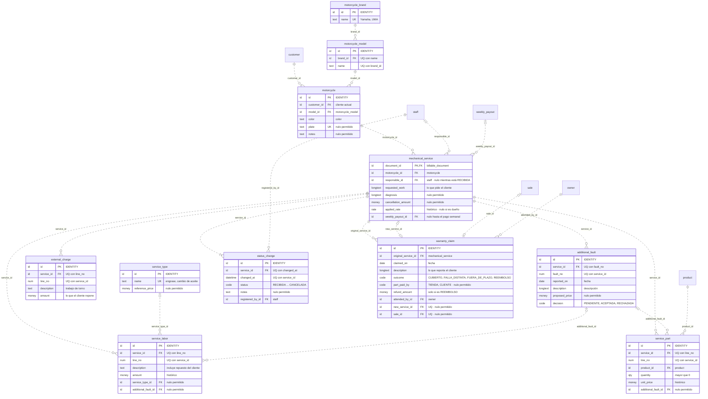
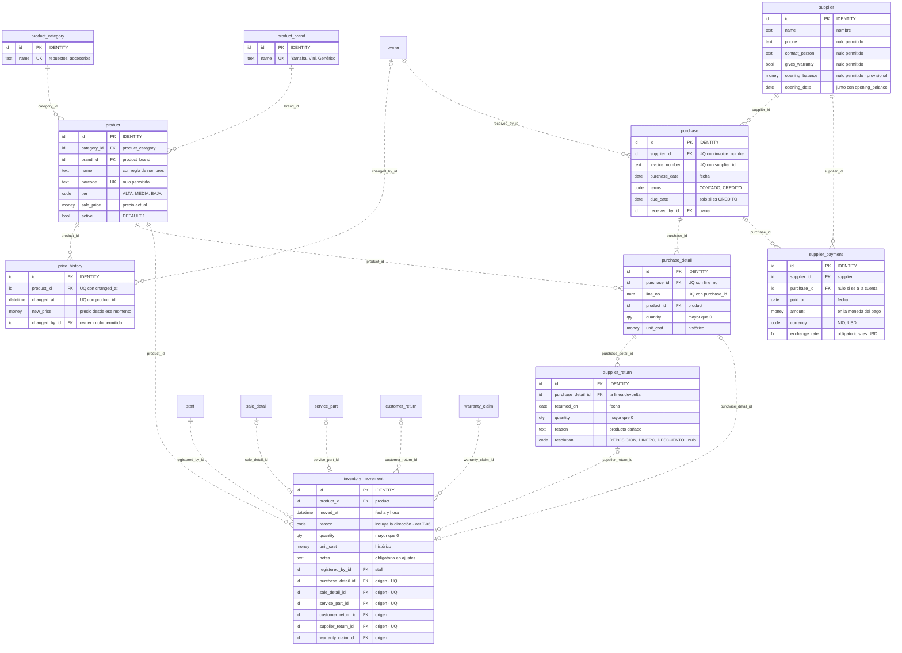
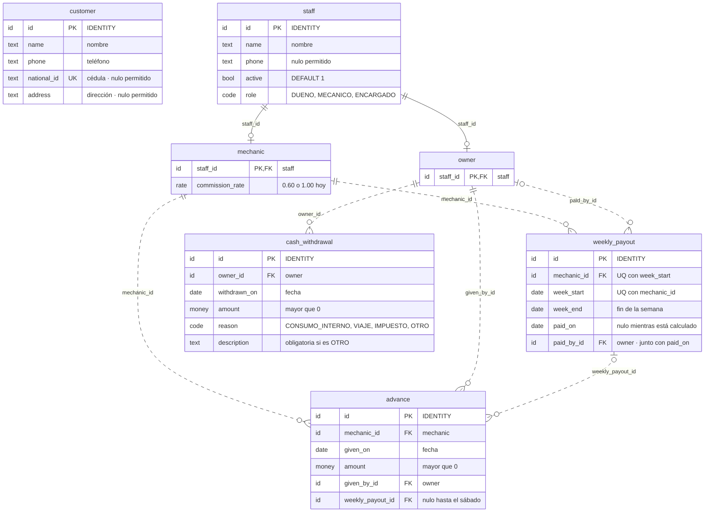

**[[Motor IRM|← Hub]]** · **[[S5 - Relational Model and Normalization - MIRM|← S5]]** · **[[S4 - ER and EER Model - MIRM|MER/EER]]** · **[[Business Rules - MIRM|📏 Business Rules]]** · **[[Traceability - MIRM|🔗 Traceability]]**

# S5 - Relational Schema - MIRM

> [!info] Cómo leer esta nota
> - **Qué es:** el MER/EER transformado a **tablas**: columnas, tipos, nulos, llaves primarias (PK), foráneas (FK), únicas (UQ) y reglas de validación (CK). Es lo más cercano al DDL, pero **no es DDL**: el DDL lo escribe el equipo.
> - **Diferencia con el MER:** en el MER las conexiones eran *relaciones*; aquí cada relación se convirtió en una **columna FK** (o en una tabla, si era M:N). Los atributos derivados **no son columnas**: son vistas (§7).
> - **Orden de la nota:** decisiones de transformación (§1) → convenciones (§2) → dominios y tipos (§3) → diagramas: el completo y uno por área (§4) → diccionario por área (§5) → restricciones entre tablas (§6) → vistas (§7) → normalización (§8) → orden de creación y reparto (§9) → pistas para el DDL en PostgreSQL (§10).

---

## 1. Decisiones de transformación

Cada una se escribirá como DEC al cerrar S5 (después del 29-oct).

| ID   | Tema                          | Decisión                                                                                                                                                                                                                                                                              | Por qué                                                                                                                                                                                                                                                                                           |
| ---- | ----------------------------- | ------------------------------------------------------------------------------------------------------------------------------------------------------------------------------------------------------------------------------------------------------------------------------------- | ------------------------------------------------------------------------------------------------------------------------------------------------------------------------------------------------------------------------------------------------------------------------------------------------- |
| T-01 | **Llaves primarias**          | Llave sustituta `id` (autonumérica) en las tablas de entidades fuertes **y débiles**; la clave natural de la débil queda como **UQ** (por ejemplo, `UQ (sale_id, line_no)`). Excepciones: subclases y `credit` usan como PK la FK a su padre; `payment_application` usa PK compuesta. | Varias tablas apuntan a entidades débiles (el movimiento apunta a la línea de venta; la mano de obra a la falla adicional): con PK compuesta, cada FK tendría dos columnas. Además, Django trabaja de forma natural con una PK de una sola columna. La UQ conserva la regla de identidad del MER. |
| T-02 | **G-1 Documento cobrable**    | Una tabla para la superclase (`billable_document`, con `kind` como discriminador) y una por subclase (`sale`, `mechanical_service`, `opening_balance`), cuya PK es a la vez FK al documento.                                                                                          | Pagos y créditos apuntan a **una sola tabla** (la razón de G-1). Cada subclase guarda solo sus columnas: sin columnas vacías según el tipo. `sale` no tiene columnas propias, pero es necesaria: `sale_detail` apunta a ella y así una línea de venta nunca puede colgar de un servicio.          |
| T-03 | **G-2 Personal**              | `staff` (con `role`) + `owner` + `mechanic`. El encargado es solo un valor de `role`: no tiene tabla.                                                                                                                                                                                 | Las FK que deben ser de un dueño apuntan a `owner`: "solo un dueño autoriza" (BR-009 a BR-011) se cumple **con una FK**, sin código. `mechanic` guarda el porcentaje. El encargado no tiene columnas ni relaciones propias.                                                                       |
| T-04 | **G-3 Origen del movimiento** | Seis FK opcionales en `inventory_movement` + **una CK** que obliga a que solo esté lleno el origen que corresponde al motivo.                                                                                                                                                         | La exclusividad se puede garantizar dentro de la misma fila con un `CHECK`. Si la FK estuviera en cada tabla de origen, la exclusividad cruzaría seis tablas y no se podría garantizar con un `CHECK`.                                                                                            |
| T-05 | **Atributos derivados**       | No se guardan: existencia, último costo, totales, saldos, deuda, comisión, estado actual y fechas del servicio → **vistas** (§7).                                                                                                                                                     | Un dato calculado que además se guarda puede quedar desactualizado (anomalía de actualización).                                                                                                                                                                                                   |
| T-06 | **Motivo del movimiento**     | El motivo incluye la dirección (`AJUSTE_ENTRADA`, `AJUSTE_SALIDA`, `CAMBIO_CLIENTE`…) y **no hay columna de dirección**.                                                                                                                                                              | Si el motivo determina la dirección (DF *motivo → dirección*), guardar las dos es redundante (§8).                                                                                                                                                                                                |
| T-07 | **Historial de precio**       | Sin `old_price`: el precio anterior es el de la fila anterior. `product.sale_price` guarda el precio actual.                                                                                                                                                                          | `old_price` repetía el dato de otra fila. Guardar el precio actual en `product` es una **redundancia controlada**, por rapidez al vender: al cambiar el precio, se actualiza el producto y se inserta el historial en la misma transacción.                                                       |
| T-08 | **Anulación de venta**        | Fuera de la versión de entrega (sin columna).                                                                                                                                                                                                                                         | No está definido qué pasa con los movimientos y los pagos de una venta anulada.                                                                                                                                                                                                                   |
| T-09 | **Costo de las salidas**      | Cada salida guarda en `unit_cost` el **último costo** del producto al momento de salir (provisional).                                                                                                                                                                                 | No cambia las tablas; solo afecta cómo se calcula la ganancia. Se revisa después (último costo o promedio).                                                                                                                                                                                       |
| T-10 | **Monedas**                   | `amount` en la moneda del pago + `exchange_rate` si es en dólares. Los montos aplicados, totales y saldos se expresan en **córdobas**.                                                                                                                                                | BR-057 y BR-058: la moneda principal es el córdoba y el tipo de cambio lo fijan los dueños (histórico).                                                                                                                                                                                           |
| T-11 | **Listas de valores**         | Valores fijos → columna `code` + CK con la lista. Catálogos con atributos o que los dueños amplían → tabla (categoría, marcas, tipo de servicio).                                                                                                                                     | Una tabla para cada lista fija agregaría FK sin ganar nada.                                                                                                                                                                                                                                       |
| T-12 | **Borrado**                   | Todas las FK sin cascada (`NO ACTION`). Nada del negocio se borra: se desactiva (`active`).                                                                                                                                                                                           | Borrar un mecánico o un producto destruiría el historial (comisiones, ventas).                                                                                                                                                                                                                    |

---

## 2. Convenciones del esquema

| Tema | Convención | Ejemplo |
| --- | --- | --- |
| Tablas | Inglés, `snake_case`, **singular** | `sale_detail` |
| Llave primaria | `id` (salvo subclases, `credit` y `payment_application`) | `customer.id` |
| Llave foránea | `<tabla>_id`, o `<rol>_id` cuando hay más de una hacia la misma tabla | `customer_id`, `registered_by_id`, `authorized_by_id` |
| Códigos (listas) | Mayúsculas, español, **sin tildes ni ñ** | `CONTADO`, `DUENO`, `EN_PROCESO` |
| Nombres de restricciones | `PK_tabla`, `FK_tabla_columna`, `UQ_tabla_columnas`, `CK_tabla_regla` | `CK_billable_document_customer` |

> Que las restricciones tengan nombre hace que los errores se entiendan ("viola `CK_billable_document_customer`") y permite quitarlas o cambiarlas después.

---

## 3. Dominios (tipos lógicos)

Los diagramas y el diccionario usan estos dominios. Al lado está su tipo en **PostgreSQL**, el motor de la entrega del 29-oct y del programa.

| Dominio | Qué guarda | Tipo en PostgreSQL |
| --- | --- | --- |
| `id` | Llave sustituta autonumérica (o FK a ella) | `INTEGER GENERATED ALWAYS AS IDENTITY` (la FK: `INTEGER`) |
| `money` | Dinero en córdobas | `NUMERIC(12,2)` |
| `rate` | Porcentaje como fracción (0.60 = 60 %) | `NUMERIC(5,4)` |
| `fx` | Tipo de cambio | `NUMERIC(10,4)` |
| `qty` | Cantidad en unidades (1 litro de aceite = 1) | `INTEGER` |
| `num` | Número de línea o de falla | `SMALLINT` |
| `text(n)` | Texto corto con tildes y ñ | `VARCHAR(n)` |
| `longtext` | Texto largo (diagnóstico, pedido del cliente) | `VARCHAR(500)` o `TEXT` |
| `code` | Valor de una lista fija | `VARCHAR(20)` + CK |
| `date` | Fecha | `DATE` |
| `datetime` | Fecha y hora | `TIMESTAMP(0)` |
| `bool` | Sí o no | `BOOLEAN` |

---

## 4. Diagramas del esquema

> [!tip] Cómo leerlos
> - Ahora las líneas son **llaves foráneas**: van de la tabla referenciada (lado `||` o `|o`) a la que tiene la columna FK (lado `o{`).
> - **Línea continua** = la FK es parte de la PK (subclases, `credit`, `payment_application`). **Punteada** = FK normal.
> - Las entidades débiles del MER ahora tienen `id` propio (T-01), así que sus líneas son punteadas; su identidad queda en la UQ.
> - Cada tabla tiene sus columnas en **un solo diagrama**; en los demás aparece solo la caja.

### Diagrama completo del modelo relacional

Todas las tablas con sus columnas, tipos y llaves (**PK**, **FK**, **UK**), y cómo se relacionan. Los tipos son los de **PostgreSQL** (entrega del 29-oct y programa); los dominios están en §3. Los detalles de cada área (nulos, CK) siguen en los diagramas A a D y en el diccionario (§5).

```mermaid
erDiagram
    customer ||--o{ motorcycle : posee
    motorcycle_brand ||--o{ motorcycle_model : fabrica
    motorcycle_model ||--o{ motorcycle : clasifica
    customer |o--o{ billable_document : "se le cobra"
    staff ||--o{ billable_document : registra
    owner |o--o{ billable_document : "autoriza rebaja"
    billable_document ||--o| sale : "es una"
    billable_document ||--o| mechanical_service : "es un"
    billable_document ||--o| opening_balance : "es un"
    billable_document ||--o| credit : "se financia con"
    owner ||--o{ credit : autoriza
    sale ||--|{ sale_detail : contiene
    product ||--o{ sale_detail : "se vende en"
    sale_detail ||--o{ customer_return : "se devuelve en"
    product |o--o{ customer_return : "se entrega a cambio"
    staff ||--o{ customer_payment : recibe
    customer_payment ||--|{ payment_application : "se reparte en"
    billable_document ||--o{ payment_application : recibe
    motorcycle ||--o{ mechanical_service : ingresa
    staff |o--o{ mechanical_service : "responsable de"
    weekly_payout |o--o{ mechanical_service : liquida
    mechanical_service ||--|{ status_change : "cambia de estado"
    staff ||--o{ status_change : registra
    mechanical_service ||--o{ service_labor : cobra
    mechanical_service ||--o{ service_part : usa
    mechanical_service ||--o{ external_charge : "cargo externo"
    mechanical_service ||--o{ additional_fault : registra
    service_type |o--o{ service_labor : tipifica
    additional_fault |o--o{ service_labor : genera
    additional_fault |o--o{ service_part : genera
    product ||--o{ service_part : "se usa en"
    mechanical_service ||--o{ warranty_claim : "recibe reclamo"
    mechanical_service |o--o| warranty_claim : "nuevo servicio"
    sale |o--o| warranty_claim : "pieza pagada"
    owner ||--o{ warranty_claim : atiende
    product_category ||--o{ product : agrupa
    product_brand ||--o{ product : marca
    product ||--o{ price_history : "cambia de precio"
    owner |o--o{ price_history : cambia
    supplier ||--o{ purchase : factura
    owner ||--o{ purchase : recibe
    purchase ||--|{ purchase_detail : contiene
    product ||--o{ purchase_detail : "se compra en"
    supplier ||--o{ supplier_payment : recibe
    purchase |o--o{ supplier_payment : "se abona con"
    purchase_detail ||--o{ supplier_return : "se devuelve en"
    product ||--o{ inventory_movement : mueve
    staff ||--o{ inventory_movement : registra
    purchase_detail |o--o| inventory_movement : origen
    sale_detail |o--o| inventory_movement : origen
    service_part |o--o| inventory_movement : origen
    customer_return |o--o{ inventory_movement : origen
    supplier_return |o--o| inventory_movement : origen
    warranty_claim |o--o{ inventory_movement : origen
    staff ||--o| owner : "es un"
    staff ||--o| mechanic : "es un"
    mechanic ||--o{ advance : recibe
    owner ||--o{ advance : entrega
    mechanic ||--o{ weekly_payout : recibe
    owner |o--o{ weekly_payout : paga
    weekly_payout |o--o{ advance : descuenta
    owner ||--o{ cash_withdrawal : realiza

    customer {
        int id PK
        varchar name
        varchar phone
        varchar national_id UK "nulo permitido"
        varchar address "nulo permitido"
    }
    motorcycle_brand {
        int id PK
        varchar name UK
    }
    motorcycle_model {
        int id PK
        int brand_id FK "UK con name"
        varchar name
    }
    motorcycle {
        int id PK
        int customer_id FK
        int model_id FK
        varchar color
        varchar plate UK "nulo permitido"
        varchar notes
    }
    staff {
        int id PK
        varchar name
        varchar phone
        boolean active
        varchar role "DUENO | MECANICO | ENCARGADO"
    }
    owner {
        int staff_id PK, FK
    }
    mechanic {
        int staff_id PK, FK
        numeric commission_rate
    }
    product_category {
        int id PK
        varchar name UK
    }
    product_brand {
        int id PK
        varchar name UK
    }
    product {
        int id PK
        int category_id FK
        int brand_id FK
        varchar name
        varchar barcode UK "nulo permitido"
        varchar tier "ALTA | MEDIA | BAJA"
        numeric sale_price
        boolean active
    }
    price_history {
        int id PK
        int product_id FK "UK con changed_at"
        timestamp changed_at
        numeric new_price
        int changed_by_id FK "-> owner.staff_id"
    }
    supplier {
        int id PK
        varchar name
        varchar phone
        varchar contact_person
        boolean gives_warranty
        numeric opening_balance
        date opening_date
    }
    purchase {
        int id PK
        int supplier_id FK "UK con invoice_number"
        varchar invoice_number
        date purchase_date
        varchar terms "CONTADO | CREDITO"
        date due_date
        int received_by_id FK "-> owner.staff_id"
    }
    purchase_detail {
        int id PK
        int purchase_id FK "UK con line_no"
        smallint line_no
        int product_id FK
        int quantity
        numeric unit_cost
    }
    supplier_payment {
        int id PK
        int supplier_id FK
        int purchase_id FK "nulo si es a la cuenta"
        date paid_on
        numeric amount
        varchar currency "NIO | USD"
        numeric exchange_rate
    }
    supplier_return {
        int id PK
        int purchase_detail_id FK
        date returned_on
        int quantity
        varchar reason
        varchar resolution "REPOSICION | DINERO | DESCUENTO"
    }
    billable_document {
        int id PK
        varchar kind "VENTA | SERVICIO | SALDO_INICIAL"
        int customer_id FK
        int registered_by_id FK "-> staff.id"
        timestamp created_at
        varchar receipt_number UK "nulo permitido"
        varchar terms "CONTADO | CREDITO"
        numeric discount
        int discount_authorized_by_id FK "-> owner.staff_id"
    }
    sale {
        int document_id PK, FK
    }
    opening_balance {
        int document_id PK, FK
        numeric amount
        varchar description
    }
    sale_detail {
        int id PK
        int sale_id FK "-> sale.document_id"
        smallint line_no
        int product_id FK
        int quantity
        numeric unit_price
    }
    customer_return {
        int id PK
        int sale_detail_id FK
        date returned_on
        int quantity
        varchar outcome "CAMBIO | REEMBOLSO"
        int exchange_product_id FK "-> product.id"
        numeric refund_amount
    }
    credit {
        int document_id PK, FK
        int authorized_by_id FK "-> owner.staff_id"
        date granted_on
        date due_date
        date extended_due_date
        numeric monthly_interest
    }
    customer_payment {
        int id PK
        timestamp paid_at
        numeric amount
        varchar currency "NIO | USD"
        numeric exchange_rate
        varchar method "EFECTIVO | TRANSFERENCIA"
        int received_by_id FK "-> staff.id"
    }
    payment_application {
        int payment_id PK, FK
        int document_id PK, FK
        numeric applied_amount
    }
    service_type {
        int id PK
        varchar name UK
        numeric reference_price
    }
    mechanical_service {
        int document_id PK, FK
        int motorcycle_id FK
        int responsible_id FK "-> staff.id"
        varchar requested_work
        varchar diagnosis
        numeric cancellation_amount
        numeric applied_rate
        int weekly_payout_id FK
    }
    service_labor {
        int id PK
        int service_id FK "-> mechanical_service.document_id"
        smallint line_no
        varchar description
        numeric amount
        int service_type_id FK
        int additional_fault_id FK
    }
    service_part {
        int id PK
        int service_id FK "-> mechanical_service.document_id"
        smallint line_no
        int product_id FK
        int quantity
        numeric unit_price
        int additional_fault_id FK
    }
    external_charge {
        int id PK
        int service_id FK "-> mechanical_service.document_id"
        smallint line_no
        varchar description
        numeric amount
    }
    additional_fault {
        int id PK
        int service_id FK "-> mechanical_service.document_id"
        smallint fault_no
        date reported_on
        varchar description
        numeric proposed_price
        varchar decision "PENDIENTE | ACEPTADA | RECHAZADA"
    }
    status_change {
        int id PK
        int service_id FK "-> mechanical_service.document_id"
        timestamp changed_at
        varchar status "RECIBIDA ... CANCELADA"
        varchar notes
        int registered_by_id FK "-> staff.id"
    }
    warranty_claim {
        int id PK
        int original_service_id FK "-> mechanical_service.document_id"
        date claimed_on
        varchar description
        varchar outcome "CUBIERTO | FALLA_DISTINTA | FUERA_DE_PLAZO | REEMBOLSO"
        varchar part_paid_by "TIENDA | CLIENTE"
        numeric refund_amount
        int attended_by_id FK "-> owner.staff_id"
        int new_service_id FK, UK "-> mechanical_service.document_id"
        int sale_id FK, UK "-> sale.document_id"
    }
    inventory_movement {
        int id PK
        int product_id FK
        timestamp moved_at
        varchar reason "COMPRA | VENTA | USO_SERVICIO | ..."
        int quantity
        numeric unit_cost
        varchar notes
        int registered_by_id FK "-> staff.id"
        int purchase_detail_id FK, UK "origen"
        int sale_detail_id FK, UK "origen"
        int service_part_id FK, UK "origen"
        int customer_return_id FK "origen"
        int supplier_return_id FK, UK "origen"
        int warranty_claim_id FK "origen"
    }
    weekly_payout {
        int id PK
        int mechanic_id FK "UK con week_start"
        date week_start
        date week_end
        date paid_on
        int paid_by_id FK "-> owner.staff_id"
    }
    advance {
        int id PK
        int mechanic_id FK
        date given_on
        numeric amount
        int given_by_id FK "-> owner.staff_id"
        int weekly_payout_id FK
    }
    cash_withdrawal {
        int id PK
        int owner_id FK "-> owner.staff_id"
        date withdrawn_on
        numeric amount
        varchar reason "CONSUMO_INTERNO | VIAJE | IMPUESTO | OTRO"
        varchar description
    }
```

### A. Documentos cobrables y cobros

```mermaid
erDiagram
    billable_document {
        id id PK "IDENTITY"
        code kind "VENTA, SERVICIO, SALDO_INICIAL"
        id customer_id FK "nulo en venta de contado"
        id registered_by_id FK "staff"
        datetime created_at "fecha y hora"
        text receipt_number UK "nulo hasta cobrar"
        code terms "CONTADO, CREDITO"
        money discount "DEFAULT 0"
        id discount_authorized_by_id FK "owner · obligatorio si hay rebaja"
    }
    sale {
        id document_id PK, FK "billable_document"
    }
    opening_balance {
        id document_id PK, FK "billable_document"
        money amount "lo que ya debía"
        text description "nulo permitido"
    }
    sale_detail {
        id id PK "IDENTITY"
        id sale_id FK "UQ con line_no"
        num line_no "UQ con sale_id"
        id product_id FK "product"
        qty quantity "mayor que 0"
        money unit_price "histórico"
    }
    customer_return {
        id id PK "IDENTITY"
        id sale_detail_id FK "la línea devuelta"
        date returned_on "fecha"
        qty quantity "mayor que 0"
        code outcome "CAMBIO, REEMBOLSO"
        id exchange_product_id FK "product · solo si es CAMBIO"
        money refund_amount "solo si es REEMBOLSO"
    }
    credit {
        id document_id PK, FK "billable_document"
        id authorized_by_id FK "owner"
        date granted_on "otorgamiento"
        date due_date "vencimiento"
        date extended_due_date "nulo permitido"
        rate monthly_interest "DEFAULT 0"
    }
    customer_payment {
        id id PK "IDENTITY"
        datetime paid_at "fecha y hora"
        money amount "en la moneda del pago"
        code currency "NIO, USD"
        fx exchange_rate "obligatorio si es USD"
        code method "EFECTIVO, TRANSFERENCIA"
        id received_by_id FK "staff"
    }
    payment_application {
        id payment_id PK, FK "customer_payment"
        id document_id PK, FK "billable_document"
        money applied_amount "en córdobas · mayor que 0"
    }
    customer ||..o{ billable_document : "customer_id"
    staff ||..o{ billable_document : "registered_by_id"
    owner |o..o{ billable_document : "discount_authorized_by_id"
    billable_document ||--o| sale : "document_id"
    billable_document ||--o| mechanical_service : "document_id"
    billable_document ||--o| opening_balance : "document_id"
    sale ||..|{ sale_detail : "sale_id"
    product ||..o{ sale_detail : "product_id"
    sale_detail ||..o{ customer_return : "sale_detail_id"
    product |o..o{ customer_return : "exchange_product_id"
    billable_document ||--o| credit : "document_id"
    owner ||..o{ credit : "authorized_by_id"
    staff ||..o{ customer_payment : "received_by_id"
    customer_payment ||--|{ payment_application : "payment_id"
    billable_document ||--o{ payment_application : "document_id"
```

### B. Taller

### C. Productos, compras e inventario

> En el MER, cada línea de compra, de venta y de producto usado origina **exactamente un** movimiento (1..1). Con la FK del lado del movimiento, la base garantiza el "como máximo uno" (UQ); el "al menos uno" lo garantiza la aplicación al guardar la línea y su movimiento en la misma transacción (§6).

### D. Personas, mecánicos y caja

---

## 5. Diccionario por área

**Columnas de las tablas:** **Nulo** = si admite vacío · **Restricción**: PK, FK → tabla, UQ, CK (regla) o DEFAULT. Las restricciones de varias columnas están debajo de cada tabla.

### 5.1 Catálogos, productos e inventario

**`product_category`** — Categoría de producto (E-05) · BR-004

| Columna | Dominio | Nulo | Restricción |
| --- | --- | --- | --- |
| id | id | No | PK |
| name | text(50) | No | UQ |

**`product_brand`** — Marca de producto (E-28) · BR-089, DEC-008

| Columna | Dominio | Nulo | Restricción |
| --- | --- | --- | --- |
| id | id | No | PK |
| name | text(50) | No | UQ |

**`product`** — Producto (E-06) · BR-004, BR-015, BR-089, BR-090, BR-093

| Columna | Dominio | Nulo | Restricción |
| --- | --- | --- | --- |
| id | id | No | PK |
| category_id | id | No | FK → product_category |
| brand_id | id | No | FK → product_brand |
| name | text(150) | No | — |
| barcode | text(50) | Sí | UQ cuando no es nulo (§10) |
| tier | code | No | CK `IN ('ALTA','MEDIA','BAJA')` |
| sale_price | money | No | CK `>= 0` |
| active | bool | No | DEFAULT 1 |

**`price_history`** — Historial de precio (E-26) · BR-016

| Columna | Dominio | Nulo | Restricción |
| --- | --- | --- | --- |
| id | id | No | PK |
| product_id | id | No | FK → product |
| changed_at | datetime | No | DEFAULT fecha y hora actual |
| new_price | money | No | CK `>= 0` |
| changed_by_id | id | Sí | FK → owner |

- `UQ (product_id, changed_at)`

**`inventory_movement`** — Movimiento de inventario (E-07) · BR-020, BR-079

| Columna | Dominio | Nulo | Restricción |
| --- | --- | --- | --- |
| id | id | No | PK |
| product_id | id | No | FK → product |
| moved_at | datetime | No | DEFAULT fecha y hora actual |
| reason | code | No | CK: lista de abajo |
| quantity | qty | No | CK `> 0` |
| unit_cost | money | No | CK `>= 0` (histórico, T-09) |
| notes | text(200) | Sí | Obligatoria en ajustes (CK) |
| registered_by_id | id | No | FK → staff |
| purchase_detail_id | id | Sí | FK → purchase_detail · UQ cuando no es nulo |
| sale_detail_id | id | Sí | FK → sale_detail · UQ cuando no es nulo |
| service_part_id | id | Sí | FK → service_part · UQ cuando no es nulo |
| customer_return_id | id | Sí | FK → customer_return |
| supplier_return_id | id | Sí | FK → supplier_return · UQ cuando no es nulo |
| warranty_claim_id | id | Sí | FK → warranty_claim |

**Motivos** (T-06) y el **único origen** que puede tener cada uno (CK de la tabla):

| Motivo (`reason`) | Dirección | Columna de origen que debe estar llena (las demás vacías) |
| --- | --- | --- |
| `COMPRA` | Entrada | `purchase_detail_id` |
| `DEVOLUCION_CLIENTE` | Entrada | `customer_return_id` |
| `INVENTARIO_INICIAL` | Entrada | ninguna |
| `AJUSTE_ENTRADA` | Entrada | ninguna (y `notes` obligatoria) |
| `VENTA` | Salida | `sale_detail_id` |
| `USO_SERVICIO` | Salida | `service_part_id` |
| `CAMBIO_CLIENTE` | Salida | `customer_return_id` (producto entregado a cambio) |
| `DEVOLUCION_PROVEEDOR` | Salida | `supplier_return_id` |
| `GARANTIA` | Salida | `warranty_claim_id` |
| `AJUSTE_SALIDA` | Salida | ninguna (y `notes` obligatoria) |

### 5.2 Compras

**`supplier`** — Proveedor (E-08) · BR-012, BR-017, BR-091

| Columna | Dominio | Nulo | Restricción |
| --- | --- | --- | --- |
| id | id | No | PK |
| name | text(100) | No | — |
| phone | text(20) | Sí | — |
| contact_person | text(100) | Sí | — |
| gives_warranty | bool | Sí | — (Q-077) |
| opening_balance | money | Sí | CK `>= 0` · provisional (decisión 6) |
| opening_date | date | Sí | — |

- CK: `opening_balance` y `opening_date` van juntos (los dos llenos o los dos vacíos).

**`purchase`** — Compra (E-09) · BR-013, BR-017

| Columna | Dominio | Nulo | Restricción |
| --- | --- | --- | --- |
| id | id | No | PK |
| supplier_id | id | No | FK → supplier |
| invoice_number | text(30) | No | — |
| purchase_date | date | No | — |
| terms | code | No | CK `IN ('CONTADO','CREDITO')` |
| due_date | date | Sí | — |
| received_by_id | id | No | FK → owner |

- `UQ (supplier_id, invoice_number)` · CK: `due_date` solo si `terms = 'CREDITO'`.

**`purchase_detail`** — Detalle de compra (E-10) · BR-014

| Columna | Dominio | Nulo | Restricción |
| --- | --- | --- | --- |
| id | id | No | PK |
| purchase_id | id | No | FK → purchase |
| line_no | num | No | CK `> 0` |
| product_id | id | No | FK → product |
| quantity | qty | No | CK `> 0` |
| unit_cost | money | No | CK `>= 0` |

- `UQ (purchase_id, line_no)`

**`supplier_payment`** — Pago a proveedor (E-11) · BR-017, BR-057, BR-058

| Columna | Dominio | Nulo | Restricción |
| --- | --- | --- | --- |
| id | id | No | PK |
| supplier_id | id | No | FK → supplier |
| purchase_id | id | Sí | FK → purchase (vacío si es a la cuenta o al saldo de apertura) |
| paid_on | date | No | — |
| amount | money | No | CK `> 0` |
| currency | code | No | CK `IN ('NIO','USD')` |
| exchange_rate | fx | Sí | — |

- CK: `currency = 'USD'` ⇔ `exchange_rate` lleno (y mayor que 0).

**`supplier_return`** — Devolución a proveedor (E-12) · BR-018

| Columna | Dominio | Nulo | Restricción |
| --- | --- | --- | --- |
| id | id | No | PK |
| purchase_detail_id | id | No | FK → purchase_detail |
| returned_on | date | No | — |
| quantity | qty | No | CK `> 0` |
| reason | text(200) | No | — |
| resolution | code | Sí | CK `IN ('REPOSICION','DINERO','DESCUENTO')` (Q-074) |

### 5.3 Personas y motos

**`customer`** — Cliente (E-01) · BR-039, BR-040

| Columna | Dominio | Nulo | Restricción |
| --- | --- | --- | --- |
| id | id | No | PK |
| name | text(100) | No | — |
| phone | text(20) | No | — |
| national_id | text(20) | Sí | UQ cuando no es nulo · solo la ven los dueños |
| address | text(200) | Sí | Solo la ven los dueños |

**`staff`** — Personal (E-02, superclase G-2) · BR-007, BR-008

| Columna | Dominio | Nulo | Restricción |
| --- | --- | --- | --- |
| id | id | No | PK |
| name | text(100) | No | — |
| phone | text(20) | Sí | — |
| active | bool | No | DEFAULT 1 |
| role | code | No | CK `IN ('DUENO','MECANICO','ENCARGADO')` |

**`owner`** — Dueño (subclase) · BR-009 a BR-011

| Columna | Dominio | Nulo | Restricción |
| --- | --- | --- | --- |
| staff_id | id | No | PK · FK → staff |

**`mechanic`** — Mecánico (subclase) · BR-044

| Columna | Dominio | Nulo | Restricción |
| --- | --- | --- | --- |
| staff_id | id | No | PK · FK → staff |
| commission_rate | rate | No | CK `> 0 AND <= 1` |

**`motorcycle_brand`** — Marca de moto (E-27) · BR-041, DEC-008

| Columna | Dominio | Nulo | Restricción |
| --- | --- | --- | --- |
| id | id | No | PK |
| name | text(50) | No | UQ |

**`motorcycle_model`** — Modelo de moto (E-04) · BR-041

| Columna | Dominio | Nulo | Restricción |
| --- | --- | --- | --- |
| id | id | No | PK |
| brand_id | id | No | FK → motorcycle_brand |
| name | text(50) | No | — |

- `UQ (brand_id, name)`

**`motorcycle`** — Moto (E-03) · BR-041 a BR-043

| Columna | Dominio | Nulo | Restricción |
| --- | --- | --- | --- |
| id | id | No | PK |
| customer_id | id | No | FK → customer (cliente actual) |
| model_id | id | No | FK → motorcycle_model |
| color | text(30) | No | — |
| plate | text(15) | Sí | UQ cuando no es nulo |
| notes | text(200) | Sí | — |

### 5.4 Documentos cobrables y cobros

**`billable_document`** — Documento cobrable (superclase G-1) · BR-038, BR-056, BR-060, BR-061

| Columna | Dominio | Nulo | Restricción |
| --- | --- | --- | --- |
| id | id | No | PK |
| kind | code | No | CK `IN ('VENTA','SERVICIO','SALDO_INICIAL')` |
| customer_id | id | Sí | FK → customer |
| registered_by_id | id | No | FK → staff |
| created_at | datetime | No | DEFAULT fecha y hora actual |
| receipt_number | text(20) | Sí | UQ cuando no es nulo |
| terms | code | No | CK `IN ('CONTADO','CREDITO')` |
| discount | money | No | DEFAULT 0 · CK `>= 0` |
| discount_authorized_by_id | id | Sí | FK → owner |

- **CK cliente (C-01):** `customer_id` lleno, salvo en una venta de contado.
- **CK rebaja (C-05):** si `discount > 0`, `discount_authorized_by_id` lleno.
- **CK saldo inicial:** si `kind = 'SALDO_INICIAL'`, entonces `terms = 'CREDITO'` y `discount = 0`.

**`sale`** — Venta (subclase) · BR-002

| Columna | Dominio | Nulo | Restricción |
| --- | --- | --- | --- |
| document_id | id | No | PK · FK → billable_document |

**`opening_balance`** — Saldo inicial de cliente (subclase, provisional) · Q-078

| Columna | Dominio | Nulo | Restricción |
| --- | --- | --- | --- |
| document_id | id | No | PK · FK → billable_document |
| amount | money | No | CK `> 0` |
| description | text(200) | Sí | — |

**`sale_detail`** — Detalle de venta (E-14) · BR-002, BR-016

| Columna | Dominio | Nulo | Restricción |
| --- | --- | --- | --- |
| id | id | No | PK |
| sale_id | id | No | FK → sale(document_id) |
| line_no | num | No | CK `> 0` |
| product_id | id | No | FK → product |
| quantity | qty | No | CK `> 0` |
| unit_price | money | No | CK `>= 0` |

- `UQ (sale_id, line_no)`

**`customer_return`** — Devolución de cliente (E-15) · BR-069, BR-070

| Columna | Dominio | Nulo | Restricción |
| --- | --- | --- | --- |
| id | id | No | PK |
| sale_detail_id | id | No | FK → sale_detail |
| returned_on | date | No | — |
| quantity | qty | No | CK `> 0` |
| outcome | code | No | CK `IN ('CAMBIO','REEMBOLSO')` |
| exchange_product_id | id | Sí | FK → product |
| refund_amount | money | Sí | CK `> 0` |

- CK: si `CAMBIO` → `exchange_product_id` lleno y `refund_amount` vacío; si `REEMBOLSO` → al revés.

**`credit`** — Crédito (E-22, débil 1:1) · BR-009, BR-062 a BR-068

| Columna | Dominio | Nulo | Restricción |
| --- | --- | --- | --- |
| document_id | id | No | PK · FK → billable_document |
| authorized_by_id | id | No | FK → owner |
| granted_on | date | No | — |
| due_date | date | No | CK `>= granted_on` |
| extended_due_date | date | Sí | CK `> due_date` |
| monthly_interest | rate | No | DEFAULT 0 · CK `>= 0` |

**`customer_payment`** — Pago de cliente (E-21) · BR-056 a BR-059

| Columna | Dominio | Nulo | Restricción |
| --- | --- | --- | --- |
| id | id | No | PK |
| paid_at | datetime | No | DEFAULT fecha y hora actual |
| amount | money | No | CK `> 0` |
| currency | code | No | CK `IN ('NIO','USD')` |
| exchange_rate | fx | Sí | — |
| method | code | No | CK `IN ('EFECTIVO','TRANSFERENCIA')` |
| received_by_id | id | No | FK → staff |

- CK: `currency = 'USD'` ⇔ `exchange_rate` lleno (y mayor que 0).

**`payment_application`** — Aplicación de pago (relación M:N) · BR-096, DEC-009

| Columna | Dominio | Nulo | Restricción |
| --- | --- | --- | --- |
| payment_id | id | No | PK (1/2) · FK → customer_payment |
| document_id | id | No | PK (2/2) · FK → billable_document |
| applied_amount | money | No | CK `> 0` (en córdobas) |

### 5.5 Taller

**`service_type`** — Tipo de servicio (E-16) · BR-030, BR-031

| Columna | Dominio | Nulo | Restricción |
| --- | --- | --- | --- |
| id | id | No | PK |
| name | text(50) | No | UQ |
| reference_price | money | Sí | CK `>= 0` |

**`mechanical_service`** — Servicio mecánico (subclase) · BR-021 a BR-025, BR-044, BR-080

| Columna | Dominio | Nulo | Restricción |
| --- | --- | --- | --- |
| document_id | id | No | PK · FK → billable_document |
| motorcycle_id | id | No | FK → motorcycle |
| responsible_id | id | Sí | FK → staff (dueño o mecánico: C-02) |
| requested_work | longtext | No | — |
| diagnosis | longtext | Sí | — |
| cancellation_amount | money | Sí | CK `>= 0` |
| applied_rate | rate | Sí | CK `> 0 AND <= 1` |
| weekly_payout_id | id | Sí | FK → weekly_payout |

**`service_labor`** — Mano de obra del servicio (antes *Detalle de servicio*) · BR-003, BR-029, BR-045

| Columna | Dominio | Nulo | Restricción |
| --- | --- | --- | --- |
| id | id | No | PK |
| service_id | id | No | FK → mechanical_service(document_id) |
| line_no | num | No | CK `> 0` |
| description | text(200) | No | — |
| amount | money | No | CK `>= 0` |
| service_type_id | id | Sí | FK → service_type |
| additional_fault_id | id | Sí | FK → additional_fault |

- `UQ (service_id, line_no)`

**`service_part`** — Producto usado en el servicio · BR-003, BR-020, BR-027

| Columna | Dominio | Nulo | Restricción |
| --- | --- | --- | --- |
| id | id | No | PK |
| service_id | id | No | FK → mechanical_service(document_id) |
| line_no | num | No | CK `> 0` |
| product_id | id | No | FK → product |
| quantity | qty | No | CK `> 0` |
| unit_price | money | No | CK `>= 0` |
| additional_fault_id | id | Sí | FK → additional_fault |

- `UQ (service_id, line_no)`

**`external_charge`** — Cargo externo (provisional: si el equipo lo descarta, se quita esta tabla y ninguna otra cambia) · BR-037, BR-082

| Columna | Dominio | Nulo | Restricción |
| --- | --- | --- | --- |
| id | id | No | PK |
| service_id | id | No | FK → mechanical_service(document_id) |
| line_no | num | No | CK `> 0` |
| description | text(200) | No | — |
| amount | money | No | CK `>= 0` |

- `UQ (service_id, line_no)`

**`additional_fault`** — Falla adicional (E-19) · BR-026 a BR-028

| Columna | Dominio | Nulo | Restricción |
| --- | --- | --- | --- |
| id | id | No | PK |
| service_id | id | No | FK → mechanical_service(document_id) |
| fault_no | num | No | CK `> 0` |
| reported_on | date | No | — |
| description | longtext | No | — |
| proposed_price | money | Sí | CK `>= 0` |
| decision | code | No | DEFAULT `'PENDIENTE'` · CK `IN ('PENDIENTE','ACEPTADA','RECHAZADA')` |

- `UQ (service_id, fault_no)`

**`status_change`** — Cambio de estado · BR-021, BR-033, BR-094, BR-095

| Columna | Dominio | Nulo | Restricción |
| --- | --- | --- | --- |
| id | id | No | PK |
| service_id | id | No | FK → mechanical_service(document_id) |
| changed_at | datetime | No | DEFAULT fecha y hora actual |
| status | code | No | CK `IN ('RECIBIDA','EN_DIAGNOSTICO','EN_PROCESO','ESPERA_REPUESTO','ESPERA_CLIENTE','TERMINADA','EN_PRUEBA','ENTREGADA','CANCELADA')` |
| notes | text(200) | Sí | — |
| registered_by_id | id | No | FK → staff |

- `UQ (service_id, changed_at)`

**`warranty_claim`** — Reclamo de garantía (E-20) · BR-071 a BR-074, BR-085 a BR-088

| Columna | Dominio | Nulo | Restricción |
| --- | --- | --- | --- |
| id | id | No | PK |
| original_service_id | id | No | FK → mechanical_service(document_id) |
| claimed_on | date | No | — |
| description | longtext | No | — |
| outcome | code | No | CK `IN ('CUBIERTO','FALLA_DISTINTA','FUERA_DE_PLAZO','REEMBOLSO')` |
| part_paid_by | code | Sí | CK `IN ('TIENDA','CLIENTE')` |
| refund_amount | money | Sí | CK `> 0` |
| attended_by_id | id | No | FK → owner |
| new_service_id | id | Sí | FK → mechanical_service(document_id) · UQ cuando no es nulo |
| sale_id | id | Sí | FK → sale(document_id) · UQ cuando no es nulo |

- CK: `refund_amount` solo si `outcome = 'REEMBOLSO'`; `new_service_id` solo si `outcome = 'FALLA_DISTINTA'`; `sale_id` solo si `part_paid_by = 'CLIENTE'`.

### 5.6 Mecánicos y caja

**`weekly_payout`** — Pago semanal (E-24) · BR-046, BR-049, BR-081

| Columna | Dominio | Nulo | Restricción |
| --- | --- | --- | --- |
| id | id | No | PK |
| mechanic_id | id | No | FK → mechanic |
| week_start | date | No | — |
| week_end | date | No | CK `>= week_start` |
| paid_on | date | Sí | — (vacío mientras está *calculado*) |
| paid_by_id | id | Sí | FK → owner |

- `UQ (mechanic_id, week_start)` · CK: `paid_on` y `paid_by_id` van juntos.

**`advance`** — Adelanto (E-23) · BR-048, BR-049

| Columna | Dominio | Nulo | Restricción |
| --- | --- | --- | --- |
| id | id | No | PK |
| mechanic_id | id | No | FK → mechanic |
| given_on | date | No | — |
| amount | money | No | CK `> 0` |
| given_by_id | id | No | FK → owner |
| weekly_payout_id | id | Sí | FK → weekly_payout |

**`cash_withdrawal`** — Retiro de caja (E-25) · BR-011, BR-075 a BR-078

| Columna | Dominio | Nulo | Restricción |
| --- | --- | --- | --- |
| id | id | No | PK |
| owner_id | id | No | FK → owner |
| withdrawn_on | date | No | — |
| amount | money | No | CK `> 0` |
| reason | code | No | CK `IN ('CONSUMO_INTERNO','VIAJE','IMPUESTO','OTRO')` |
| description | text(200) | Sí | Obligatoria si `reason = 'OTRO'` (CK) |

---

## 6. Restricciones entre tablas (no caben en un `CHECK`)

Un `CHECK` solo ve **la fila que se está guardando**. Estas reglas miran otras tablas, así que se cumplen en la aplicación (Django) o con *triggers*. **No hacen falta para la entrega del 29-oct**, pero quedan escritas para S6.

| ID (S4) | Restricción | Cómo se cumplirá |
| --- | --- | --- |
| C-02 | `mechanical_service.responsible_id` es un dueño o un mecánico. | Aplicación |
| C-03 | Una venta la registra un dueño o el encargado; un servicio o un saldo inicial, un dueño. | Permisos de Django |
| C-06 | Un cliente con crédito tiene `national_id` y `address`. | Aplicación |
| C-07 | La suma de `applied_amount` de un pago = su monto en córdobas. | Aplicación (transacción) |
| C-08 | Si `supplier_payment.purchase_id` está lleno, esa compra es del mismo proveedor. | Aplicación o *trigger* |
| C-09 | Si el responsable es un dueño: `applied_rate` y `weekly_payout_id` vacíos. | Aplicación |
| C-10 | El pago semanal liquida servicios y descuenta adelantos del mismo mecánico y de esa semana. | Aplicación |
| C-11 | La cantidad devuelta no supera la vendida en esa línea. | Aplicación |
| C-13 | Venta y compra con al menos una línea; servicio con al menos un cambio de estado; cada línea con su movimiento. | Aplicación (transacción) |
| — | Las filas de `owner` y `mechanic` coinciden con `staff.role`, y el tipo de subclase coincide con `billable_document.kind`. | Aplicación (ver §10, idea avanzada) |
| — | `credit` existe solo si el documento es `CREDITO`. | Aplicación |
| — | `additional_fault_id` de una línea es una falla **del mismo servicio**. | Aplicación |

C-01, C-04, C-05 y C-12 sí son `CHECK` y ya están en el diccionario (§5).

---

## 7. Vistas (datos derivados)

Se crean **después** de las tablas. No son necesarias para la entrega del 29-oct, pero son las primeras consultas que vale la pena escribir.

| Vista | Qué calcula | De qué tablas | Reglas |
| --- | --- | --- | --- |
| `v_product_stock` | Existencia (entradas − salidas, según el motivo) y último costo | inventory_movement, purchase_detail | BR-005, BR-014, BR-020 |
| `v_document_total` | Total de cada documento según su tipo: líneas − rebaja, monto por cancelación o monto del saldo inicial | billable_document, sale_detail, service_labor, service_part, external_charge, opening_balance | BR-003, BR-080 |
| `v_credit_status` | Monto (con interés), saldo y estado (vigente, vencido, pagado) | credit, v_document_total, payment_application | BR-064 a BR-068 |
| `v_customer_debt` | Deuda total y si debe | v_credit_status, billable_document | BR-092 |
| `v_service_status` | Estado actual, fecha de ingreso y de cierre de cada servicio | status_change | BR-033, BR-047 |
| `v_service_commission` | Total de mano de obra y comisión | mechanical_service, service_labor | BR-045, BR-051, BR-083 |
| `v_weekly_payout_summary` | Comisiones, adelantos y monto neto | weekly_payout, v_service_commission, advance | BR-049 |
| `v_purchase_balance` · `v_supplier_balance` | Saldo de cada compra y de cada proveedor | purchase, purchase_detail, supplier_payment, supplier | BR-017 |

> `v_service_status` es un buen ejercicio de SQL: hay que tomar **el último** cambio de estado de cada servicio. Investiguen las *funciones de ventana* (`ROW_NUMBER() OVER (PARTITION BY …)`), que existen igual en SQL Server y en PostgreSQL.

---

## 8. Normalización

**1FN:** todas las columnas guardan un solo valor (por ejemplo, un solo teléfono, BR-039) y no hay grupos repetidos: las líneas de venta, compra y servicio están en sus propias tablas.

**2FN y 3FN:** para cada tabla, sus dependencias funcionales (DF) además de *PK → todas las columnas*:

| Tabla | Otras DF | ¿3FN? | Comentario |
| --- | --- | --- | --- |
| product_category · product_brand · motorcycle_brand · service_type | name → resto | ✅ | La UQ es clave candidata. |
| motorcycle_model | (brand_id, name) → id | ✅ | |
| product | barcode → resto | ✅ | Existencia y último costo no se guardan (T-05). |
| price_history | (product_id, changed_at) → resto | ✅ | Se quitó `old_price` (T-07): repetía la fila anterior. |
| customer | national_id → resto | ✅ | |
| motorcycle | plate → resto | ✅ | La marca **no** se guarda: saldría de *model_id → brand_id* (sería transitiva). |
| staff · owner · mechanic | — | ✅ | `role` coincide con la subclase: consistencia que controla la aplicación (§6). |
| supplier | — | ✅ | El saldo no se guarda (T-05). |
| purchase | (supplier_id, invoice_number) → resto | ✅ | |
| purchase_detail · sale_detail | (padre, line_no) → resto | ✅ | `unit_cost` y `unit_price` son **históricos**: dependen de la línea, no del producto. Por eso no violan la 2FN aunque el producto tenga su propio precio. |
| supplier_payment · supplier_return · customer_return · customer_payment · advance · cash_withdrawal | — | ✅ | |
| billable_document | receipt_number → resto | ✅ | El total no se guarda. |
| sale · opening_balance · credit | — | ✅ | Su PK es la del documento. |
| mechanical_service | — | ✅ | `applied_rate` es histórico: no depende de `responsible_id` (el porcentaje actual del mecánico puede cambiar). |
| payment_application | (payment_id, document_id) → applied_amount | ✅ | El monto depende de **toda** la clave compuesta: cumple la 2FN. |
| service_labor · service_part · external_charge · additional_fault · status_change | (service_id, línea, número o fecha) → resto | ✅ | |
| warranty_claim | new_service_id → resto; sale_id → resto (cuando no son nulos) | ✅ | |
| inventory_movement | — | ✅ | Con motivos como `AJUSTE` (que podía ser entrada o salida), la dirección había que guardarla aparte. Al separar `AJUSTE_ENTRADA` y `AJUSTE_SALIDA`, *motivo → dirección* pasa a ser una DF y la dirección **ya no se guarda** (T-06). |
| weekly_payout | (mechanic_id, week_start) → resto | ✅ | Los totales no se guardan. |

**Redundancias controladas (aceptadas a propósito):**
- `product.sale_price` = el último `new_price` del historial (T-07).
- `staff.role` + la fila en `owner` o `mechanic`, y `billable_document.kind` + la fila de su subclase (discriminadores, T-02 y T-03).

---

## 9. Orden de creación y reparto del DDL

**Por qué importa el orden:** una FK solo se puede crear si la tabla a la que apunta ya existe.

| Nivel | Tablas (cada una solo apunta a niveles anteriores) |
| --- | --- |
| 0 | product_category · product_brand · motorcycle_brand · service_type · customer · staff · supplier |
| 1 | owner · mechanic · motorcycle_model · product |
| 2 | motorcycle · price_history · purchase · billable_document · weekly_payout · cash_withdrawal |
| 3 | purchase_detail · supplier_payment · sale · opening_balance · mechanical_service · credit · customer_payment · advance |
| 4 | supplier_return · sale_detail · payment_application · status_change · additional_fault · external_charge · warranty_claim |
| 5 | service_labor · service_part · customer_return |
| 6 | inventory_movement |

**Reparto propuesto entre los dos que escriben:**

| Persona | Áreas | Tablas |
| --- | --- | --- |
| **1** | Catálogos y productos (5.1, sin movimientos) · Compras (5.2) · Personas y motos (5.3) · Mecánicos y caja (5.6) | product_category, product_brand, product, price_history, supplier, purchase, purchase_detail, supplier_payment, supplier_return, customer, staff, owner, mechanic, motorcycle_brand, motorcycle_model, motorcycle, weekly_payout, advance, cash_withdrawal |
| **2** | Documentos y cobros (5.4) · Taller (5.5) · Movimientos (5.1) | billable_document, sale, opening_balance, sale_detail, customer_return, credit, customer_payment, payment_application, service_type, mechanical_service, service_labor, service_part, external_charge, additional_fault, status_change, warranty_claim, inventory_movement |

- Antes de escribir, **acuerden las convenciones de §2**: si cada uno nombra distinto, las FK entre los dos archivos no van a coincidir.
- Se escriben en paralelo y se ejecutan **en orden: primero el archivo de la persona 1, después el de la persona 2**. Las tablas de la persona 2 apuntan a las de la persona 1, nunca al revés.
- **Alternativa que elimina el problema del orden:** crear todas las tablas solo con sus PK, UQ y CK, y agregar **todas las FK al final** con `ALTER TABLE … ADD CONSTRAINT`. Es como se hace en proyectos grandes.

---

## 10. Pistas para el DDL en PostgreSQL

Son conceptos que hay que buscar, no código. Cada uno evita un error típico de mañana.

1. **UQ con columnas que pueden ser nulas.** En PostgreSQL, una restricción `UNIQUE` **admite varios nulos**: dos clientes sin cédula no chocan. Por eso `national_id`, `plate`, `barcode`, `receipt_number`, los orígenes del movimiento y `new_service_id` y `sale_id` del reclamo se resuelven con una `UNIQUE` normal. (Existe la opción `NULLS NOT DISTINCT` para lo contrario: aquí **no** la usen.)
2. **Texto con tildes y ñ:** creen la base con codificación **UTF8** (es la de casi todas las instalaciones). Con eso, `VARCHAR` guarda "Dueño" sin problema.
3. **No usen `ON DELETE CASCADE`** (T-12): borrar un mecánico o un producto se llevaría su historial.
4. **`GENERATED ALWAYS AS IDENTITY` solo en las tablas con `id` propio.** Las subclases (`sale`, `mechanical_service`, `opening_balance`, `owner`, `mechanic`) y `credit` **no** generan su llave: usan la de su padre.
5. **`CHECK` de varias columnas** (C-01, C-05, el origen del movimiento): se escriben como restricción **de tabla**, no de columna, porque comparan columnas entre sí.
6. **Listas de valores:** PostgreSQL tiene tipos `ENUM`, pero usen `VARCHAR` + `CHECK` (T-11): agregar o quitar un valor de un `CHECK` es más simple que modificar un `ENUM`, y el mismo DDL sirve para el programa.
7. **Quien escriba desde Windows** instala PostgreSQL nativo (instalador oficial). Que los dos usen la **misma versión mayor** y prueben con `psql`, pgAdmin o DBeaver.
8. **Idea avanzada (opcional, no para mañana):** para que la base garantice que una fila de `mechanic` corresponde a un `staff` con `role = 'MECANICO'`, se puede usar una **FK compuesta** hacia `(id, role)` con una UQ en `staff (id, role)`. El mismo truco sirve para `kind` en los documentos. Investiguen *"subtype discriminator foreign key"*.

## Lecturas

- Elmasri y Navathe, *Fundamentals of Database Systems*: capítulo de **mapeo ER y EER a relacional** (opciones para especializaciones, entidades débiles y relaciones M:N) y capítulos de **normalización** (DF, 2FN, 3FN, FNBC).
- PostgreSQL — *Constraints*: https://www.postgresql.org/docs/current/ddl-constraints.html
- PostgreSQL — *CREATE TABLE* (columnas `IDENTITY`, restricciones de tabla): https://www.postgresql.org/docs/current/sql-createtable.html
- PostgreSQL — *Window Functions* (para `v_service_status`): https://www.postgresql.org/docs/current/tutorial-window.html
